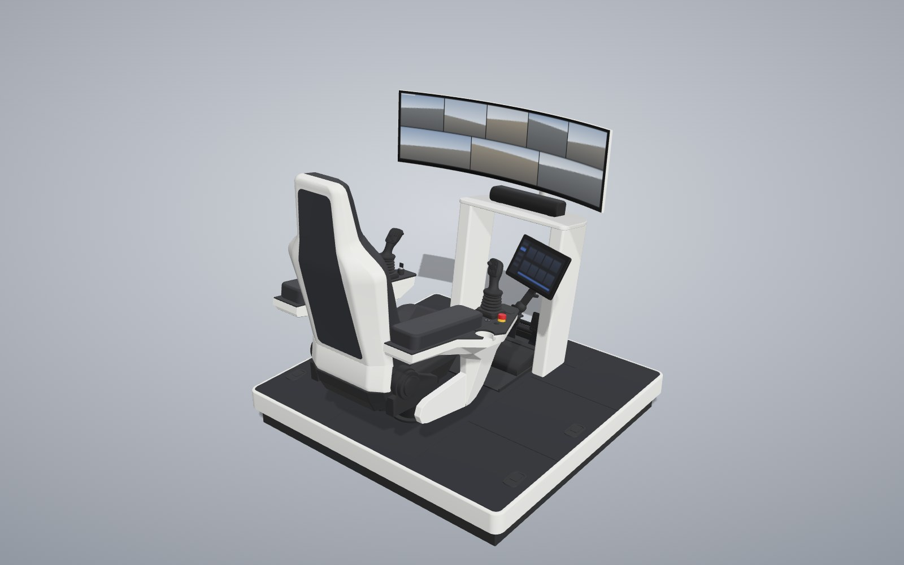

# rigtwin

A proof of concept for building **credible, modular, parametric 3D models of operator workstations
from a handful of photographs**, made by AI agents and checked by independent reviewers, for later
human-factors assessment and simulator training.

The first asset is **Rig B**, a seated teleoperation station for heavy machinery: platform, seat,
two armrest pods with industrial joysticks, touchscreen on an arm, a two-column stand with a curved
49-inch monitor on an arm, soundbar and pedals. It was modelled from 11 casual phone photos.



*Rig B as generated (28,070 triangles, 0.72 MB). The live viewer lets you rotate, zoom, hide any
component, and move the seat, monitor, armrests, joysticks and pedals.*

## Where to start

| You want to | Go to |
|---|---|
| Understand what this is and how good it is | [wiki/00-overview/summary.md](wiki/00-overview/summary.md) |
| See every page | [wiki/index.md](wiki/index.md) |
| Read what was learned | [wiki/60-lessons/lessons-learned.md](wiki/60-lessons/lessons-learned.md) |
| Know what the model can and cannot be used for | [wiki/70-results/rig-b-model-card.md](wiki/70-results/rig-b-model-card.md) |
| Build a new asset | the Agent Skill in [.claude/skills/modeling-3d-assets-from-references](.claude/skills/modeling-3d-assets-from-references/SKILL.md) and [wiki/40-method/pipeline.md](wiki/40-method/pipeline.md) |
| Run the tools | [wiki/80-reference/tools.md](wiki/80-reference/tools.md) |

Live: the viewer at <https://mightwork.ai/rigtwin/> and this wiki at <https://mightwork.ai/rigtwin/wiki/>.

## In one paragraph

No automatic 3D reconstruction is used: photogrammetry found almost nothing on the rig. Instead an
agent measures the photos (cameras solved on the room and the platform, scale closed against
known-size parts), writes every dimension into a parameter file with its source class and range,
and writes generator code that builds each component from those parameters. The build produces one
`.glb` model and one JSON description (components, joints with limits, reference frames such as
seat reference and eye points, every parameter with its provenance). Scripted checks run on every
build; a separate reviewer agent that never sees the builders' notes compares renders with the
photos and rejects anything toy-like. The model passed after two review rounds and a set of small
fixes. Its sizes are **photo estimates, not yet checked against a tape measure**; see the model
card for what that means.

## Quick start

Requires [Bun](https://bun.sh) 1.3 or later; Python 3 (standard library only) for the independent
model reader; Chromium (from Playwright's cache or a local Chrome) for headless rendering.

```
bun install
bun run build                # 0.2 s: parameters + sources -> assets/rig-b/build/rig-b.glb + manifest
bun run check                # every check (about 5 s)
bun run serve                # viewer at http://127.0.0.1:4173/
bun run render --set sheet   # contact sheet in work/renders/sheet/
bun run wiki build           # static wiki site
bun run deploy --dry-run     # see wiki/50-implementation/deployment.md
```

## Repository layout

| Path | Contents |
|---|---|
| `assets/rig-b/` | the asset: `params/*.toml` (every number, with class, range, evidence), `src/*.ts` (component generators), `spec/rig.toml` (tree, joints, reference frames, expected motion) |
| `generator/` | geometry kit, assembler, deterministic GLB writer |
| `shared/` | code shared by generator and viewer (pose function, description-file types) |
| `viewer/` | the browser viewer (TypeScript, three.js) |
| `tools/` | checks, renders, wiki site, distribution and deploy scripts; `glb_inspect.py` is the independent reader |
| `wiki/` | the project wiki: single source of truth for people and agents |
| `.claude/` | the Agent Skill and agent definitions |
| `deploy/` | production web-server site file |

Not in the repository: unmasked photographs, solved camera files and the planning archive
(`private/`), and agent working files (`work/`).

## Licence

Code and the Agent Skill: MIT (see [LICENSE](LICENSE)). Wiki text: CC BY 4.0. The model of Rig B and
the masked photographs depict a third party's product and are not openly licensed.

The manikin (`assets/manikin/`) is built from openly licensed parts, listed with their authors in
[assets/manikin/CREDITS.md](assets/manikin/CREDITS.md) and per package in its `PROVENANCE.json`: the MakeHuman body,
skins, cap and glasses are CC0; the work shirt ("Male shirt untucked BD1" by Elvaerwyn) and the work trousers ("Male
trousers 2" by Mindfront) are **CC BY 4.0 and must be credited wherever the dressed manikin is shown**; the motion
clips are retargeted from the CMU Graphics Lab Motion Capture Database, whose terms allow use inside products but not
resale of the data, and ask for its credit line; the fabric weave maps are Poly Haven CC0. The project's own parts (the
fitted shape space, rig, eyes, props, hair, clay style, and the build code in `tools/manikin-build/`) are under the
repository's MIT licence.
