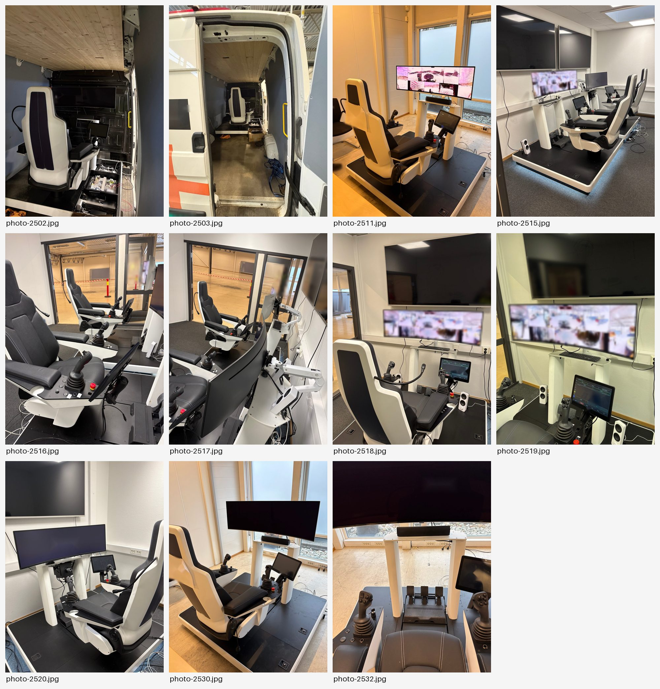

# The owner's requests, verbatim

## TL;DR

- The owner is a human factors and ergonomics researcher who wants an open, modular way to model, evaluate and live-test remote operating stations. The first step is a credible 3D model of one station ("the rig"), built from photographs only.
- The first request asked for an investigation and a plan, made by a team of specialist AI agents and then attacked by a fresh review team. The second asked for a full test implementation, a wiki, a private GitHub repository and a deployment.
- The texts below are verbatim. Typing errors are the owner's and are kept on purpose.
- One substitution was made: where the owner named the maker of the rig, the name is replaced by `[rig maker]`, because the owner asked that the name not appear in the repository.
- The requests are broken down into numbered requirements in [requirements.md](requirements.md).

## How to read this page

Each block is one message from the owner. The line above it says when in the project it came.
All messages are from one working day, 2026-11-23. "The plan" means the document summarised in
[../30-plan/approved-plan.md](../30-plan/approved-plan.md).

The photographs the owner refers to are a folder of 16 phone pictures, 11 of which show the rig.
Masked copies of those 11 are in this wiki:

*The eleven photographs of the rig that the owner supplied, as masked copies (people and names blurred, metadata removed). They show four physical rigs: Rig A in a van, Rig B in a room with windows (the reference rig), and Rigs C1 and C2 in a control room.*

## 1. The original request

Context: the first message of the session. It starts the investigation and planning phase.

> I am a human factors ergonomics researcher. We work with a company (and potentially future such clients) who does remote operating solutions. We want to support them with assessment and sim traiinng solutions.
>
> I want your help to check the feasibility of developing an open, modular envornment and worklow for modeling, evaluating (eg against ergonomic standrards) and live-testing such envirnments. We need to look into the tool stack, workflow, capabilities, scope etc.
>
> All this will revolve around a 3D environment. I first want you to focus on how to build custom 3D assets. Under Downloads, there is a folder called cockpit, which has a series of pictures from the actual rig they built. The first step is to make a credible 3D model of that rog, using just the pictures.
>
> Take a look at the pictures, and set up a specialist agent teams to do the investigation and planning for this capability. first you need to consider how you can achieve the building of a credible 3d model of the rig. is it feasible from the pictures? where to you have to enhance or invent certain data, such as the actual measurement, which i dont have. We want to make sure the asset can be adjusted later if and when we have actual measureemnts.
>
> Next is how to go from picture to 3D model. Do we need to isolate or extract the rig from the pictures? Then how do we build a model in a good-quality and simple way? Is it worth using Blender for asset generation? if so, how do we proceed? how do we actually generate the 3D structure? can we do it natively , or are other tools needed (always only opern source, and use as few dependencies or external software as possible; achieving my required quality goals with the simplest means).
>
> The modal shouldnt just be a monolithic entitiy, instead it should have a functional and structureal decomposition that you will have to work out. For the rig, this might involve anything that is parameterizable or movable, such as the screen, the seat, the joystick. This will be needed later if and when we want to do assessment of the asset under different conditions (eg reachability depending on seat position), or if we want to use this in a 3D training simulator.
>
> Such consdierations, such as component decomposition, our general modeling approach, ghuidance, targets etc; should all be documented in a Agent Skill that can be refined and re-used . We will have many such tasks with varying assets and use cases, so this Skill is foundational and has to be good.
>
> We also need to consider the actual modeling of the aset; and where the componet decomposition comes in (decomp first, then model; or other way around). For the actual modeling, who does that, and under what guidance ? what "thought process" does the modeling agent go thru when considering the modeling? who monitors this thought process , and who gies feadback (eg monitoring / guidance agent? what feedback should it give?)
>
> To what extent is the modeling process step-by-step and iterative? How do we balance this against good pace of progress; what is needed and why; do we use the right appraoch?
>
> How does the agent observe and control the monitoring? when does it know it is finished, and how does it do the checking and documentation? What format should the asset be in, and how do we preserve modularity and parameterisability?
>
> Once we have designed the modeling pipeline, and tested that model constructin from photos is feasible, we will later separately work on the validation and simulation / training. Im just bringing these up as a heads-up so you can consider them in the modeling phase.
>
> We want to turn this feasibility test into a project on github. consdier and suggest suitable names. create a local folder on this machine. install Blender if needed, but also consider alternatives. Consider a good envirnment to view the asset in a web browser; check the Leitbild 3D capability on this machine and see if any of those ideas can be re-used (but dont use these if some better soultions come up).
>
> Now I want you to do a deep investigation and planning with a specialised agent team, including agent that take my position; and an agent that monitors from the perspective "could this be simpler". The goal of this agent team is to make a detailed plan to achieve my goals at the highest level; then with a completeley new fresh agent teams, make a complete adversarial and ruthless review of the plan, identify and fix any flaws, and check if the proposed plan will meet our goals and standards; present the plan for approaval, including any significant choices, uncertainties and open questions. at any stage, ask me questions if needed

Note: "Leitbild" is an earlier project of the owner's on the same machine, which has its own 3D
capability. What was and was not reused from it is in
[../20-decisions/options-considered.md](../20-decisions/options-considered.md).

## 2. During the investigation

Context: sent while the specialist agents were working. It narrows the scope. The photo folder also
contains pictures of other things (a van interior, wheel loaders, rooms); only the rig is to be
modelled.

> only use pictures of the rig (the white one with the joyrsticks); that is what i want you to model

Context: sent before the plan was presented. It names four topics the plan must explain in detail.

> make sure the final presented plan describes all critical aspects in detail, incl how augmentation is doen realiabliy, how the rig is isolated from the packground int he photos , and if that is needed; how sizes are estiamted; how things are connecrted;

## 3. Plan approval and the implementation request

Context: the owner's reply to the presented plan (version 3). It does five things at once: reports a
defect in the trial model shown as an illustration, gives three scale figures, answers two of the
plan's questions, approves the plan, and asks for a full test implementation followed by a wiki, a
GitHub repository and a deployment.

> Initial results look promising, but it is missing the joystick on the left side; investigate how and why this failure occurred and how it can be avoided in the future. some scale guidance: "room that is in the pictures 4,5 m deep, 5,8 m wide and 2,48 m to the ceiling. A cockpit platform is 1,5 X 1,5 m and with a seat mounted on it that is 1,4 m high. The distance from the head to the display is 1,2 m ".
>
> answers: q2: ok; confidentiality is no concern. q1: internal test
>
> Plan approved. Now do a full test implementation of the pipeline, with the goal of having a rotatable, zoomable, high-quality  3D version of the rig as an asset in a browser window, with the ability to show / hide any element that was identified and modeled as a component. Regularly check your work, especially the quality of the 3D modeling; if you see problems or are unable to achieve the desired quality level over a few iterations, go back and find the cause, adjust your assumptions, tools, processes workflows etc if needed, and try again. Have a separate ruthless agent who will not accept a micky-mouse version of the rig; we dont need need photrealistic copy, but it needs to be credible and usable for the intended evaluation and training precesses (actually make sure you dont make the model unnecessarily detailed, so we have good viewing performance and good performance during the modeling).
>
> Once th model is completed to satisfaction and has been verified in the browser, write a complete llm-wiki about this proof of concept, including my original request, breakdown into key requirements and system features, options considered, accepted and/or rejected; approved plan and its justification; tech stack and work process; the actual implementation incl perf data (eg how long stuff took); lessons learned, changes and adjustments during the modeling and implementation; and documentation of the final proof-of-concept; including critique, justification why goal was achieved , and next steps. Make sure that the wiki has a good structure that can be extended as the project grows, making sure that it is human-readable, but also the single-source-of-truth reference for AI agents that will continue to work with this. Make sure you include screenshots such as the original photos, screenshots during the modeling, and the results in the browser. Important to document clearly  and easily findable all lessons learned, successes, failures, improvements, ideas, processes, algorithms, patterns, pipelines , agent skills and tools, etc; and short summaries / TLDRs.
>
> This wiki should be part of the repo. When everything is completed and verified, push it to github as a private repo. Do not mention the name "[rig maker]" in the repo.
>
> Then deploy a version of the viewer to my prod box mightwork.ai, building a pipeline so that future updates will be pushed to prod. also have the wiki on prod as a subfolder

Notes for readers:

- "q1" and "q2" are the plan's first two questions. Q1 asked what the first model is for and who
  will see it; the answer is "internal test". Q2 asked about confidentiality of the photographs; the
  answer is that it is no concern. See [../30-plan/approved-plan.md](../30-plan/approved-plan.md).
- The scale figures use a decimal comma: 4.5 m, 5.8 m, 2.48 m, 1.5 × 1.5 m, 1.4 m, 1.2 m. How they
  were used, and where the photographs disagreed with them, is decision D-24 in
  [../20-decisions/decision-log.md](../20-decisions/decision-log.md).
- The "initial results" were a quick trial model shown inside the plan as an illustration. Why it
  lacked the left joystick is decision D-25 in the same log.

## 4. During the implementation

Context: asked while the build agents were running. The plan's question Q6 had proposed four names
(one Norwegian word, one German word, one coined word and one plain description); the research
behind it had listed twelve candidates. The full list is in
[../20-decisions/options-considered.md](../20-decisions/options-considered.md).

> what are the suggested project names?

Context: the owner's reaction to the list.

> all bad. keep it simpler. no german or norwegian

The owner then chose **rigtwin** from a list of plain English names.

Context: sent after the name was chosen. It fixes the two public addresses.

> use mightwork.ai/rigtwin for the live viewer and mightwork.ai/rigtwin/wiki for the wiki. now continue

Context: asked on seeing the viewer's source file. It led to the viewer being rewritten in TypeScript.

> why is viewer.js a js and not ts

Context: sent after using the first version of the viewer.

> in review, look at the UI. it is overcomplicated and takes a lot of time. do a pass with an indpendent UI/UX agents and find simplifiactions, especially simplifying controls for a single componet (currently eg monitor height / tilt / pan as separate slider; consider alternatives)

Context: sent after trying the seat controls. In the first viewer, adjustments that are only assumed
to exist (such as the seat slide) were shown locked.

> why cant i adjust the seat? the lock is confusing for users unless there is a way to unlock

## What is not on this page

- The plan's questions to the owner and the plan itself: [../30-plan/approved-plan.md](../30-plan/approved-plan.md).
- What changed between the approved plan and what was done: [../30-plan/deviations.md](../30-plan/deviations.md).
- Whether each request was met: [../70-results/goal-assessment.md](../70-results/goal-assessment.md).
