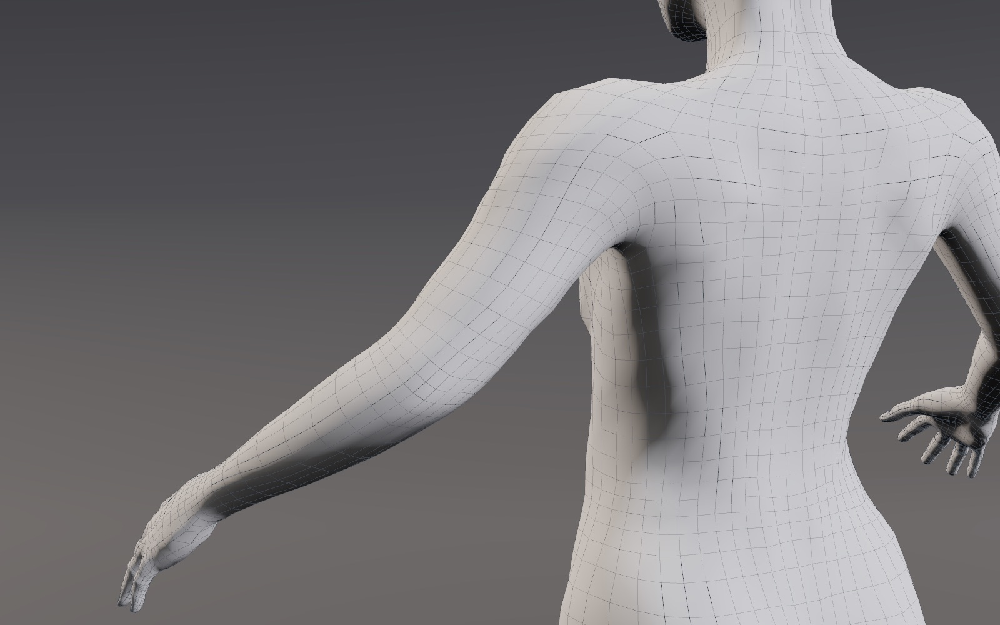

# Manikin approaches: libraries, licences and the choice

## TL;DR

- **The problem:** a seated operator manikin that is credible to look at by game standards, sized and shaped from a real survey (ANSUR II), rigged for working postures and fast in a browser; open licences only, nothing bought, no accounts.
- **Commercial options are referenced, never used.** MetaHuman is the quality benchmark, and its licence now allows other engines, but its parametric body stays inside Unreal Engine (a browser gets one fixed body per export), its look depends on Unreal's renderer, it needs an Epic account, and its content stays under Epic's terms.
- **The choice:** the MakeHuman production mesh (CC0), one topology for every body; a shape space fitted to 512 survey people that reproduces stature with a mean error under 3 mm and weight within 1.4 kg on 5,556 people it never saw; a game-style rig of 102 joints (twist and helper joints, 8 influences, dual-quaternion skinning, a seat contact deformer); two styles on that one body.
- **Excluded by licence:** SMPL, SMPL-X, MANO and their relatives (non-commercial research only), and the SMPL-X option inside Anny.
- **Where it stands (2026-11-25):** the abstract clay figure passed the designer's review at level 3, the Unreal-mannequin class, explicitly **not** MetaHuman quality; the dressed operator passed on 2026-11-25 at L4− at 1.5–4 m and L3 for the head at 1.2 m, one level under MetaHuman at working distance and two in a head close-up; nothing is public until the owner approves it.

## The problem

| Need | What it means here | How it is judged |
|---|---|---|
| Credible to look at | "gaming-industry standard", with "a metahuman / UnrealEngine quality character" as the benchmark (the owner's words); nothing toy-like or embarrassing in front of customers | an independent designer agent against a fixed quality ladder and a fixed shot list ([below](#the-bar-a-designer-with-a-veto)) |
| Anatomically and dimensionally valid | any person of the US Army [ANSUR II](https://www.openlab.psu.edu/ansur2/) survey (6,068 people, 93 dimensions each) reproducible: thin to heavy, short to tall, long arms on a short person, with the skeleton following the body | the mesh measured with virtual tapes against survey people it was not fitted to |
| Rigged for working postures | seated with hands on grips and feet on pedals, reaching, turning the head; no collapsing joints, twist artefacts, pinched shoulders or skin passing through skin | a range-of-motion test of 39 poses on several body sizes, in numbers and in pictures |
| Runs in a browser | three.js; at least 60 frames per second at 1600 × 1000 on the project's laptop (Apple M2); body sliders that respond at once | measured by the packet renderer |

Constraints: open licences only (CC0, CC-BY with credit, Apache-2.0, MIT, BSD; GPL only for build tools whose
output is not GPL); nothing bought; no accounts; the site may be public; the work is built and checked by AI
agents. Earlier home-made manikins (capsules, blended volumes, a raw parametric mesh with painted-on clothes) were
rejected by the owner; this page records what replaced them.

## How the options were judged

- For each option: the **licence** (read on the source's own page where possible), what it **gives** (mesh, rig, shape space, textures, hair, clothes), its fit for **ergonomics** (does the shape follow measurements; is the joint model usable for posture) and its fit for a **public web viewer** (format, size, runtime, redistribution).
- Evidence: *desk research* = read on the source's page on 2026-11-24 or 2026-11-25; *tested* or *measured* = run on the project machine; *not verified* = from secondary pages or general knowledge. None of this is legal advice.
- Quality is stated on the designer's ladder:

| Level | Name | What it is | Public example |
|---|---|---|---|
| L5 | Hero close-up | film-adjacent real-time human: strand hair, 8K skin with scattering, full facial rig | MetaHuman at its highest level of detail |
| L4 | Gameplay distance | a current game character: card hair, real garments, correctives, captured motion; holds at 1.5–4 m | MetaHuman at lower levels of detail |
| L3 | Mannequin class | a designed figure without skin, face or hair, game quality in everything it does | Unreal Engine's Manny and Quinn |
| L2 | Last-generation character | a complete clothed character of about 2008–2013 | Rocketbox; MakeHuman with stock skin, hair and clothes |
| L1 | Research manikin | a correct body shown bare and grey | SMPL-class, MHR, Anny, SOMA-X figures |
| L0 | Slop | primitives, blobs, painted-on clothes, broken skinning | the project's earlier attempts |

## The options at a glance

| Option | Kind | Licence | Gives | Ergonomics | Web viewer | Verdict |
|---|---|---|---|---|---|---|
| [MetaHuman](#metahuman-epic-games) | commercial | Unreal Engine EULA | parametric body, scanned faces, grooms, full rig with correctives | a few measurement sliders, not a survey model | one fixed body per export; shaders lost | **benchmark only** |
| [Manny and Quinn](#unreal-engine-mannequins-manny-and-quinn) | commercial | Unreal Engine EULA | faceless mannequins, game rig | one size, no shape parameters | needs an Epic account | **benchmark only** (L3) |
| [Character Creator](#character-creator-reallusion) | commercial | paid | morph-slider creator, rig, clothes, hair | sliders, no survey | licence fees for interactive use | not used |
| [Daz Studio](#daz-studio-daz-3d) | commercial | free tool, paid content | figures with morphs, clothes | sliders, no survey | interactive licence needed | not used |
| [Ready Player Me](#ready-player-me-and-other-avatar-services) | hosted service | vendor terms | stylised avatars through an API | none | service closed | not used |
| [Mixamo](#mixamo-adobe) | free with an account | Adobe terms | automatic rigging, characters, animations | none | original files not redistributable | not used |
| [Ergonomics manikins](#commercial-ergonomics-manikins) | commercial | commercial | validated manikins, posture prediction, analyses | the domain's reference | desktop products | referenced for functions |
| [UMTRI HumanShape](#umtri-humanshape) | research model | not verified | seated body shapes from scans | closest seated model | not assessed | later, to validate against |
| [MakeHuman / MPFB2](#makehuman-and-mpfb2) | open | CC0 assets, GPL tool | mesh, UVs, 1,477 shape targets, rigs with weights, skins, eyes, hair, clothes | measurement targets, not calibrated | easy to convert | **chosen as the base** |
| [Anny](#anny-naver-labs-europe) | open | Apache-2.0 code, CC0 data | the same mesh, calibrated parameters, joints from shape | made for fitting | build time only | **used to fit the shape** |
| [Meta MHR](#meta-mhr) | open | Apache-2.0 | scan-based shape, learned correctives, levels of detail | shape has no measurement meaning | no look kit | not used |
| [NVIDIA SOMA-X](#nvidia-soma-x) | open | Apache-2.0 | scan-based shape space, learned correctives | scans, not ANSUR | no look kit | tested, not used |
| [Blender Studio base meshes](#blender-studio-human-base-meshes) | open | CC0 | sculpted bodies, heads, hands, feet | no shape space | no rig | not used; a reference |
| [Rocketbox](#microsoft-rocketbox) | open | MIT | 115 rigged, textured characters, 417 animations | fixed bodies | works | not used |
| [Quaternius](#quaternius-universal-base-characters) | open | CC0 | stylised rigged bodies | stylised proportions | works | look reference only |
| [CMU motion, Poly Haven](#supporting-open-data) | open data | free incl. commercial; CC0 | motion clips; lighting and fabrics | — | — | **used** |
| [SMPL family, MANO, AMASS](#excluded-by-licence-smpl-smpl-x-mano-and-relatives) | research | non-commercial | the best-studied body and motion models | strong | — | **excluded** |

## Commercial and closed options (referenced, not used)

These are described and linked to their makers' own pages only. None of them is used, and no picture of any of
them is in this wiki.

### MetaHuman (Epic Games)

- **What it offers:** the benchmark for real-time digital humans. Since Unreal Engine 5.6, MetaHuman Creator runs inside the engine with a parametric body: continuous body shape, refined region by region, with sliders that Epic calls "statistically driven" in a space built from real body data, and measurements such as height, chest, waist and leg length that can be set and pinned; parametric clothing that follows the body; scanned faces with a facial rig; strand and card grooms; a body rig with twist and corrective joints, pose-driven correctives and up to 8 influences per vertex (*desk research*: [MetaHuman](https://www.metahuman.com/), [body controls](https://dev.epicgames.com/documentation/metahuman/body-model-controls), [parametric clothing](https://dev.epicgames.com/documentation/metahuman/creating-parametric-clothing-for-metahuman), [levels of detail](https://dev.epicgames.com/documentation/en-us/metahuman/platform-support-and-lod-specifications-for-metahumans)).
- **Licence:** since 5.6, MetaHuman falls under the [Unreal Engine EULA](https://www.unrealengine.com/eula/unreal) (the page refuses automated readers). The [licence page](https://www.metahuman.com/license) says "MetaHumans can be used with any engine or creative software" (*desk research*, read 2026-11-25); free below USD 1 million annual revenue, Unreal's standard terms (a seat licence) above. Its FAQ forbids using MetaHuman characters to build databases or to train or test AI. Content taken from the older cloud Creator or Bridge may only be used and shared as Unreal-only content.
- **Ergonomics:** a handful of named measurements, not a survey model; whether its measurement definitions match the ANSUR landmarks could not be found (*not verified*).
- **Web viewer:** the body is fixed at export; the parametric body and its sliders stay in Unreal. The skin, eye and hair shading, strand grooms and in-engine correctives do not survive a glTF export; the designer's estimate is that an exported MetaHuman lands at about L4 in a browser (*judgment*). Whether serving the raw model file from a public page counts as allowed distribution was not settled.
- **To use it** only the owner could act: an Epic account, accepting the EULA, installing Unreal Engine 5.6 or later (tens of gigabytes), authoring and exporting each body by hand.
- **Verdict: not used; it is the benchmark.** The research did find that MetaHumans may now be used outside Unreal. They still miss the needs that matter most here: no live, survey-driven body in the browser; a look that depends on Unreal's renderer; an account and Epic's terms, which no open release can carry, including the clause on AI use in a project built and checked by AI agents.

### Unreal Engine mannequins (Manny and Quinn)

- **Licence:** Epic content under the Unreal Engine EULA, distributed through Fab ([Mannequins Asset Pack](https://www.fab.com/listings/ad542ee6-34d0-4828-a56c-13846cd649d0)); whether they count as freely redistributable examples was not settled.
- **Gives:** faceless designed figures with a game rig; one size each, no shape parameters.
- **Verdict: not used.** They define level L3, the class the abstract style was judged against.

### Character Creator (Reallusion)

- [Character Creator](https://www.reallusion.com/character-creator/) is a paid character creator with morph sliders, clothes, hair and export to game engines. Redistributing its characters in interactive products is licensed separately, with fees (*not verified*).
- **Verdict: not used:** paid, proprietary, sliders without a survey behind them.

### Daz Studio (Daz 3D)

- [Daz 3D](https://www.daz3d.com/): a free application with paid figures and clothes (figures with many morphs). Using its content in a game or an interactive application needs an interactive licence (*not verified*).
- **Verdict: not used.**

### Ready Player Me and other avatar services

- A hosted avatar service: users make stylised avatars and apps fetch them through the vendor's API. No sizing from measurements. Ready Player Me was bought by Netflix in December 2025 and closed its public services on 31 January 2026 (news reports, *not verified*); [readyplayer.me](https://readyplayer.me/) did not answer on 2026-11-25.
- **Verdict: not used.** It shows the risk of any hosted service: every avatar built on it disappears with it.

### Mixamo (Adobe)

- [Mixamo](https://www.mixamo.com/): automatic rigging, stock characters (among them the X Bot and Y Bot mannequins) and animations; free with an Adobe ID; characters and animations royalty-free inside projects. An unofficial Adobe community FAQ says the original files may not be redistributed (*desk research*).
- **Verdict: not used:** it needs an account, and a model file in a public viewer is redistribution.

### Commercial ergonomics manikins

- [Siemens Jack / Process Simulate Human](https://www.siemens.com/en-us/products/tecnomatix/human-centered-design-simulation/), [RAMSIS](https://www.mec.ed.tum.de/en/lfe/research/software/ramsis/), [IPS IMMA](https://fcc.chalmers.se/software/ips/ips-imma/), [DELMIA Ergonomics](https://www.3ds.com/products/delmia/ergonomics), [AnyBody](https://www.mec.ed.tum.de/en/lfe/research/software/anybody/), and Santos and SAMMIE CAD (no working public page found on 2026-11-25).
- They are the domain's reference for **function**: sizing by percentiles or body typologies, manikin families (an average person plus boundary cases), posture prediction, eye views and vision cones, reach and comfort zones, the out-of-reach distance when a reach fails. Their look is not the benchmark the owner set.
- **Verdict: referenced for functions, not used:** commercial desktop products, not usable in an open web viewer.

### UMTRI HumanShape

- A **seated** body-shape model from 155 laser scans, driven by stature, BMI, sitting-height ratio, sex and age ([Park et al., *Ergonomics* 2022](https://doi.org/10.1080/00140139.2021.1992020)); a newer app is sold by subscription; its terms were not verified. It is the closest thing to an ergonomics-grade seated surface, for a different population (US civilians).
- **Verdict: later**, as an independent reference to check our seated shapes against, if its terms allow.

## Open options

### MakeHuman and MPFB2

- **Licence:** [MakeHuman](https://static.makehumancommunity.org/) data through MPFB 2.0.18 (October 2026), the MakeHuman plug-in for Blender ([extensions page](https://extensions.blender.org/add-ons/mpfb/), [source](https://github.com/makehumancommunity/mpfb2)): code GPL-3.0-or-later, used only as a build-time source; core assets CC0 ("All core assets are shared under Creative Commons, CC0", [licence page](https://static.makehumancommunity.org/about/license.html)). Community asset packs are CC0 or CC-BY 4.0 per asset, and CC-BY authors must be credited; all 310 assets fetched were checked one by one, and 30 whose own files still carry an old AGPL header are skipped (*desk research*).
- **Gives:** the hm08 production mesh (about 13,400 body vertices in quads, with UVs); 1,477 artist-made shape targets (sex, age, muscle, weight, height, proportions; 20 measurement targets such as upper-arm length, waist and hip girth; per-segment changes); rigs with painted weights (a 163-bone default, a 53-bone game rig with Unreal-style names but no twist joints, rigs matching Mixamo and CMU motion); skins (2048-pixel colour maps), eyes, teeth, brows, lashes, ten hair meshes, and 20 garments and 6 pairs of shoes in the system pack. A garment is bound to the body (each garment vertex follows three body vertices plus an offset), so it follows every body shape (*tested*).
- **Ergonomics:** shape targets exist for many survey-like dimensions, but they are not calibrated to any survey; the body is modelled standing; the rig's joints are MakeHuman's positions, not validated joint centres.
- **Web viewer:** plain text formats, converted to GLB at build time; at run time only three.js.
- **For:** the only free system with both a parametric body and a dressing kit on one topology. **Against:** shown raw it gives the owner's "horror movie" result (a realistic face without eyes or skin, clothes as colour); hair is the weakest part; garments are of uneven hobbyist quality; the forearm is thinly meshed; torso sections are rounder than real ones.
- **Verdict: chosen** for the body, UVs, weights, shape targets and dressing kit.

*The raw MakeHuman hm08 base mesh as downloaded (CC0; no shape, rig or texture applied), from behind the left shoulder with its quad edges drawn, rendered by the project in its lab viewer. The rings of quads round the upper arm and forearm and the loops over the shoulder blade are what a game rig bends. This is the open library's raw asset, not the project's manikin.*

### Anny (NAVER LABS Europe)

- **Licence:** Anny 0.6.2: code and model Apache-2.0, MakeHuman-derived data CC0 ([source](https://github.com/naver/anny), [package](https://pypi.org/project/anny/), [paper](https://arxiv.org/abs/2511.03589)). Its optional SMPL-X-based topology falls under SMPL-X's non-commercial licence and is **never used**.
- **Gives:** the MakeHuman mesh (13,718 vertices, a subset of hm08 in the same order, *tested*), body parameters calibrated to WHO population statistics, local shape changes, and joint positions that are linear in the shape coefficients; written in PyTorch, so a fit to measurements can be computed directly.
- **Ergonomics:** built for fitting bodies to measurements; no seated shapes and no pose correctives.
- **Web viewer:** Python and PyTorch at build time only; its output is ordinary shape targets.
- **Verdict: used at build time** to fit the shape space ([below](#a-shape-space-fitted-to-the-survey)); nothing of Anny's runtime ships.

### Meta MHR

- **Licence:** MHR 1.2.0 ([source](https://github.com/facebookresearch/MHR)): the README states Apache-2.0; the licence file inside the downloadable assets was not read.
- **Gives:** scan-based shape (45 identity parameters), 72 expression and 204 pose parameters, learned pose correctives, seven levels of detail, an FBX rig. No textures, eyes, hair or clothes.
- **Ergonomics:** its identity parameters carry no measurement meaning.
- **Verdict: not used** and not downloaded; a possible later source of correctives once its asset licence is read.

### NVIDIA SOMA-X

- **Licence:** SOMA-X 0.3.0, Apache-2.0, described as ready for commercial use ([model card](https://huggingface.co/nvidia/SOMA-X)). Its optional SMPL and MANO parts keep their own non-commercial licences and were never fetched.
- **Gives:** an 18,056-vertex body with 77 joints, a 128-component shape space learned from purchased scan collections, learned pose correctives, and ready-made wraps onto Anny's and MHR's meshes. No look kit.
- **Tested here:** its wrap matches our mesh closely (median 0.28 mm). Its correctives, carried onto our rig, restored a 90° knee but over-inflated deep flexion, and made the knee, hip, shoulder and neck worse in the range-of-motion numbers; they helped only at the wrist and in one shoulder pose (*measured*).
- **Verdict: not used.** Its shape space comes from scans, not from the survey the owner works with.

### Blender Studio Human Base Meshes

- **Licence:** version 1.4.1, CC0 in every asset's own metadata (*tested*); offered among the [Blender demo files](https://www.blender.org/download/demo-files/) (the page sits behind a bot check).
- **Gives:** professional sculpted bodies (realistic and stylised), heads, hands and feet, in quads with UVs; no rig, textures or shape targets.
- **Verdict: not used** in the build; the right starting form for a designed head if a mannequin style with a planar head is built later.

### Microsoft Rocketbox

- **Licence:** MIT ("now released under MIT License", README); the repository is now read-only ([source](https://github.com/microsoft/Microsoft-Rocketbox)).
- **Gives:** 115 rigged, textured game characters, among them construction workers, with facial blend shapes and 417 animations.
- **Ergonomics:** fixed bodies, sized only by scaling bones; about 2010 game fidelity, L2 (*judgment*).
- **Verdict: not used;** a possible motion source.

### Quaternius Universal Base Characters

- CC0 ([pack page](https://quaternius.com/packs/universalbasecharacters.html)): stylised game bodies with a humanoid rig, about 13,000 triangles, stylised proportions, no anthropometric sizing.
- **Verdict:** a look reference only.

### Supporting open data

- [CMU Graphics Lab motion capture](http://mocap.cs.cmu.edu/): free for research and allowed inside commercial products, not for resale; a credit line is asked for. **Used:** range of motion, walking, sitting down and a seated base layer, retargeted to each body; it has no finger data.
- [Poly Haven](https://polyhaven.com/license): CC0 studio lighting and fabric textures. **Used.**
- [OpenSim](https://simtk.org/projects/opensim): musculoskeletal models without a skin surface. **Later**, for joint ranges and loads in an assessment step.
- Seen in searches and not assessed: CharMorph (a CC0 character add-on for Blender) and Google's GNM head model (Apache-2.0).

## Excluded by licence: SMPL, SMPL-X, MANO and relatives

- The Max Planck Institute's body models [SMPL](https://smpl.is.tue.mpg.de/), [SMPL-X](https://smpl-x.is.tue.mpg.de/modellicense.html), [MANO](https://mano.is.tue.mpg.de/) (hands), STAR, [SUPR](https://github.com/ahmedosman/SUPR) and SKEL are the best-studied statistical bodies. Their licences allow non-commercial research only; commercial use needs a separate paid licence. The same holds for the motion collection [AMASS](https://amass.is.tue.mpg.de/) and for LAFAN1 and similar motion sets.
- The project assesses stations for a company and its site may be public, so none of them is used, and neither is any file that depends on them: Anny's SMPL-X topology, SOMA-X's SMPL and MANO parts.

## What we chose and why

### One shared open mesh

Every person is the same MakeHuman mesh, with the same vertices in the same order; only their positions change.
Every game character creator rests on this property, MetaHuman included: UVs, textures, painted weights,
correctives and garments are made once and carry over to every body, and a slider moves the body in about a
millisecond instead of rebuilding a mesh. The earlier home-made bodies had no shared topology, which is why none
of this could ever be added to them.

### A shape space fitted to the survey

- **Fit:** 512 real ANSUR II people (256 per sex, chosen to include the extremes of nine criteria such as stature, weight, BMI, relative sitting height and relative arm length) were fitted by adjusting Anny's body parameters and about 50 local MakeHuman targets until virtual tapes on the mesh read the survey values: girths as a taut tape, heights with the legs straightened, weight from the mesh's volume and a body density from the US Navy circumference equations.
- **Space:** the fitted bodies were reduced to 40 shape components per sex. A linear map turns 38 survey dimensions into component weights, and the joints follow linearly (mean residual 0.25 mm).
- **Controls:** stature and weight, then 36 further dimensions, each set as "this dimension, given the ones before it". Any slider setting is a plausible person, and all 38 together reproduce any survey person.
- **Accuracy** on 5,556 survey people never used in the fit (*measured*, mean absolute error, men / women): stature 2.7 / 2.8 mm, sitting height 3.0 / 2.9 mm, weight 1.0 / 1.4 kg, arm segments and hand under 1 mm, limb girths 1–5 mm. **Weak:** waist girth reads 21 / 32 mm short and buttock girth 26 / 34 mm short, because the mesh's torso sections are rounder than real ones; men's acromial (shoulder) height reads 29 mm high.
- **Runtime:** the shape is applied on the processor when a slider moves (about 1 ms), which leaves the graphics card's morph budget to the correctives. The survey files are not in the repository; only the derived shape space would ship.

### A game-style rig

| Part | What | Why, with the measured effect |
|---|---|---|
| Skeleton | 82 joints with Unreal-mannequin names (`pelvis`, `spine_01` to `spine_05`, `neck_01`, `neck_02`, `head`, `clavicle_l`, `upperarm_l`, `lowerarm_l`, `hand_l`, three joints per finger, `thigh_l`, `calf_l`, `foot_l`, `ball_l`, and the same on the right) | game motion and tools map onto it by name |
| Twist joints | two in each upper arm, forearm, thigh and calf, at about one-third and two-thirds of the segment; driven, never animated | rotation spread along the limb: the forearm's smallest section at 90° of twist went from 0.49 to 0.94 of its rest size on the raw body (*measured*) |
| Helper joints | 16: knee front, buttock, hip–belly, groin, armpit (chest and arm side), shoulder front and lap–thigh, on each side | they hold volume and contact lines where skin folds; in the end they did more than corrective shapes |
| Influences | up to 8 joints per vertex, with a 4-joint copy for other glTF readers | cutting to 4 moved shoulder vertices by up to 22.6 mm (*measured*) |
| Skinning | dual-quaternion skinning blended in per vertex at shoulders, hips, knees, wrists and twist zones; linear blending elsewhere | volume lost on the raw body: shoulder −28 % → −3 %, hip −21 % → −10 %, knee −26 % → −9 % (*measured*) |
| Correctives | two pose-driven corrective shapes, for wrist flexion | learned and solved correctives were tried; most made the numbers worse |
| Contact | a seat contact deformer: buttock and thigh pushed onto the seat pan, the back onto the backrest, in the vertex stage, so shadows and depth agree | the body rests on the seat instead of passing into it |
| Eyes | the skeleton's two eye joints plus 4 eyelid joints (102 joints in all) | gaze and blink in the dressed style |
| Motion | CMU capture retargeted per body; a seated-operator layer that solves the arms and legs as two-joint chains (hands on the grips, feet on the pedals) and turns the head to the screen | hands hold the grips within 0.8–1.8 mm on every body size; in the captured walk, foot slide at most 9 mm and the largest joint change 14.9° per frame (*measured*) |

### Two styles on one body

Both styles share one body, skeleton, set of hands and motion; switching style or outfit takes 0.2 ms and never
moves a joint or changes a body measurement, apart from the declared sole height (*measured*).

| | Abstract "clay figure" | Dressed "operator" |
|---|---|---|
| Idea | a designed figure in one satin material, with no skin, hair or seeing eyes, so nothing can look uncanny; the head's direction shows the line of sight | a realistic adult in plain workwear, kept out of the uncanny valley by a cap, a headset, safety glasses and small areas of skin |
| Body and head | eye sockets closed over blank sculpted eyeballs; nostrils, mouth, navel, nipples and genital detail filled in; feet built on a shoe last with a sole; one subdivision level on head and hands; the surface stays within 3 mm of the body on all 37 dimensions over the whole shape range (*measured*) | textured skin on head, neck and hands only; eyeballs with lids, a tear line, blink and gaze; brows; short hair under the cap |
| Clothes | none | separate garments from the MakeHuman packs (work shirt and trousers CC-BY 4.0, cap and safety glasses CC0), bound to the body so they follow every shape; the body hidden under cloth pixel by pixel; trainers; four colourways |
| Cost | 112,574 triangles, 4 draw calls, no textures, 12.7 MB; at least 62 frames per second (median 90) at 1600 × 1000 on the M2, measured under load (*measured*) | 109,329 (man) and 111,114 (woman) triangles, 11 and 12 draw calls, 106 and 113 MB of textures, 18.9 and 19.2 MB files, within limits of 120,000, 12, 128 MB and 20 MB; median 66 (man) and 63 (woman) frames per second, slowest runs 53 and 54, at 1600 × 1000 on the M2 (*measured*, see below) |

### The bar: a designer with a veto

- A visual-designer agent that never builds set the bar before anything was built: the ladder above; a **floor** (nothing below L3 in any category or shot; anything that claims to be human surface must be L4 at 1.5–4 m and survive a head view at 1.2 m and a hand view at 0.7 m; one realism level throughout); 12 categories; 21 **hard fails** (among them blob construction, an uncanny face, painted-on clothes, joint collapse, candy-wrapper twist, pinched shoulders, skin through cloth or seat, bad hands, bare feet on an operator); and a fixed **review packet** of 340–470 images from fixed cameras and lights, rendered from one build with no per-shot changes.
- **Calibration:** under this rubric every earlier attempt failed on several hard fails and none reached the floor, which matches the owner's verdicts.
- **Veto:** the designer opens the pictures and reads the numbers itself, gives a level and PASS or VETO per category, and nothing it has not passed reaches the owner. A hard fail that survives two rounds means changing the approach, not a third round of polish.

### What was taken from game technology

| Game practice | What we did | Result |
|---|---|---|
| One topology for every body; shape as blend shapes; joints computed from the shape | the shared mesh and the survey shape space | live sliders; garments and weights follow every body |
| Measured drivers kept apart from the authored look | sizes and joint positions from the survey; the look from an artist-made mesh | the earlier blobby bodies came from treating appearance as a measurement |
| Twist and helper joints, 4–8 influences, dual-quaternion skinning | all four | the owner's named faults (pinched shoulders, collapsing joints, no twist) gone in the working range |
| Pose-space corrective shapes, including learned ones | tried: SOMA-X's learned correctives and a contact-aware solve of our own | mostly worse in the numbers; two kept, helper joints did the work |
| Simulated flesh (Unreal's ML Deformer and Chaos Flesh) | the principle only: a closed-form seat contact deformer | buttock and thighs rest on the seat |
| Consistent stylisation against the uncanny valley (Zell et al., *ACM Transactions on Graphics* 2015) | one material and no human surface in the abstract style; cap and headset over hairline and ears in the dressed style | both styles passed; the dressed head reaches L3 at 1.2 m |
| Garments bound to the body, skin hidden under cloth | MakeHuman's binding; hiding per pixel | clothes follow every body; shirt folds and seated trousers still fail |
| Captured motion, retargeting that keeps contacts, reach solving for hands and feet | CMU clips and the seated-operator layer | the motion category passed at L3 |
| Review against a fixed shot list at stated distances | the designer's packet | every round judged on the same pictures |
| Not transferable | MetaHuman's skin, eye and hair shaders and strand grooms need Unreal | hair cards remain the weakest part: the women's hair failed twice |

## Recommendations

1. **Keep the open route:** the shared MakeHuman mesh, the survey shape space and the game-style rig. Adopt no commercial library; MetaHuman and Manny and Quinn stay benchmarks, linked, never downloaded.
2. **The owner decides first:** show the passed abstract style to the owner with the designer's captions. Only after approval bring it into the Synergon viewer, then the public site, and then add its pictures to this page.
3. **The dressed style:** show it to the owner with the designer's captions alongside the abstract style. Next-round items, none a condition: standing high-knee poses (hip 90–130°) still show a full trouser thigh; faces read about twenty against a brief of 35–45; a faint seam on the near cheek in close-ups.
4. **Measurement validity:** correct the torso section shape (waist, buttock) with a sculpted target or test another base body; check the men's shoulder height; compare seated shapes with an independent reference (UMTRI HumanShape if its terms allow) and with tape measurements of real people.
5. **Licence hygiene:** never any SMPL-family file; a licence record for every asset; credit CC-BY garment authors where the viewer credits assets; skip any asset whose own files disagree with its pack licence.
6. **Correctives:** revisit only for a measured gain on the range-of-motion test; MHR's correctives only after its asset licence has been read.
7. **The bar:** keep the designer's veto and the fixed packet for every change, including the end of the range of motion before it is ever shown.

## Conclusions and current state

- **Open, game-style technology reaches the Unreal-mannequin class in a browser.** The abstract clay figure passed the designer's full review on 2026-11-25: L3 or above in every category within the working envelope, close views included, no hard fail, at least 62 frames per second. It is explicitly **not MetaHuman quality**, and the rig is **not proven beyond the working envelope**: arm overhead beyond about 150° and arm across the chest at its limit are clamped and not shown.
- **The dressed operator passed on 2026-11-25,** after four vetoes. Two faults needed a change of method, not polish: the women's hair (pack hair cards fitted under the cap became one opaque sculpted bun made for the cap) and the seated trousers (an offline cloth drape on the seated pose, applied as correctives driven by hip and knee flexion). It reaches L4− at 1.5–4 m and L3 for the head at 1.2 m: a competent game character at working distance, one level under MetaHuman there and two in a head close-up. It is within its budget and skins with the same 8 influences as the body.
- **Frame rate:** measured on the project laptop while macOS indexing kept the load average at 17–18 all night with nothing of the project's running: median 66 and 63 frames per second for the dressed man and woman, 90 for the clay figure, slowest runs 53, 54 and 64. The owner ruled this the machine's normal quiet state; on a lighter-loaded machine the figures can only be higher.
- **Measurements:** the body reproduces survey people to a few millimetres in lengths and about 1 kg in weight, but torso girths read 2–3 cm short and men's shoulder height 3 cm high. Seated, each body sinks 40–62 mm into the cushion by design, because sitting height is taken from the survey less 20 mm of cushion: where looks and measurement conflict, the measurement wins. Nothing has been compared with real people or with an independent seated model.
- **Not yet in the product:** the proof is in a separate lab viewer. The live viewer and the public site show no manikin, by the owner's decision of 2026-11-24, and this wiki shows no picture of it until the owner approves.
- **MetaHuman** remains the benchmark that sets the bar, not a library this project builds on.

## Pictures to add once the owner approves

All four pictures exist in the project's private working files and have passed the designer. They stay out of
this wiki until the owner approves showing the manikin.

> **Picture pending the owner's approval:** the size range standing, abstract style: short woman (1523 mm, 58 kg), median man (1756 mm, 86 kg), tall heavy man (1869 mm, 115 kg).

> **Picture pending the owner's approval:** the same three seated in the operator seat, hands on the grips.

> **Picture pending the owner's approval:** the range-of-motion sheet in clay under raking light (shoulder, elbow, hip, knee).

> **Picture pending the designer's pass and the owner's approval:** the dressed operator with two outfits.

## Sources

- The research behind this page is kept in the project's private working files, not in the repository: the asset scout's survey of libraries and licences (2026-11-24; 310 asset licences read one by one), the rigging lead's measured comparison of skinning methods, the shape lead's survey fit and its second version, the rendering lead's look-development report, the designer's benchmark and reviews 1 to 8, the four-member review of the earlier manikin, and two earlier desk studies of looks and of comparable ergonomics manikins.
- Related pages: [Next steps](../90-next/next-steps.md#6-the-assessment-phase) (the digital human layer), [Human-factors standards](../80-reference/standards.md) (ISO 15536 on computer manikins), [idea I-09](../60-lessons/ideas.md#i-09) (the assessment layer), [Options considered](../20-decisions/options-considered.md).
