# Modelling rounds

## TL;DR

- Two planning **trials** built the same small brief in two stacks. Both silently lacked the whole left armrest pod and joystick; the owner noticed ([F-01](../60-lessons/failures-and-fixes.md#f-01)). Since then a coverage check runs on every build.
- The **blockout** (simple solids for every component, both sides, all 20 joints) took one agent 46 minutes: 11,162 triangles, all checks passing.
- **Round 1** (three modellers in parallel, 27–41 min each) gave 30,742 triangles. The reviewer did not accept it: 28 components accepted, 9 with minor fixes, **8 rejected**: toy-grade upholstery, pod legs like "a slab with a sausage attached", and three parts that failed when moved.
- **Round 2** (13–15 min per modeller) closed 24 of the 28 round-1 findings with **fewer** triangles (28,042). A fresh reviewer: **41 accepted, 5 with minor fixes, 0 rejected**, "accepted after the listed fixes".
- **Round 3** (one agent, 17 min) applied the three small required fixes (pod cup recess, flat-faced columns, lighter black rubber and plastic) and a joint-limit rounding bug: 28,070 triangles, all checks pass, spot-checked by the coordinator.

All images on this page are renders of the model; none contains photo pixels. Times are UTC on
2026-11-23 (local time is one hour later). How the agents were organised is in
[The agent process](../40-method/agent-process.md); timing tables are in
[Timeline and performance](timeline-and-performance.md).

## Overview

| Stage | When (UTC) | Who | Triangles | Draw primitives | GLB | Outcome |
|---|---|---|---|---|---|---|
| Trial A (Blender as a library) | planning phase | one agent, 29.6 min | not recorded here | — | — | built; right pod only |
| Trial B (TypeScript with three.js) | planning phase | one agent, 24.1 min | not recorded here | — | — | built; right pod only; chosen stack |
| Blockout | 17:15–18:01 | infrastructure agent | 11,162 | 62 | 0.33 MB | every component, all checks pass |
| Round 1 | 18:05–18:46 | three modellers in parallel | 30,742 | 68 | 0.77 MB | not accepted: 28 / 9 / 8 |
| Round 2 | 19:15–19:30 | the same three modellers, resumed | 28,042 | 67 | 0.72 MB | accepted after three fixes: 41 / 5 / 0 |
| Round 3 | 20:34–20:51 | one agent | 28,070 | 67 | 0.72 MB | three fixes and a limit bug; spot-checked by the coordinator; final |

Counts "28 / 9 / 8" are components accepted / accepted with minor fixes / rejected.

## The two early trials

During planning, two agents built **the same small brief** with two different stacks, so that the
choice of stack would rest on evidence ([P-01](../60-lessons/patterns.md#p-01),
[L-37](../60-lessons/lessons-learned.md#l-37)). Both passed. TypeScript with three.js was chosen for
speed, size and licence ([D-01](../20-decisions/decision-log.md#d-01),
[D-03](../20-decisions/decision-log.md#d-03), [D-04](../20-decisions/decision-log.md#d-04)); the
comparison is in [Options considered](../20-decisions/options-considered.md).

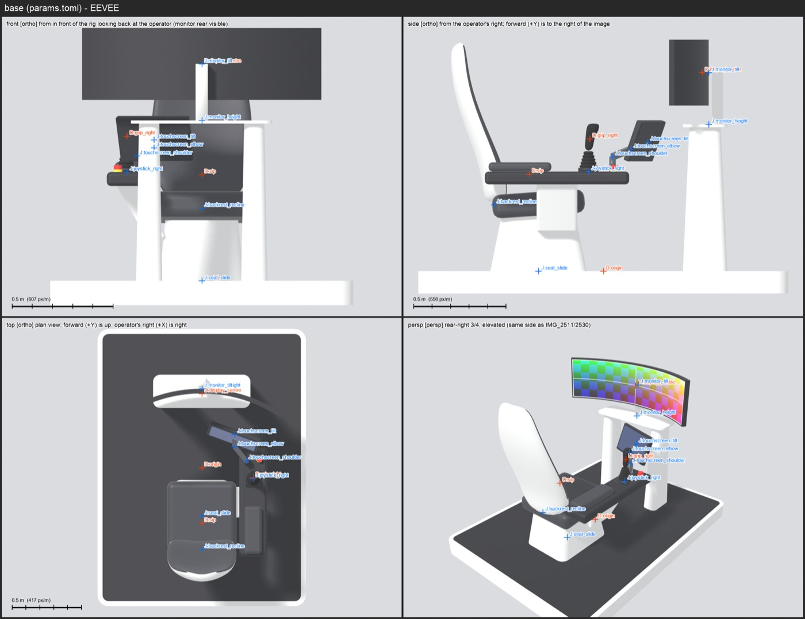
*Trial A (Blender used as a library): front, side, top and three-quarter views with joint labels. There is no left armrest pod and no left joystick.*

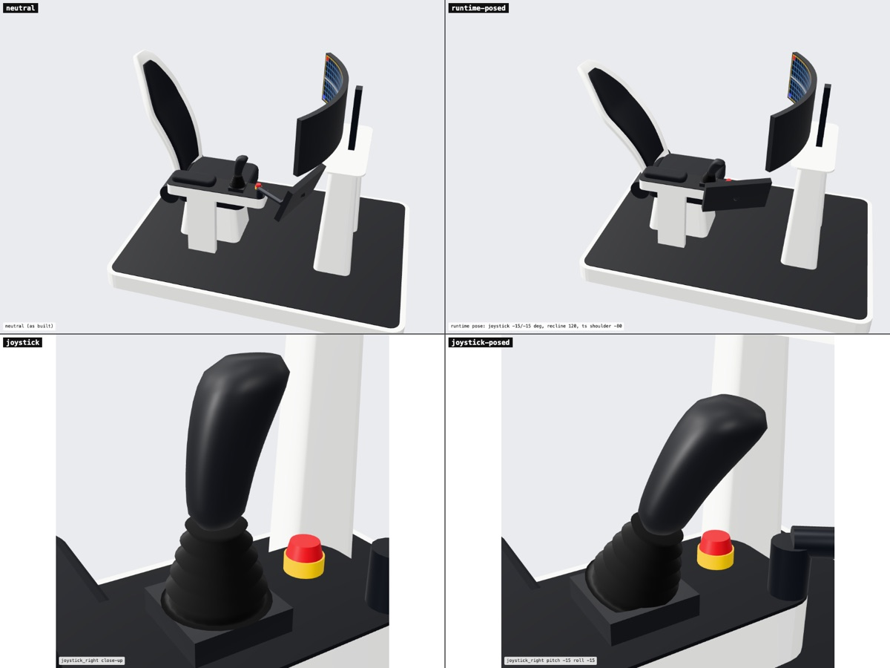
*Trial B (TypeScript with three.js): the posing test. Again only the right pod is present.*

**What went wrong.** To keep the trials small, the coordinator's brief scoped them to the right pod.
The figure captions said "trial blockout" without listing what was left out, and nothing compared
the built model with the component list. The owner saw the plan's illustration and asked where the
left joystick was. Guards since then: a coverage check on every build
([C-08](../40-method/checks.md#c-08)), a left/right counterpart check
([C-09](../40-method/checks.md#c-09)), the omitted list printed on every contact sheet, and briefs
that state omissions ([L-32](../60-lessons/lessons-learned.md#l-32)).

## The first complete blockout

The infrastructure agent wrote the generator, viewer, checks and render driver and, with them, a
blockout of **every** component: simple solids of the right size, in the right place, on their
pivots ([P-09](../60-lessons/patterns.md#p-09)). Result at 18:00: 48 components with geometry,
20 joints, 11,162 triangles, 62 draw primitives, 0.33 MB, all checks passing (*tested*).

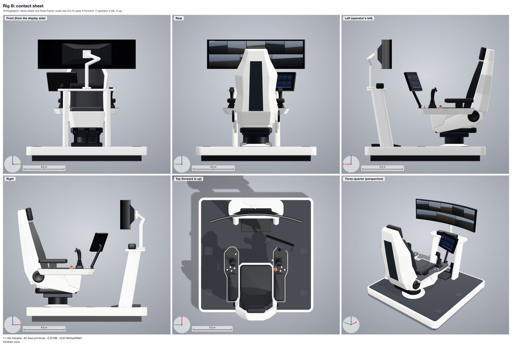
*The complete blockout, both pods and both joysticks included. Footer: 11,162 triangles, 62 draw primitives, 0.33 MB, omitted: none.*

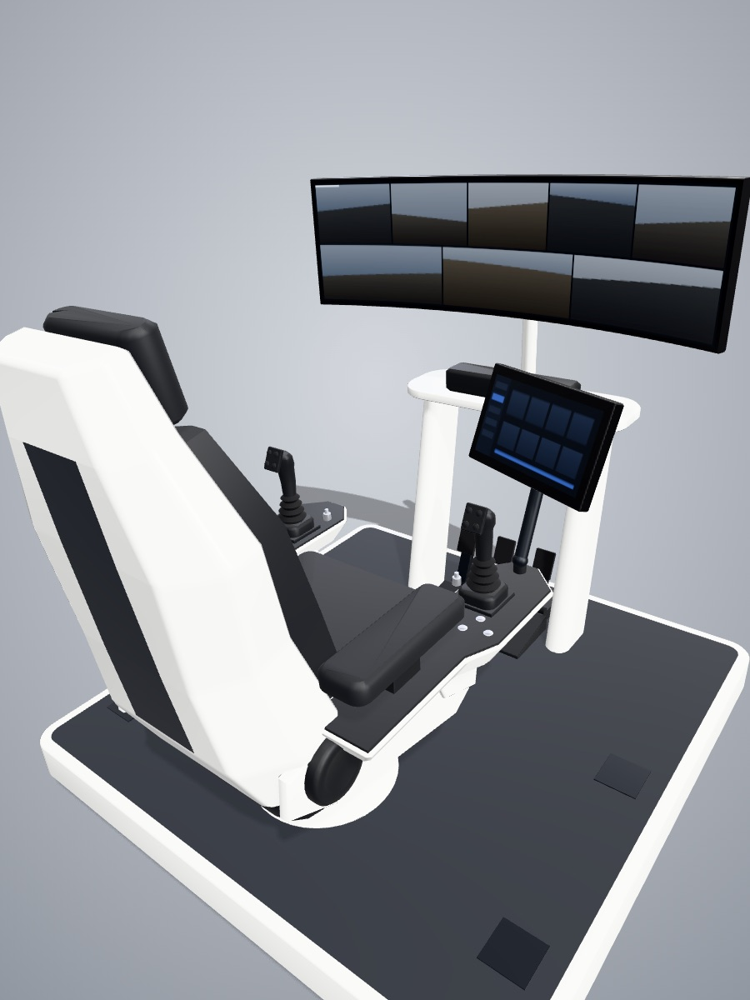
*The blockout seen through the solved camera of photo 2530 (rear right). Comparing this with the photo is how placement was judged.*

## Round 1, per group

Three modellers worked in parallel from 18:05, each in its own workspace and owning its own files
([P-10](../60-lessons/patterns.md#p-10)). Iterations are build-render-compare cycles as the
modellers logged them; durations are wall clock from the timeline and the agent harness.

| Group | Modeller's time | Iterations logged | Main work | Triangles | Primitives |
|---|---|---|---|---|---|
| Platform, stand, pedals | 27 min (18:05–18:32) | stand 2, platform 1, pedals 2 | rewrite of the three groups; column depth re-measured (0.22 at the foot, 0.245 at the head); heel-plate slot; brighter test image on the main screen | 11,104 (3,492 + 4,376 + 3,236) | 26 |
| Pods (armrests, joysticks, controls, touchscreen) | 36 min (18:05–18:41) | grip 4, bellows 3, shell 3, touchscreen arm 3, touchscreen pose 2, pad 2, E-stop 1 | pod frame pitched with the plate; shell as rim band, keel, leg and blade; both grips with their own button sets | 14,274 | 31 |
| Seat | 41 min (18:05–18:46) | back shell and dark panel 7, lower shell and hubs 5, cushions 4 | faceted back shell cage; lower shell, tray, cheeks, hubs; cushions | 5,364 | 11 |

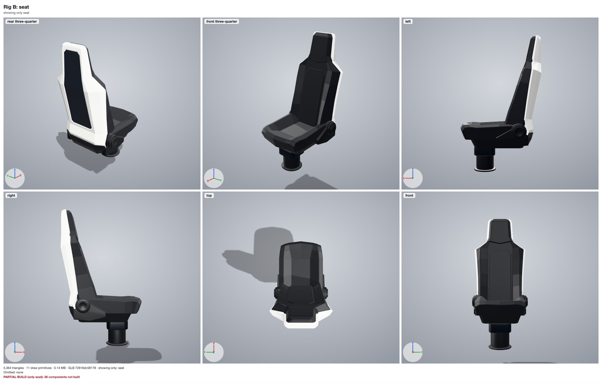
*Seat, round 1. The shell outline is right; the cushion and backrest are flat facets with hard creases. This is what the reviewer rejected.*

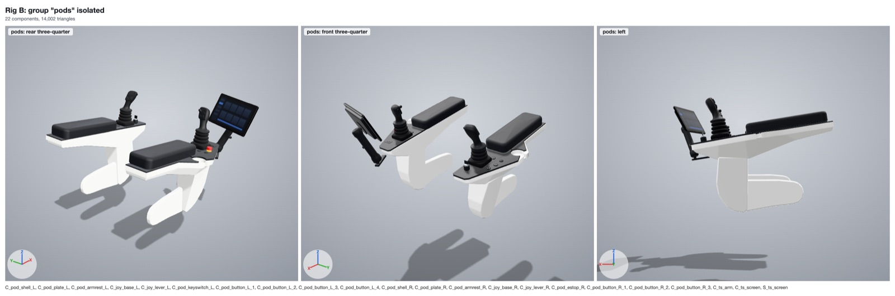
*Pods, round 1. Plates, controls and grips are recognisable; each leg and blade is a slab with a rounded capsule attached.*

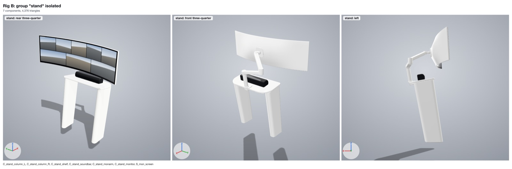
*Stand, round 1. Columns, shelf and monitor are right; the monitor arm is one rigid piece.*

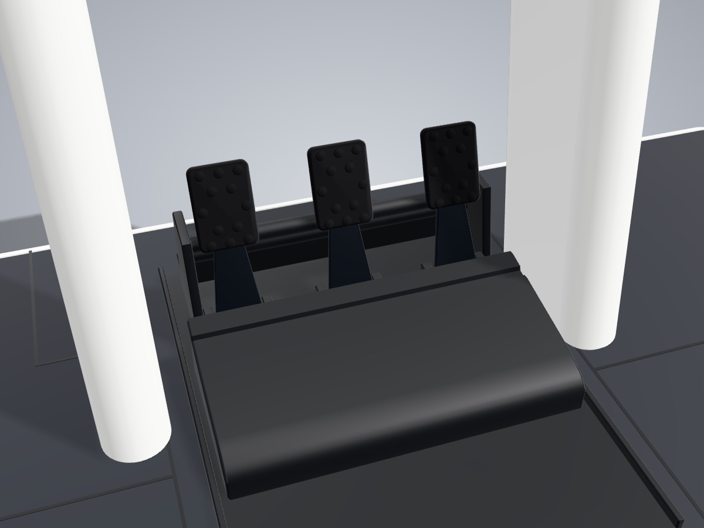
*Pedals, round 1. Recognisable, but an upper cross bar sits inside the pedals' travel.*

## Round 1 assembled

The coordinator assembled the three groups at 18:46: **30,742 triangles, 68 draw primitives,
0.77 MB**, build 0.20 s, all printed checks passing (*tested*). By group: pods 14,274, seat 5,364,
stand 4,376, platform 3,492, pedals 3,236.

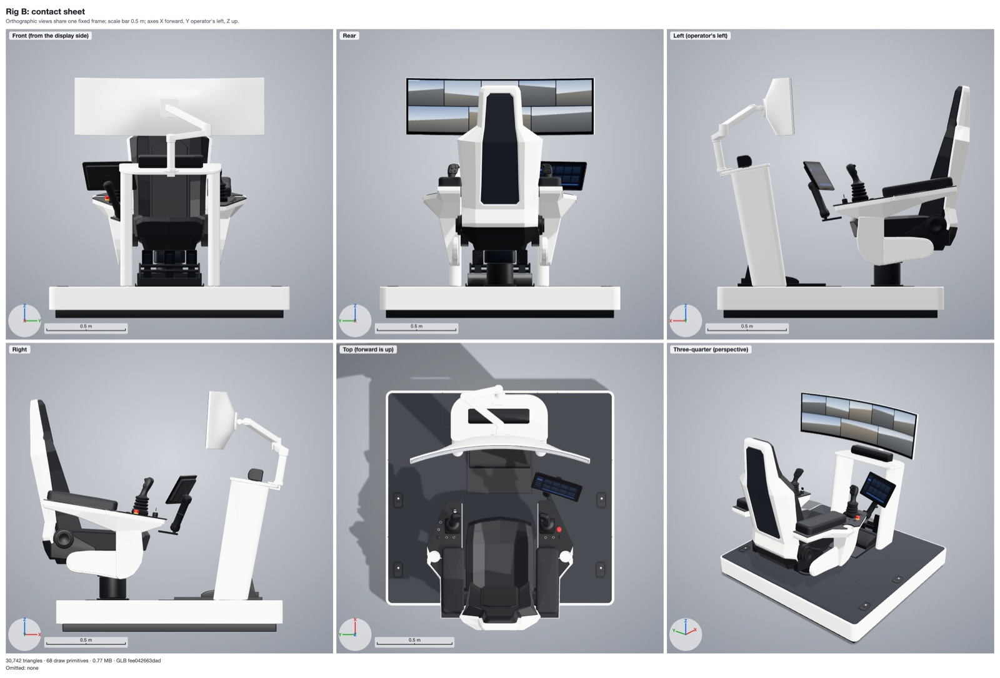
*The assembled round-1 model. Every check passed; the reviewer still rejected eight components, which is the point of having a reviewer ([L-24](../60-lessons/lessons-learned.md#l-24)).*

## The round-1 verdict

A fresh reviewer agent, which made its own renders (about 150) and read the model with its own
geometry code and did not read the builders' notes, judged the model in 26.8 minutes
([P-15](../60-lessons/patterns.md#p-15)). Verdict, in its words: **"In between: a credible layout
carrying a few toy-grade parts. Not accepted yet."** Layout and proportions fitted the three Rig B
photos within a few centimetres.

Counts over 45 components with geometry: **28 accepted, 9 accepted with minor fixes, 8 rejected**.
Rejected: the seat pan, the back cushion, both pod shells, both joystick bases, the monitor arm and
the pedal base.

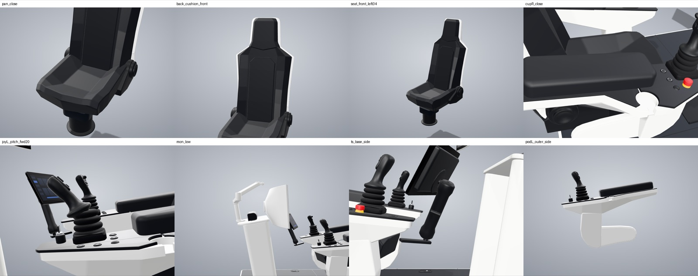
*The parts behind the main round-1 findings, rendered by the reviewer: faceted seat pan (S1), flat-planed backrest (S2), joystick boot tearing at 20° (J1), monitor hanging below its arm at the low limit (J2), touchscreen arm like a baton (P5), slab-and-capsule pod leg (P1).*

| Finding | Part | Severity | What was wrong |
|---|---|---|---|
| S1 | Seat pan | blocker | a faceted polyhedron (686 triangles), side crests 65–75 mm above the centre; the photo shows a smooth cushion with mild bolsters |
| S2 | Back cushion, headrest | major | the right layout, but every face a flat plane: "reads as folded card" |
| P1 | Pod shells | major | leg a plain slab, blade an inflated capsule, butt-jointed with a visible seam |
| J1 | Joystick bases | major | the boot was rigid, so the lever tore out of it at ±20° |
| J2 | Monitor arm | major | one rigid mesh: at the low end of its height range the monitor hung 0.24 m below the arm |
| J3 | Pedal base | major | at 20° the pedal arm passed through the upper cross bar |
| R1 | Rendering | major | lit whites at 244–249 of 255 against 150–160 in the photos; form invisible |
| U1 | Eye point | major | 0.835 m above the seat reference and behind it: a tall man's eye, not a median one |
| U2 | The owner's three figures | major (a decision) | all three overruled by photo estimates; a tape must settle them |
| S3–S5, P2–P6, T1–T3, R2–R4 | various | minor | shell edges too crisp; armrest pads inside the back shell; pleats too few; E-stop head small; pad too puffy; screen plate a visible 16-gon; platform band too tall; soundbar sunk 8 mm; monitor rim heavy; black plastic white at grazing angles; glare on the touchscreen; all blacks alike |
| E1–E5 | economy | — | triangles on small hidden parts (one ring button 308, more than the head pad's 188; four deck handles 1,888, more than the whole seat upholstery 1,386) |

The incidents are recorded as [F-18](../60-lessons/failures-and-fixes.md#f-18) (toy-grade parts),
[F-19](../60-lessons/failures-and-fixes.md#f-19) (parts failing when moved),
[F-20](../60-lessons/failures-and-fixes.md#f-20) (exposure),
[F-21](../60-lessons/failures-and-fixes.md#f-21) (eye point) and
[F-22](../60-lessons/failures-and-fixes.md#f-22) (triangle distribution). The reviewer also said
what to remove: about 6,500 triangles from hidden detail, to be spent on upholstery
([L-28](../60-lessons/lessons-learned.md#l-28)).

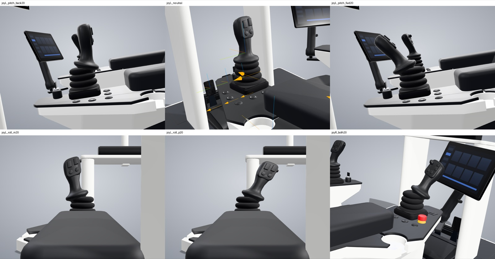
*Round 1, joystick at ±20° in both axes: the collar cuts into the top pleat on one side and lifts off it on the other (finding J1).*

## Round 2: what changed, finding by finding

The same three modellers were resumed with the findings for their group
([L-36](../60-lessons/lessons-learned.md#l-36)); the materials went to the structure modeller and the
exposure to the viewer's implementer. Round 2 took 13.2, 14.2 and 14.5 minutes (19:15–19:30).

| Finding | What the modeller did | Status at the round-2 review |
|---|---|---|
| S1 | seat cushion rebuilt as a smooth loft with a rolled front lip and mild bolsters (35 mm), 2,606 triangles; 4 iterations | closed |
| S2 | back cushion and head pad rebuilt as smooth lofts with a soft recessed insert; 2 iterations | closed |
| S3 | shell and lower shell lofted with rounded edges and top corners | closed |
| S4 | armrest pads moved 9 mm outward, now 16 mm clear of the back shell | closed |
| S5 | lower shell wraps round the hub region | partly (pan sides ahead of it still a black block; hidden by the pods) |
| P1 | pod leg and blade rebuilt as one faceted cage with the tray underside: tapering, creased leg, flat blade; 2 looks | closed |
| J1 | boot split: fixed lower pleats with a taut sleeve, upper pleats ride with the lever; pivot lowered from 45 to 12 mm above the plate; 3 looks and an 8-pose montage | closed |
| J2 | arm split into a base and sliding links that follow the height joint; range now −0.095…+0.060 m | closed |
| J3 | pedal rails moved clear of the full-travel sweep | closed |
| U1 | three eye points (small, median, large) derived from the live seat reference; median 0.770 above and 0.037 ahead of it | closed |
| U2 | nothing to model: the parameter notes record the conflict | open (needs a tape) |
| P2–P6 | six thinner pleats; E-stop head 37 mm; flat-topped pad; two-socket touchscreen arm with visible balls; 24-sided plate | closed |
| T1, T3 | platform band 0.105 m (re-measured through the cameras); monitor rim 1.5 mm | closed |
| T2 | soundbar re-seated | partly (24 of 118 vertices of its feet still up to 8 mm inside the shelf; not visible) |
| R1 | viewer exposure and tone curve retuned by the interface implementer (see [Viewer](viewer.md#the-exposure-correction)) | closed |
| R2, R3 | matte plastics (roughness 0.5 → 0.82), anti-glare screens (0.15 → 0.6) | closed |
| R4 | leather lighter and satin; plastic and rubber darker | partly (leather distinct; plastic, rubber and deck now too dark: new finding N3) |
| E1–E5 | joystick bases 2,012 → 924 each; monitor arm 1,936 → 844; handles 472 → 136; hub covers 880 → 336; pedals 828 → 532 | closed |

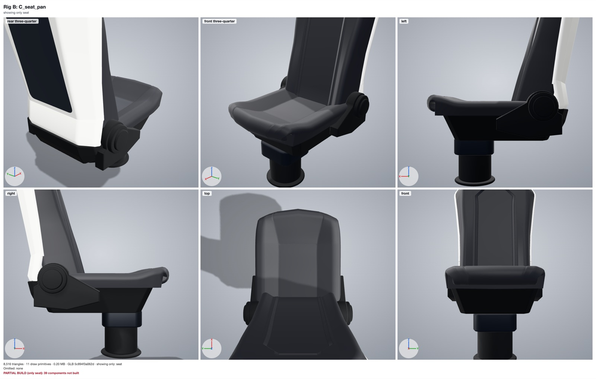
*Seat, round 2: a smooth lofted cushion with a rolled lip and mild bolsters, in the same views as round 1 (partial build of the seat group only).*

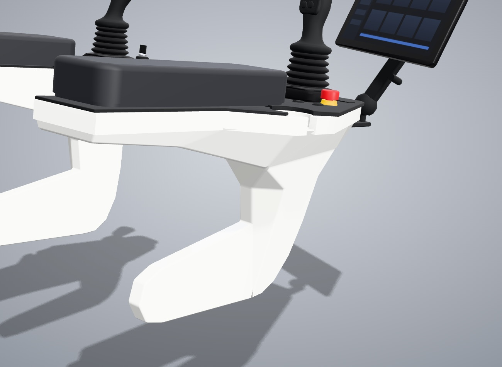
*Pods, round 2: leg and blade as one faceted moulding, with a crease and a taper.*

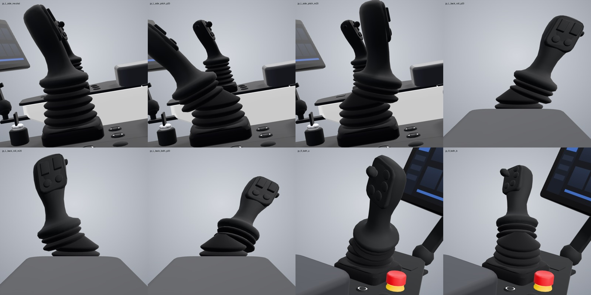
*Joysticks, round 2: the upper pleats ride with the lever, so the boot flexes mid-height instead of tearing.*

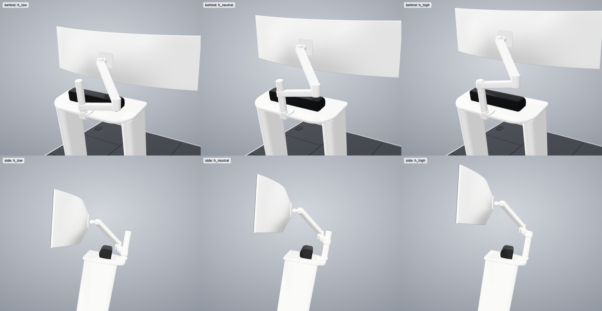
*Monitor arm, round 2, at its low, neutral and high positions: the links follow the monitor.*

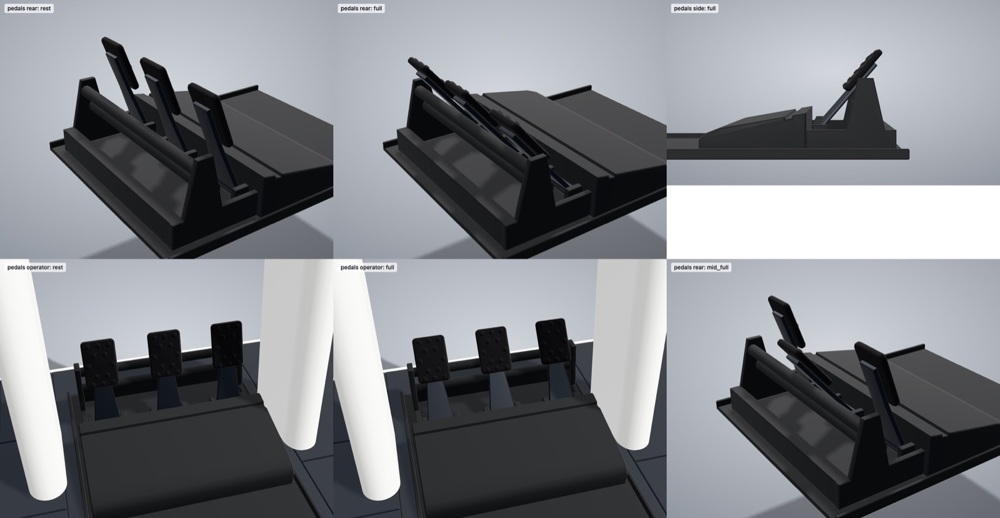
*Pedals, round 2, at rest and at full travel: the frame is clear of the sweep.*

## Round 2 assembled

Assembled at 19:30: **28,042 triangles, 67 draw primitives, 0.72 MB (719,220 bytes), 89 nodes**,
303 parameter records; all checks pass. More shape quality with fewer triangles, because hidden detail
was removed and the triangles went to the body-contact surfaces
([L-18](../60-lessons/lessons-learned.md#l-18)).

| Group | Round 1 triangles | Round 2 triangles |
|---|---|---|
| Pods | 14,274 | 11,598 |
| Seat | 5,364 | 8,516 |
| Stand | 4,376 | 3,428 |
| Pedals | 3,236 | 2,348 |
| Platform | 3,492 | 2,152 |
| **All** | **30,742** | **28,042** |

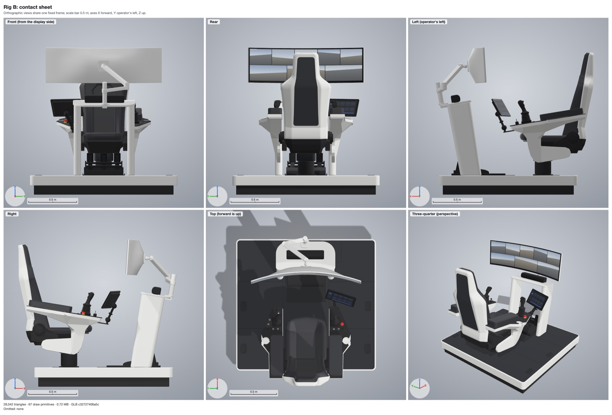
*The assembled round-2 model, build `c32727406a5c`: 28,042 triangles, 67 draw primitives, 0.72 MB.*

## The round-2 verdict

Another fresh reviewer (18.4 minutes, about 190 renders, 34 photo side-by-sides, its own penetration
and dimension scripts, the glTF validator) judged build `c32727406a5c`. Verdict: **"ACCEPTED AFTER
THE LISTED FIXES. Three fixes, each small; no second full review is needed, a spot check of the
three places is enough."** In its words, "the model is no longer a toy in any view"; every joint
can be taken to both limits without anything tearing, detaching or passing through a neighbour.

Counts over 46 components with geometry: **41 accepted, 5 accepted with minor fixes (seat pan, both
pod shells, both columns), 0 rejected**. Round-1 findings: 24 closed, 3 partly, 1 open (U2).

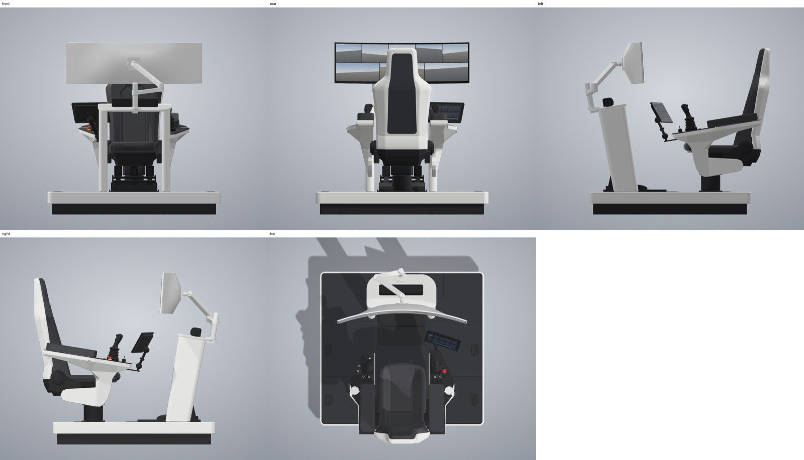
*The round-2 reviewer's orthographic views of the whole rig.*

| New finding | Part | Severity | What | Required |
|---|---|---|---|---|
| N1 | Pod shells, cup recess | major (small) | a white spike above the plate at the notch, a slot cut through the tray wall, a loose flap: "reads as a broken bracket" | fix 1 |
| N2 | Stand columns | minor | the operator-side face is a half-round nose; the photos show a flat face with tight corners | fix 2 |
| N3 | Black rubber and plastic | minor | joysticks, bellows and pedals near-black from the operator's eye (bellows 37–45 of 255 against 19–103 in the photo) | fix 3 |
| N4 | Pod blade end, tray tail | minor | blade end cut in three flats; tray tail too thick | when convenient |
| N5 | Joint limits | minor | limits written rounded to six decimals, so a pose at the stated limit (for example 15°) is refused | fixed with round 3 |
| N6 | Seat pan lip ends | minor | a small pinch at each end of the front lip | known deviation |
| N7 | Viewer shadows | minor | a hard shadow edge across the cushion reads as a facet | when convenient |
| N8 | Pedal face frames | minor | the push-direction convention is not in the labels | documentation |

The reviewer's numbers for the main human dimensions of the round-2 model (cushion height, armrest
height, grip points, eye points, screen distance) are on the
[measurement results](measurement-results.md#the-owners-three-figures) page and will be on the model
card.

## Round 3: the final fixes

The round-2 reviewer accepted the model on condition of three small fixes and said a spot check of
those places would be enough, with no third full review. Two modellers were about to apply them
when the agents' model hit its usage limit and seven agents stopped mid-task
([F-30](../60-lessons/failures-and-fixes.md#f-30)). The coordinator confirmed the model on disk was
byte-identical to the reviewed build (same SHA-256), and one fresh agent on another model applied
all four changes in 17 minutes.

| Item | Component | Change | Result |
|---|---|---|---|
| Fix 1 (N1) | both pod shells | the 10–15 mm white spike at the cup notch removed (rear plate meets control plate in one seam); the slot through the tray wall replaced by a shallow spout that stops 11 mm below the rim (new parameter `cup_spout_depth`); the loose flap removed (a non-planar cage face split into two triangles) | +10 triangles per pod |
| Fix 2 (N2) | both stand columns | section now D-shaped: flat operator-side face with 12 mm corners; far end stays half-round because the rear-right photo shows it rounded (new parameter `column_face_corner_radius`); width, depth, lean and taper unchanged | 340 → 344 triangles per column |
| Fix 3 (N3) | shared materials | `rubber_black` #0c0c0d roughness 0.97 → #1c1c1e roughness 0.62; `plastic_black` #141516 roughness 0.82 → #1e1f21 roughness 0.64; still black, no white-out at grazing angles, leather stays the lightest black | grip buttons, bellows pleats and pedal pads now visible from the operator's eye |
| N5 | joint limits | limit tolerance in the shared pose function raised from 1e-9 to 1e-6, so a pose exactly at a stated limit is accepted; limits stay rounded in the description file because the viewer's sliders stop on those values; the independent reader needed no change | 15° accepted, 15.001° refused |

Final build: **28,070 triangles, 67 draw primitives, 719,872 bytes, SHA-256 `0b6d8248b63f…`**,
305 parameter records. `bun run check` passed (0 failures, 1 warning about unused parameters) and
the viewer's acceptance script passed (53 checks, one of which is a comparison that is skipped
when no baseline server is given). Not done: the reviewer's optional lighter heel plate (it would
need a third black material).

**Coordinator's spot check** (as the reviewer prescribed): the before/after renders of the cup
recess from the reviewer's own viewpoint and the operator's-eye view were inspected; the spike,
slot and flap are gone, the columns read as flat-faced posts, and the grip buttons, pleats and
pedal pads are visible. Accepted.

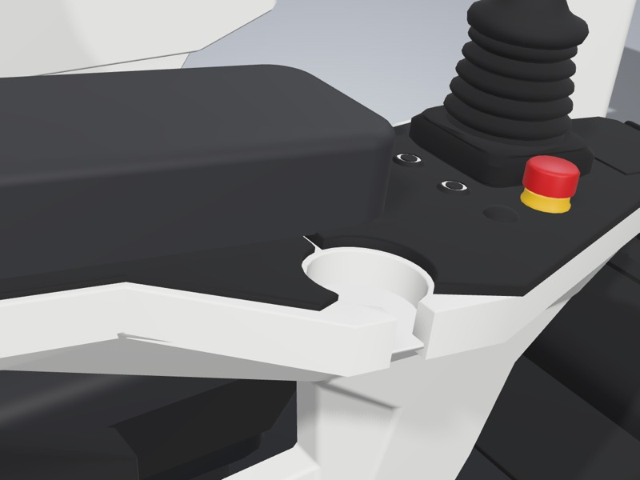

*Right pod cup recess before round 3: white spike at the notch tip, slot through the tray wall, loose flap.*

*The same view after round 3: shallow spout, no spike, no flap.*

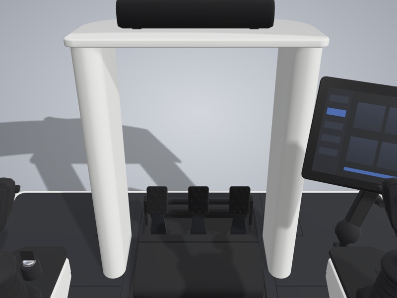

*Stand columns before round 3: half-round operator-side face that reads as a pipe.*

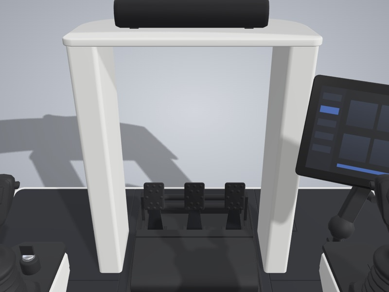

*After round 3: flat operator-side face with 12 mm corners, as in the operator's-eye photo.*

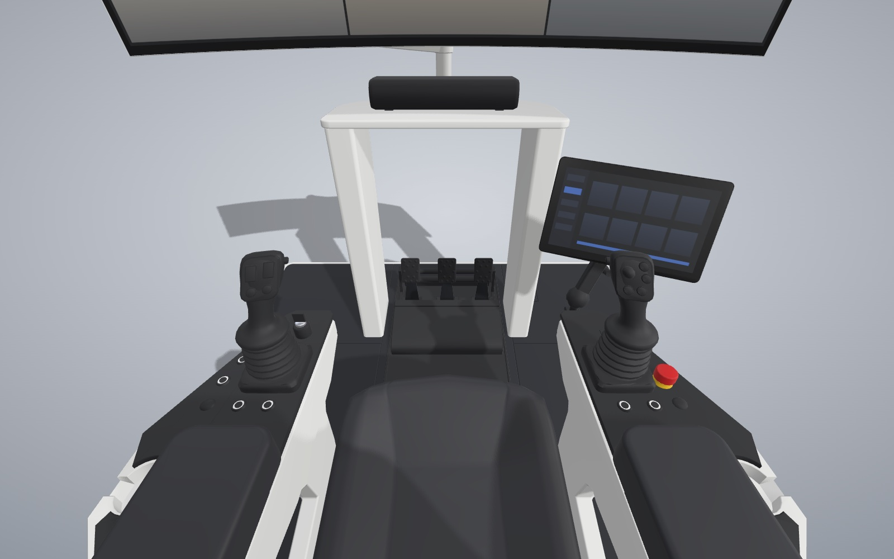

*The final model from the provisional median eye point: stand, shelf, soundbar, three pedals, both
joysticks with visible buttons, touchscreen and emergency stop, as in the operator's-eye photo.*

The model was then verified by hand in the browser (see
[goal assessment](../70-results/goal-assessment.md)).
The work below is as recorded by the round-3 agent in the timeline (20:34–20:51 UTC) and in the
coordinator's notes; the coordinator confirms the final state when the asset is published.

One agent, started after the usage-limit interruption on another model, applied the three required
fixes and the limit bug; each logged step has the agent's own duration (agent-written, see
[F-28](../60-lessons/failures-and-fixes.md#f-28)).

| Fix | What was done | Iterations | Agent's time |
|---|---|---|---|
| Fix 1: cup recess (N1) | on both pods: the plate seam closed at the tip of the notch, so no white spike; the through-slot replaced by a shallow spout (a ramp from the cup floor to a lip 11 mm below the rim top, lower two thirds of the wall whole); the loose flap removed (a non-planar face split in two) | 3 | 6.5 min |
| Fix 2: columns (N2) | D-shaped section: a flat face toward the operator with 12 mm corner radii, the far end kept half-round (photo 2530 shows a round far end); width, depth, lean and taper unchanged; 340 → 344 triangles per column | 1 | 2 min |
| Fix 3: dark materials (N3) | rubber #0c0c0d at roughness 0.97 → #1c1c1e at 0.62; matte plastic #141516 at 0.82 → #1e1f21 at 0.64; three variants judged from the operator's eye, on joystick close-ups, pedals, a grazing view and the whole rig | 3 variants | 2.5 min |
| N5: joint limits | the pose function's tolerance at a limit widened from 1e-9 to 1e-6, so a pose exactly at a stated limit (for example `J_mon_tilt` ±15°) works; 15.001° is still refused; pose conformance check passes | — | 2 min |

Result (*tested* by the round-3 agent): **28,070 triangles, 67 draw primitives, 719,872 bytes**,
build `0b6d8248b63f`; `bun run check` 0 failures (1 standing warning); viewer acceptance 53/53. The
round-2 reviewer had said a spot check of the three places was enough; the coordinator inspected the
before/after renders of the cup recess and the operator's view and accepted them. No third full
review was run.

 
*Fix 1, right pod, same camera. Left: round 2, with the white spike at the notch tip and the slot through the tray wall. Right: round 3, seam closed and a shallow spout.*

 
*Fix 2, the columns from the operator's eye. Left: round 2, half-round noses that read as pipes. Right: round 3, flat faces with tight corners.*

## What the rounds show

| Observation | Evidence | Lesson or pattern |
|---|---|---|
| Passing every check does not make a model credible | round 1 passed all checks and was rejected | [L-24](../60-lessons/lessons-learned.md#l-24) |
| A matching outline says nothing about surface quality | round 1's outlines fitted within centimetres; its cushion was faceted | [L-17](../60-lessons/lessons-learned.md#l-17) |
| Parts must be moved to both limits to be judged | J1–J3 appeared only in posed renders | [L-19](../60-lessons/lessons-learned.md#l-19) |
| Blockout first keeps structure stable | no round broke the tree, joints or frames | [L-16](../60-lessons/lessons-learned.md#l-16), [P-09](../60-lessons/patterns.md#p-09) |
| Fresh reviewers, same builders | round 2 took 35–50 % of round 1's time per modeller (13–15 against 27–41 min) | [L-36](../60-lessons/lessons-learned.md#l-36) |
| Ask what to remove | triangles fell 9 % while quality rose | [L-28](../60-lessons/lessons-learned.md#l-28) |
