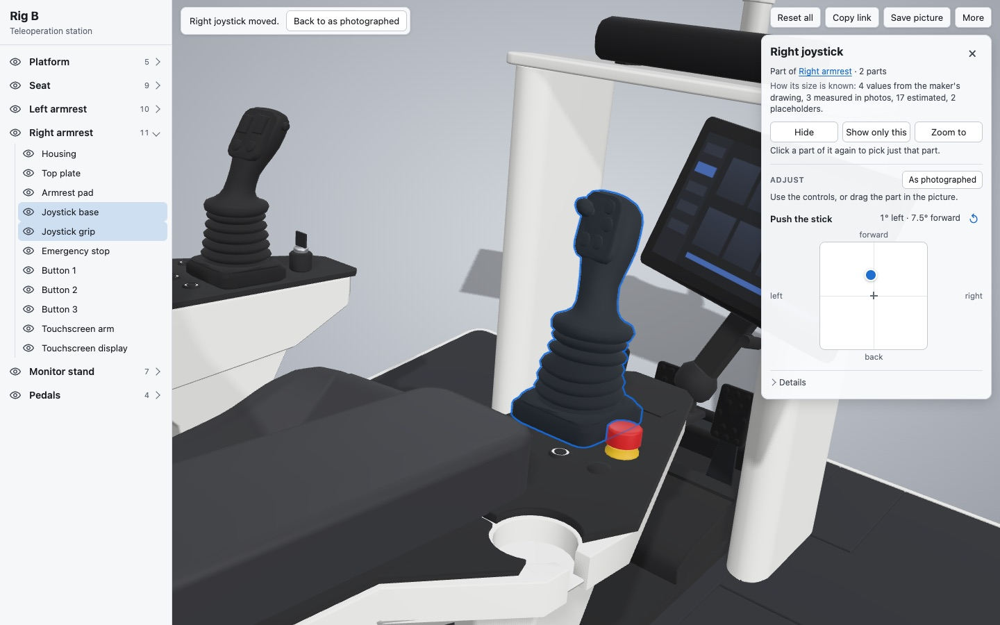
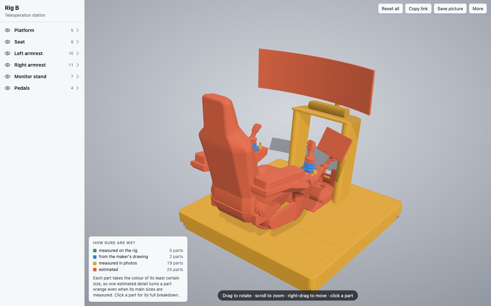
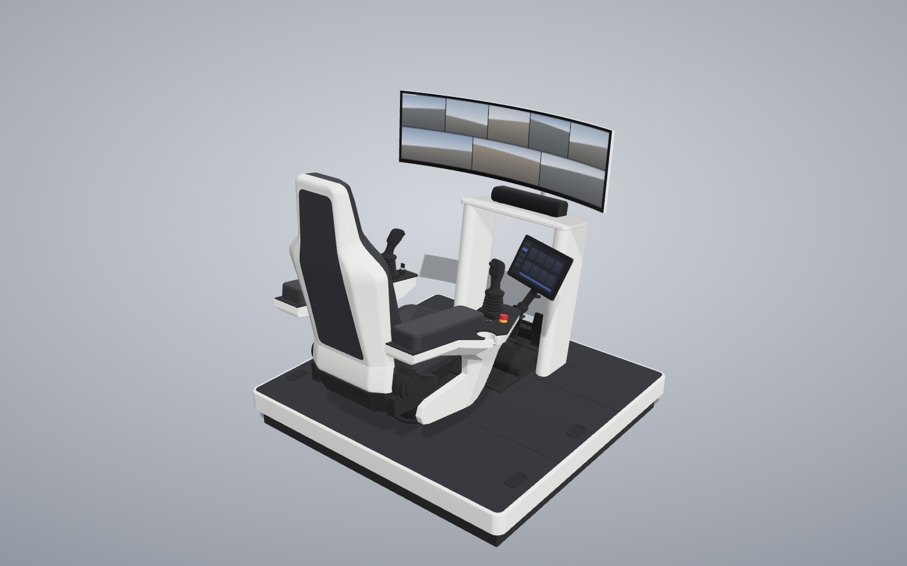

# The viewer

## TL;DR

- One static web page loads the model file and its description file. A person can turn, zoom and pan, hide or show any part or group, click a part to get a **card** with only that part's adjustments, drag the selected part, look from the operator's eye, colour parts by how sure we are of their sizes, copy a link to the exact view, and save a picture.
- The **first version** was rejected by the owner as overcomplicated. Two independent reviews measured it: 103 controls, the model 58 % of a 1440 × 900 window, 24 sliders in one list, two traps that hid the wrong thing, 35–40 wheel notches to zoom to a joystick, no reset and no link.
- A **separate implementer**, working in a copy so the agents' renders were not disturbed, rebuilt the page: **16 controls, model 82.8 % of the window, 53 of 53 acceptance checks passed** (*tested*; one of the 53 was skipped, see below).
- Assumed adjustments (the seat) are **usable**, tagged "assumed range", with an amber notice on the picture while one is in use; the description file still records them as assumed. Lit whites came down from 244–249 to 221–231 of 255.
- The viewer is **TypeScript**, bundled by Bun, and shares one pose function with the generator. Agents drive it by URL parameters; that interface did not change in the redesign.
- **Platform step 1** ([below](#the-shared-scene-platform-step-1)): when the page's server has the rigtwin server, the page joins one shared scene. Every pose change (slider, pad, drag, keys, Reset all) is saved as one command; changes by others, including Claude Code, appear at once with an **activity line** and its **Undo**; More shows the page's **session code** and a statement about the sandbox. Without a server nothing changes and no request is made. The page loads one script of 733 kB and is ready in about 210 ms (*measured* 2026-11-24).

Commands and every URL parameter are in the [tool reference](../80-reference/tools.md#the-viewers-url-interface).
Decisions: [D-13](../20-decisions/decision-log.md#d-13), [D-29](../20-decisions/decision-log.md#d-29),
[D-30](../20-decisions/decision-log.md#d-30), [D-31](../20-decisions/decision-log.md#d-31).
Requirements: [R-36](../10-request/requirements.md), [R-51](../10-request/requirements.md),
[R-52](../10-request/requirements.md), [R-67](../10-request/requirements.md) to
[R-69](../10-request/requirements.md).

## What the viewer does

| Function | How | Known by |
|---|---|---|
| Turn, zoom, pan | drag, wheel (zooms toward the pointer), right-drag; double-click a part to zoom to it | acceptance checks T19, T22 |
| Show and hide | an eye button per group (six rows) and per part; on a selected part: Hide, Show only this; keys H, I, A; "Show all" appears whenever something is hidden | T12–T16, T18 |
| Adjust one part | its card shows only its own adjustments: a slider for one motion, a two-way pad for two rotations; "As photographed" undoes them | T24–T28 |
| Drag the selected part | dragging it moves its main adjustment (monitor height, seat slide, armrest pad, joystick); dragging anything else still turns the view | T38–T42 |
| Assumed adjustments | usable, tagged "assumed range", amber notice on the picture with "Back to as photographed" | T31–T37 |
| How sure are we? | colours each part by its least certain size class, with a plain legend and counts | T29 |
| Operator's eye | camera on the median eye point; drag to look around in place | T23 |
| Copy link, Save picture, Reset all | the address always holds the view, hidden parts, selection and adjustments; the picture is the 3D view without panels | T27, T30 |
| Narrow windows | at phone width the parts list becomes a drawer and the card a bottom sheet | T52 |
| Agents | the same page, driven headless, makes every render the agents and reviewers judge ([P-11](../60-lessons/patterns.md#p-11), [L-30](../60-lessons/lessons-learned.md#l-30)) | all render sets |

Size and speed (*measured* by the acceptance script on the local server, one Apple M2; round 2):
ready 198 ms after navigation; 1.69 MB in 7 requests, of which the viewer script is 726 kB
(2026-11-24, with the live client: ready 210 ms; 1.70 MB in 9 requests; one script of 733 kB);
61 fps while something changes every frame at 1440 × 900; an idle page draws no frames.

*The redesigned viewer as it opens (1440 × 900, round-2 model): six rows, four buttons, a hint line that disappears after the first drag.*

## The first version, and why the owner rejected it

The infrastructure agent built the first viewer between 17:15 and 18:01 UTC, as its build brief asked:
a working inspection page with a parts list, view buttons and one slider per joint. It worked
(page ready in about 0.1 s, steady 60 fps). The owner's verdict during the build: "it is
overcomplicated and takes a lot of time", with the request to simplify above all the controls for a
single component ([R-68](../10-request/requirements.md)); and, separately, "why cant i adjust the
seat? the lock is confusing for users unless there is a way to unlock"
([R-69](../10-request/requirements.md)).

*The first viewer, on the blockout: 54 rows of checkboxes on the left, view buttons and 24 sliders on the right.*

*The first viewer after a click on the monitor: it selects "Main monitor active area" (the picture surface only) and opens a data sheet of parameter records.*

What the two reviews measured (*measured* with real pointer input in headless Chromium; review A
counted every control, review B walked through twelve tasks):

| Problem | Number or behaviour | Source |
|---|---|---|
| Controls on screen at once | **103** (157 pointer targets counting clickable rows); review B, counting differently, 75 controls and 403 words | review A, review B |
| Share of the window for the model | **58 %** at 1440 × 900; 41 % at 1024 × 768 (49–53 % at other sizes in review A); 0 % on a phone | both |
| Adjustments | **24 sliders** (6 disabled) for 20 joints in **one global list** under "Joints", ordered by the internal tree; the monitor's three were entries 14–16, below the fold at every tested size | both |
| Parts list | 54 rows of equal weight, 1,281 px tall in a box of 622–822 px; the monitor was row 52 | review A |
| Screen-click trap | a click on the monitor selected only its picture surface; unticking that row left a black monitor | review A |
| Isolate trap | "Isolate" on the seat showed 1 of 48 parts: a lone back shell floating in space | review B |
| Zoom | **35–40 wheel notches** to make a joystick fill a third of the view, zooming toward the middle of the rig, not the pointer | review B |
| No way back | no reset for adjustments ("Reset view" left a moved monitor where it was); undo was a hidden double-click per slider | both |
| No way to share | **no link, no picture** | review B |
| Seat | five sliders greyed out with a padlock that did nothing and explained nothing | both |
| Small targets, jargon | 13 × 13 px checkboxes; node IDs, triangle counts, parameter keys and words like "Isolate", "Orthographic", "By data source" on screen | review A |
| Idle cost | redrew 60 times a second with nothing changing (7–8 % of the main thread) | review A |

Recorded as [F-24](../60-lessons/failures-and-fixes.md#f-24) and
[F-25](../60-lessons/failures-and-fixes.md#f-25); lessons
[L-38](../60-lessons/lessons-learned.md#l-38) to [L-41](../60-lessons/lessons-learned.md#l-41).

## Two independent reviews and a separate implementer

| Step | Who | Time | Output |
|---|---|---|---|
| Review A: interaction design | a fresh agent | 15.0 min | inventory of every control, heuristic evaluation, seven alternatives for adjusting one component, a proposed design with 19 controls, 32 acceptance tests |
| Review B: first-time-user walkthrough | another fresh agent, independent of A | 16.6 min | 12 tasks × 2 window sizes with real pointer input, 135 screenshots, a language audit, a proposed screen, an acceptance checklist |
| Implementation | a third agent, working in a **copy** of the viewer folder | 61.9 min | the redesigned page; `tools/ui-accept.ts` with 53 checks taken from both reviews' checklists; the exposure correction |
| Swap | the coordinator | — | ran the acceptance script (53/53), checked the page by hand, replaced the viewer |

The two reviews used different methods and agreed on what mattered: put a part's controls on the
part, give the model the window, remove the lock, add a way back and a way to share
([P-16](../60-lessons/patterns.md#p-16)). The implementer worked in a copy because three modellers
and a reviewer were rendering with the old viewer at the same time
([L-42](../60-lessons/lessons-learned.md#l-42)).

## The redesign

*The monitor selected and adjusted: its card holds Hide, Show only this, Zoom to, one height slider and one two-way pad for turn and tilt. The strip at the top says what has moved and offers the way back.*

| | First version | Redesign | Check |
|---|---|---|---|
| Controls visible by default (1440 × 900) | 103 | **16** | T01 (limit ≤ 20) |
| Words on screen by default | 396 | 41 | T02 |
| Sliders; disabled controls; padlocks, by default | 24; 7 (6 sliders and the Isolate button); one per locked joint (6) | 0; 0; 0 | T04 |
| Pointer targets under 24 × 24 px | 65 | 0 | T08 |
| Model's share of the window | 58 % / 41 % / 0 % | **82.8 %** / 78.1 % / 100 % at 1440 / 1024 / 390 px wide | T05 |
| Hide the monitor | scroll and find row 52, or a trap | click it, Hide: 2 actions | T12 |
| Show only the seat | 4–6 actions, left one mesh | 2 actions, all 9 seat parts | T16 |
| Lower and tilt the monitor | scroll a global list, 2 drags far from the model | click, drag Height, drag the pad: 3 actions | T25 |
| Zoom to the right joystick | 35–40 notches plus a right-drag | 6 notches with the pointer on it (12 % → 35 % of the view height) | T22 |
| Slide the seat back 5 cm, recline to 20° | impossible | 3 actions | T31 |
| Everything back to the start | about 10 actions, inexact | Reset all: 1 click | T27 |
| Share the view | impossible | Copy link: reopens within 0.06 cm and 0.01° | T30 |
| Idle page | 120 frames per 2 s, 7–8 % busy | 0 frames, 0.08 % busy | T44 |

The main design choices:

1. **A card for the selected part.** Name, what it is part of, how its sizes are known, Hide,
   Show only this, Zoom to, its own adjustments, "As photographed", and a Details fold for the
   parameter records. A click on a screen selects the monitor or touchscreen, never only its
   picture surface (T15).
2. **One two-axis pad** where a part has two rotations (monitor turn and tilt, joystick sideways and
   forward). Review A proposed three sliders for the monitor; the owner asked for an alternative to
   separate sliders, so it became one slider for height plus one pad (T24).
3. **Drag the selected part** to move its main adjustment, within its limits (T38–T41). Dragging an
   unselected part or empty space still turns the view (T42).
4. **Assumed adjustments usable, with a notice instead of a lock** ([D-31](../20-decisions/decision-log.md#d-31),
   [L-14](../60-lessons/lessons-learned.md#l-14), [P-22](../60-lessons/patterns.md#p-22)). The seat's five
   sliders each carry an "assumed range" tag; while any is away from the photographed value, an amber
   line stays on the picture, also in a saved picture. Scripts still see the joints as assumed and
   locked: they must say so explicitly (`pose=` from the address, or `setJoint` with `force`) (T37).
5. **Sharing and saving.** The address follows every change, so a copied link reproduces the view; Save
   picture writes the 3D view as a PNG, with the assumed-range sentence when it applies (T30, T30b).
6. **Plain words.** Parts are named "Left armrest", "Monitor stand"; jargon on screen by default: 0 (T03).
   Wireframe, orthographic projection, reference frames and ID colours have no control on the page;
   they remain URL parameters for agents.

*The seat slid 5 cm back and reclined to 20°: each slider is tagged "assumed range", the card explains why, and the amber notice on the picture offers "Back to as photographed".*

*The right joystick dragged in the picture: the pad in its card shows 1° left and 7.5° forward.*

*At 390 px wide the model takes the whole window; the parts list is a drawer and the card a bottom sheet.*

*"How sure are we?": 0 parts measured on the rig, 2 from the maker's drawing, 19 measured in photos, 25 estimated. A part takes the colour of its least certain size.*

**About "53 of 53".** In every recorded run, check T49 (machine-interface pictures compared with the
previous viewer) reports "skipped (no --baseline server given)" and counts as passed. The comparison
it stands for was made once by the implementer by hand: 14 sets of URL parameters gave pixel-identical
pictures with `look=previous`. So 52 checks ran and passed; the 53rd is a skip.

## The exposure correction

The round-1 reviewer measured lit white surfaces at 244–249 of 255 against 150–160 in the photos: the
white shell looked like flat paper, which "hides the form the builders did model" (finding R1,
[F-20](../60-lessons/failures-and-fixes.md#f-20), [L-23](../60-lessons/lessons-learned.md#l-23)).
The implementer retuned the lighting while redesigning the page:

| Setting | Before (`look=previous`) | After |
|---|---|---|
| Exposure | 1.0 | 0.78 |
| Environment light | 1.0 | 0.6 |
| Key light, fill light | 2.6, 0.5 | 2.0, 0.3; key moved further behind the operator |
| Tone curve | three.js "neutral" | own curve: straight up to 0.6, then a soft shoulder; nothing taken away near black, so leather, deck and matte plastic stay apart |

Result (*measured*, check T53, mean of R, G, B per material, 0–255): three-quarter view, lit white
223–231 (median 221), shaded white 164, 0 % clipped; rear view, lit white 201–225 (median 190),
shaded 125, 0 % clipped; leather 61–63, black plastic 33–44, deck 59–74. The round-2 reviewer, with its
own method, measured lit white at 190–200 (median), 95th percentile 227, no pixel at 250 or above.
The materials were retuned separately by the structure modeller (matte black plastic, lighter satin
leather, anti-glare screens).

*Before: the earlier lighting (`look=previous`). The white shell and columns are nearly uniform.*

*After: the same view with the new exposure and tone curve. Facets, bevels and roundness of the white parts show.*

## From JavaScript to TypeScript, with one pose function

The build brief asked for "plain ES modules, no build step", so the first viewer was JavaScript. The
owner asked "why is viewer.js a js and not ts" ([R-67](../10-request/requirements.md),
[F-23](../60-lessons/failures-and-fixes.md#f-23)). The infrastructure agent converted it during its own
run ([D-29](../20-decisions/decision-log.md#d-29)):

- The viewer is TypeScript in `viewer/src/` (`engine.ts`, `interact.ts`, `ui.ts`, `words.ts`,
  `main.ts`), bundled with three.js by Bun into one module. The local server and the render driver
  bundle in memory in about 0.1 s and re-bundle when a file changes; `bun run dist` writes the bundle.
- `shared/pose.ts` is **the** definition of how a joint value becomes a transform. The generator uses
  it to write the model file at the neutral pose; the viewer uses it to pose. The planning trials had
  three slightly different conventions in three codebases.
- `bun run check` type-checks generator, viewer and tools together
  ([C-01](../40-method/checks.md#c-01)) and compares the shared pose function with the independent
  Python reader on 96 poses ([C-13](../40-method/checks.md#c-13)): largest difference 2.4e-8.

## The shared scene (platform step 1)

Added on 2026-11-24 by platform step 1 ([the platform plan](../30-plan/platform-plan.md)). The code is
`viewer/src/live.ts` and `viewer/src/live-connection.ts`; it does not load the command layer, so the page
stays small.

**When it is on.** The page reads `version.json`; only if that names a server does it ask `api/health`,
and only if that answers with the scene format does it connect. Otherwise it stays a page on its own:
no request under `api/`, nothing in the console, everything as before. `bun run serve` and the
deployed site (once the server is set up) have a server; `bun run dist`'s folder opened on its own does not.

**One rule for every pose change.** Sliders, ↺, double-click, the pads, the arrow keys, "As
photographed", the notices, Reset all and dragging in the 3D view all end in the engine's own joint
setters. The page treats any difference between what it shows and the shared pose as a local preview,
and saves it as one `pose.set` (based on the version the preview started from) when no pointer is down
and nothing has changed for 300 ms. A change from the server for a joint this page is still changing
waits; the save is then refused as stale, the page shows the shared pose again and says why ("Not saved:
Claude Code · 0c24 — Monitor: height 8 cm lower came first. This page shows the shared scene again.").

**A link with other adjustments** (`pose=` that differs from the shared scene) opens as a preview with
**Apply** and **Dismiss**: nothing is saved until Apply.
`viewer.apply()` from a script is treated the same way.

**The activity line** appears only for changes made by someone else: "Claude Code · 3f2a — Monitor:
height 3 cm lower" with **Undo** (which undoes that entry for everyone, [D-40](../20-decisions/decision-log.md#d-40))
and ×. Authors are labels the server makes ([D-41](../20-decisions/decision-log.md#d-41)); the page knows
its own changes by the versions its requests recorded. The words are the same as in the cards and in
`bun run rig` (`shared/words.ts`).

**The session code** (eight letters and digits) is shown under More, "Shared scene", with "Give it to
Claude Code to show views here". View commands (`view.set`, `view.show`, `view.select`) reach only the
page with that code. Under it, "About this sandbox" says what is stored: only the pose of the rig and
its last 200 changes, each with a random author id, no names and no other text; anyone can change it,
Undo puts a change back, and the scene is reset on request.

**Reconnecting** follows the rules of Leitbild, the owner's other project ([D-39](../20-decisions/decision-log.md#d-39)):
after a drop, again after 1 s, then 2, 4, 8, 16 and at most 30 s; at once when the page becomes visible
or the network comes back; one resync after each reconnect, asking for the changes after the version it
has (`since=`) and keeping its session code. A stream that the deployed server ends after 512 kB
([D-46](../20-decisions/decision-log.md#d-46)) closes with an `end` event, and the page reconnects at
once instead of waiting: it gets only the missed changes, no full snapshot, and nothing shows on the
page (*tested* 2026-11-24 with the real page against a server with a 3 kB budget: two ends in 30
changes, the page never fell behind, no console message, no failed request).

**Tested** by `tools/live-accept.ts` (14 of 14, two real browsers and the command line on one local
server) and by the 53 acceptance checks, which start every page on an empty temporary scene so that no
pose of the shared scene reaches a test or a published picture ([checks](../40-method/checks.md)).

## The agent interface by URL

Agents do not click. They open the page with URL parameters, or call `window.viewer.apply({...})`
with the same keys, and read the state back. The main parameters: `view`, `camera`, `cam` (a solved
photo camera, local server only), `overlay`, `only`, `hide`, `fit`, `pose`, `mode` (`ids`, `class`),
`wire`, `frames`, `legend`, `hud`, `caption`, `ui=0`, `sel`, `look`. The full list with values is
in the [tool reference](../80-reference/tools.md#the-viewers-url-interface).

The redesign kept this interface: 14 sets of URL parameters gave pixel-identical pictures and equal
state with the previous viewer (with `look=previous`). One change was deliberate: `view=operator`
now puts the camera exactly on the median eye point, 6.8 cm further forward than before.

## Known rough edges

| Rough edge | Status |
|---|---|
| Frame rate and exposure were measured only in headless Chromium on one Apple M2, capped at 60 fps | not verified on other devices ([I-15](../60-lessons/ideas.md#i-15)) |
| Touch input was never driven in a test; narrow layouts were tested with mouse events | not verified |
| The operator's-eye view needs two clicks (More, then Operator's eye); review B asked for one | accepted deviation |
| Check T49 (comparison with the previous viewer) is skipped unless a second server is given | see above |
| A hard shadow edge from the seat back falls across the cushion and can be misread as a facet | round-2 finding N7, open |
| Photo views (`cam=`) work only on the local server, because the camera file stays private | by design |
| No measuring tool that shows a distance with its range | idea [I-21](../60-lessons/ideas.md#i-21) |
| Pressed or lit states of buttons, key switch and emergency stop are not modelled | provisional in the [asset contract](../40-method/asset-contract.md) |
| The page has been tested only against the local server; behaviour behind the production server is checked by the deployment step | see [deployment](deployment.md) |
| The shared scene has not yet run on mightwork.ai: the host is set up (2026-11-24), the first release with the server comes with the merge to `main`, and the ten-minute idle test and the two-browser test on the live site follow it | step 1's rollout, see [the server and its host setup](server-and-host-setup.md#order-of-the-first-rollout) |
| On the laptop (HTTP/1.1) a browser holds six live streams per host, so a seventh viewer tab waits; the public site uses HTTP/2 | by design |
| After a server restart or a dropped connection live changes pause until the page has reconnected (a second or more) | accepted |
