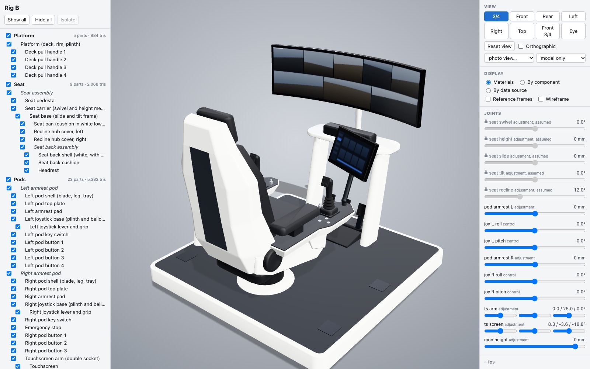
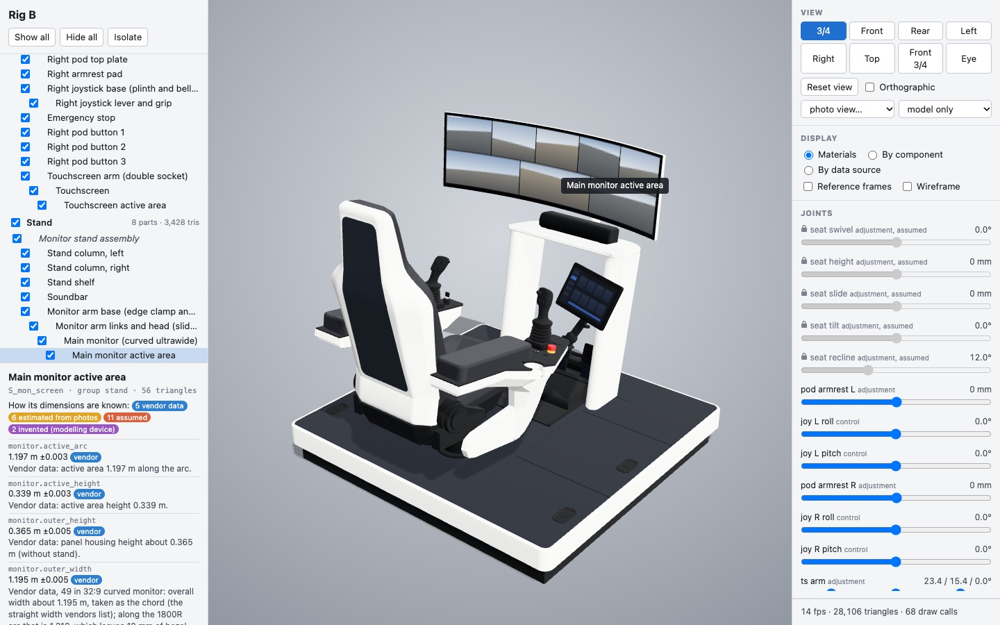
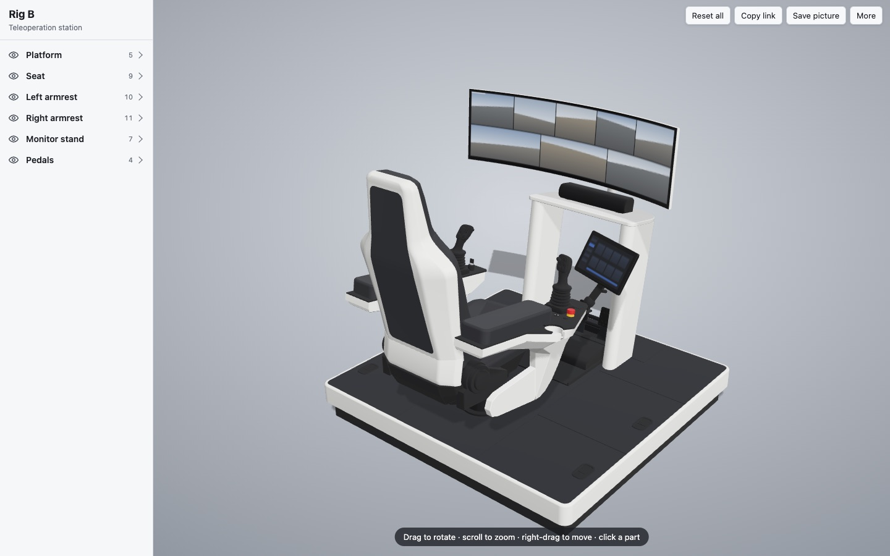
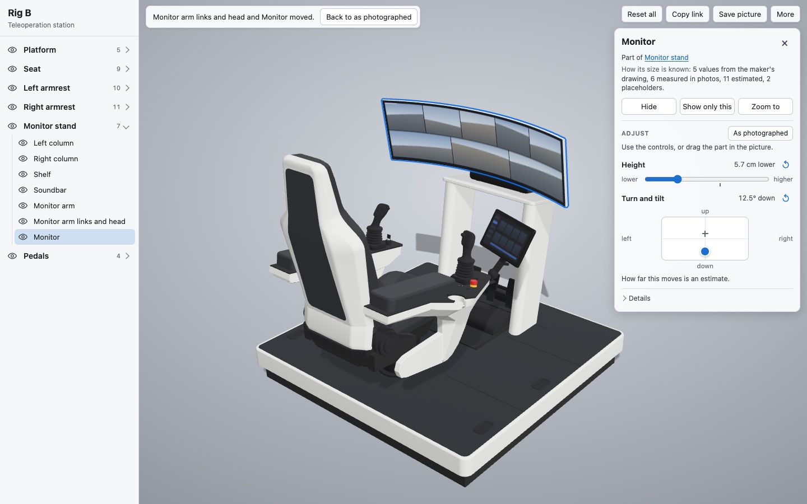
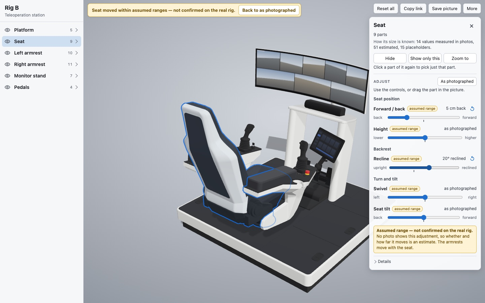
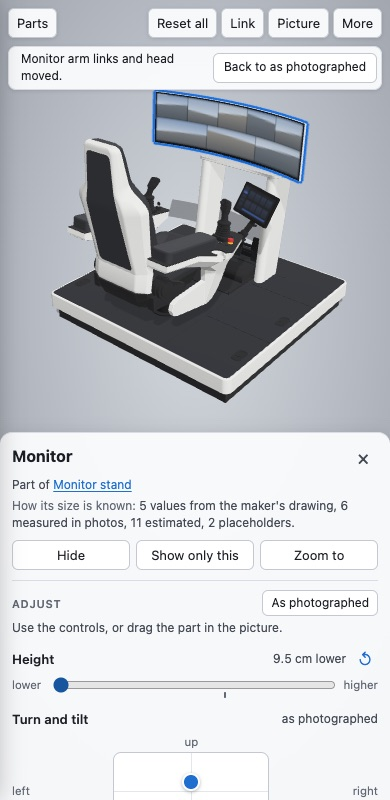
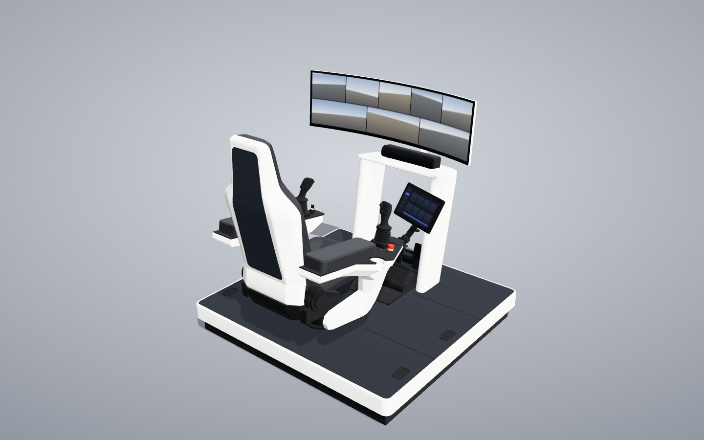

# The viewer

## TL;DR

- Orbit, zoom and pan the rig directly. Click a component or the seated person to show its controls in the left panel. Expand **Components** there to browse or select parts by name.
- The workspace selector sits at the top of the left panel. Its footer has **Copy view link**, **Save picture**, **Trace** and **Settings**. Trace starts closed. Drag its right edge toward the left to collapse it. The translucent handle reopens it.
- Camera presets, **Operator’s eye** and **Reset all** sit in the lower-right corner of the view. On a narrow screen, open **Views** for the direction presets.
- A live workspace saves rig and person changes for everyone with its link. The Trace icon shows changes by other people and agents, with Undo. The viewer also works as a standalone page.
- The TypeScript viewer shares the pose function with the generator. URL parameters also drive the headless viewer used to render pictures.

Commands and every URL parameter are in the [tool reference](../80-reference/tools.md#the-viewers-url-interface).
Decisions: [D-13](../20-decisions/decision-log.md#d-13), [D-29](../20-decisions/decision-log.md#d-29),
[D-30](../20-decisions/decision-log.md#d-30), [D-31](../20-decisions/decision-log.md#d-31).
Requirements: [R-36](../10-request/requirements.md), [R-51](../10-request/requirements.md),
[R-52](../10-request/requirements.md), [R-67](../10-request/requirements.md) to
[R-69](../10-request/requirements.md).

## What the viewer does

| Task | Where to do it |
|---|---|
| Orbit, zoom or pan | Drag to orbit, scroll to zoom toward the pointer, right-drag to pan. |
| Pick or find a part | Click it on the rig, or open **Components** in the left panel and choose a part. The list starts closed. When the left panel is closed, selection opens floating controls and leaves the panel closed. Shift-click a component to open an additional card and keep the existing controls. |
| Adjust a part | Named sliders show current offsets. The joystick uses a two-axis pad, and finer motions are under **Fine adjustments**. **As photographed** resets that component’s adjustments. |
| Control visibility or frame a selected part | Use the eye controls in **Components** to show or hide groups and individual parts. Press **H** to hide the selected part, **I** to show it alone, **A** to show all parts, or **F** to frame the selected part. Double-clicking a part also frames it. |
| Pop out controls | On desktop, use **Pop out controls** in the card heading to place it over the left side of the view. Use **Dock controls** to return it to the workspace panel or × to close it. |
| Move a part in the view | Drag a selected adjustable component to move its primary joint. Other drags orbit the rig. |
| Resize or hide the workspace panel | The desktop panel starts at 244 px. Drag its divider or use the arrow keys while the divider has focus. Drag left to snap it shut and use **Open workspace panel** to restore the previous width. On narrow screens the same panel opens as a drawer. Closing the drawer keeps the current selection. |
| Change or reset the view | Use the preset icons in the lower-right corner. **Operator’s eye** switches to the seated viewpoint. **Reset all** returns the rig’s adjustments, visibility and camera to their defaults. |
| Share a view or picture | Use **Copy view link** or **Save picture** in the left footer. Saved pictures include an estimated-adjustments caption when those adjustments are in use. |
| Recover adjustments or visibility | When joints have moved or parts are hidden, the left panel offers **Reset adjustments** and **Show all components** as applicable. It notes when adjustments include estimated ranges. |

**Settings** groups display and workspace utilities. **Colours** offers natural materials, part colours and evidence colours. In evidence mode, the legend shows the least certain size class for each component. **Agent access** holds the browser code, the workspace’s agent connection details and controls for agent views. On a local server with solved photos, **Compare with a photo** holds the photo choices. **Controls and shortcuts**, **Documentation** and **Credits** are available from the same menu.

## The first version, and why the owner rejected it

The infrastructure agent built the first viewer between 17:15 and 18:01 UTC, as its build brief asked:
a working inspection page with a parts list, view buttons and one slider per joint. It worked
(page ready in about 0.1 s, steady 60 fps). The owner's verdict during the build: "it is
overcomplicated and takes a lot of time", with the request to simplify above all the controls for a
single component ([R-68](../10-request/requirements.md)); and, separately, "why cant i adjust the
seat? the lock is confusing for users unless there is a way to unlock"
([R-69](../10-request/requirements.md)).

*The first viewer, on the blockout: 54 rows of checkboxes on the left, view buttons and 24 sliders on the right.*

*The first viewer after a click on the monitor: it selects "Main monitor active area" (the picture surface only) and opens a data sheet of parameter records.*

What the two reviews measured (*measured* with real pointer input in headless Chromium; review A
counted every control, review B walked through twelve tasks):

| Problem | Number or behaviour | Source |
|---|---|---|
| Controls on screen at once | **103** (157 pointer targets counting clickable rows); review B, counting differently, 75 controls and 403 words | review A, review B |
| Share of the window for the model | **58 %** at 1440 × 900; 41 % at 1024 × 768 (49–53 % at other sizes in review A); 0 % on a phone | both |
| Adjustments | **24 sliders** (6 disabled) for 20 joints in **one global list** under "Joints", ordered by the internal tree; the monitor's three were entries 14–16, below the fold at every tested size | both |
| Parts list | 54 rows of equal weight, 1,281 px tall in a box of 622–822 px; the monitor was row 52 | review A |
| Screen-click trap | a click on the monitor selected only its picture surface; unticking that row left a black monitor | review A |
| Isolate trap | "Isolate" on the seat showed 1 of 48 parts: a lone back shell floating in space | review B |
| Zoom | **35–40 wheel notches** to make a joystick fill a third of the view, zooming toward the middle of the rig, not the pointer | review B |
| No way back | no reset for adjustments ("Reset view" left a moved monitor where it was); undo was a hidden double-click per slider | both |
| No way to share | **no link, no picture** | review B |
| Seat | five sliders greyed out with a padlock that did nothing and explained nothing | both |
| Small targets, jargon | 13 × 13 px checkboxes; node IDs, triangle counts, parameter keys and words like "Isolate", "Orthographic", "By data source" on screen | review A |
| Idle cost | redrew 60 times a second with nothing changing (7–8 % of the main thread) | review A |

Recorded as [F-24](../60-lessons/failures-and-fixes.md#f-24) and
[F-25](../60-lessons/failures-and-fixes.md#f-25); lessons
[L-38](../60-lessons/lessons-learned.md#l-38) to [L-41](../60-lessons/lessons-learned.md#l-41).

## Two independent reviews and a separate implementer

| Step | Who | Time | Output |
|---|---|---|---|
| Review A: interaction design | a fresh agent | 15.0 min | inventory of every control, heuristic evaluation, seven alternatives for adjusting one component, a proposed design with 19 controls, 32 acceptance tests |
| Review B: first-time-user walkthrough | another fresh agent, independent of A | 16.6 min | 12 tasks × 2 window sizes with real pointer input, 135 screenshots, a language audit, a proposed screen, an acceptance checklist |
| Implementation | a third agent, working in a **copy** of the viewer folder | 61.9 min | the redesigned page; `tools/ui-accept.ts` with 53 checks taken from both reviews' checklists; the exposure correction |
| Swap | the coordinator | — | ran the acceptance script (53/53), checked the page by hand, replaced the viewer |

The two reviews used different methods and agreed on what mattered: put a part's controls on the
part, give the model the window, remove the lock, add a way back and a way to share
([P-16](../60-lessons/patterns.md#p-16)). The implementer worked in a copy because three modellers
and a reviewer were rendering with the old viewer at the same time
([L-42](../60-lessons/lessons-learned.md#l-42)).

## The redesign

The following pictures and measurements describe the 2026-11-23 interface.

*The earlier viewer at 1440 × 900 with the round-2 model.*

*The monitor selected and adjusted: its card holds Hide, Show only this, Zoom to, one height slider and one two-way pad for turn and tilt. The strip at the top says what has moved and offers the way back.*

| | First version | Redesign | Check |
|---|---|---|---|
| Controls visible by default (1440 × 900) | 103 | **16** | T01 (limit ≤ 20) |
| Words on screen by default | 396 | 41 | T02 |
| Sliders; disabled controls; padlocks, by default | 24; 7 (6 sliders and the Isolate button); one per locked joint (6) | 0; 0; 0 | T04 |
| Pointer targets under 24 × 24 px | 65 | 0 | T08 |
| Model's share of the window | 58 % / 41 % / 0 % | **82.8 %** / 78.1 % / 100 % at 1440 / 1024 / 390 px wide | T05 |
| Hide the monitor | scroll and find row 52, or a trap | click it, Hide: 2 actions | T12 |
| Show only the seat | 4–6 actions, left one mesh | 2 actions, all 9 seat parts | T16 |
| Lower and tilt the monitor | scroll a global list, 2 drags far from the model | click, drag Height, drag the pad: 3 actions | T25 |
| Zoom to the right joystick | 35–40 notches plus a right-drag | 6 notches with the pointer on it (12 % → 35 % of the view height) | T22 |
| Slide the seat back 5 cm, recline to 20° | impossible | 3 actions | T31 |
| Everything back to the start | about 10 actions, inexact | Reset all: 1 click | T27 |
| Share the view | impossible | Copy link: reopens within 0.06 cm and 0.01° | T30 |
| Idle page | 120 frames per 2 s, 7–8 % busy | 0 frames, 0.08 % busy | T44 |

The main design choices:

1. **A card for the selected part.** Name, what it is part of, how its sizes are known, Hide,
   Show only this, Zoom to, its own adjustments, "As photographed", and a Details fold for the
   parameter records. A click on a screen selects the monitor or touchscreen, never only its
   picture surface (T15).
2. **One two-axis pad** where a part has two rotations (monitor turn and tilt, joystick sideways and
   forward). Review A proposed three sliders for the monitor; the owner asked for an alternative to
   separate sliders, so it became one slider for height plus one pad (T24).
3. **Drag the selected part** to move its main adjustment, within its limits (T38–T41). Dragging an
   unselected part or empty space still turns the view (T42).
4. **Assumed adjustments usable, with a notice instead of a lock** ([D-31](../20-decisions/decision-log.md#d-31),
   [L-14](../60-lessons/lessons-learned.md#l-14), [P-22](../60-lessons/patterns.md#p-22)). The seat's five
   sliders each carry an "assumed range" tag; while any is away from the photographed value, an amber
   line stays on the picture, also in a saved picture. Scripts still see the joints as assumed and
   locked: they must say so explicitly (`pose=` from the address, or `setJoint` with `force`) (T37).
5. **Sharing and saving.** The address follows every change, so a copied link reproduces the view; Save
   picture writes the 3D view as a PNG, with the assumed-range sentence when it applies (T30, T30b).
6. **Plain words.** Parts are named "Left armrest", "Monitor stand"; jargon on screen by default: 0 (T03).
   Wireframe, orthographic projection, reference frames and ID colours have no control on the page;
   they remain URL parameters for agents.

*The seat slid 5 cm back and reclined to 20°: each slider is tagged "assumed range", the card explains why, and the amber notice on the picture offers "Back to as photographed".*

*The right joystick dragged in the picture: the pad in its card shows 1° left and 7.5° forward.*

*At 390 px wide the model takes the whole window; the parts list is a drawer and the card a bottom sheet.*

*"How sure are we?": 0 parts measured on the rig, 2 from the maker's drawing, 19 measured in photos, 25 estimated. A part takes the colour of its least certain size.*

**About "53 of 53".** In every recorded run, check T49 (machine-interface pictures compared with the
previous viewer) reports "skipped (no --baseline server given)" and counts as passed. The comparison
it stands for was made once by the implementer by hand: 14 sets of URL parameters gave pixel-identical
pictures with `look=previous`. So 52 checks ran and passed; the 53rd is a skip.

## The exposure correction

The round-1 reviewer measured lit white surfaces at 244–249 of 255 against 150–160 in the photos: the
white shell looked like flat paper, which "hides the form the builders did model" (finding R1,
[F-20](../60-lessons/failures-and-fixes.md#f-20), [L-23](../60-lessons/lessons-learned.md#l-23)).
The implementer retuned the lighting while redesigning the page:

| Setting | Before (`look=previous`) | After |
|---|---|---|
| Exposure | 1.0 | 0.78 |
| Environment light | 1.0 | 0.6 |
| Key light, fill light | 2.6, 0.5 | 2.0, 0.3; key moved further behind the operator |
| Tone curve | three.js "neutral" | own curve: straight up to 0.6, then a soft shoulder; nothing taken away near black, so leather, deck and matte plastic stay apart |

Result (*measured*, check T53, mean of R, G, B per material, 0–255): three-quarter view, lit white
223–231 (median 221), shaded white 164, 0 % clipped; rear view, lit white 201–225 (median 190),
shaded 125, 0 % clipped; leather 61–63, black plastic 33–44, deck 59–74. The round-2 reviewer, with its
own method, measured lit white at 190–200 (median), 95th percentile 227, no pixel at 250 or above.
The materials were retuned separately by the structure modeller (matte black plastic, lighter satin
leather, anti-glare screens).

*Before: the earlier lighting (`look=previous`). The white shell and columns are nearly uniform.*

*After: the same view with the new exposure and tone curve. Facets, bevels and roundness of the white parts show.*

## From JavaScript to TypeScript, with one pose function

The build brief asked for "plain ES modules, no build step", so the first viewer was JavaScript. The
owner asked "why is viewer.js a js and not ts" ([R-67](../10-request/requirements.md),
[F-23](../60-lessons/failures-and-fixes.md#f-23)). The infrastructure agent converted it during its own
run ([D-29](../20-decisions/decision-log.md#d-29)):

- The viewer is TypeScript in `viewer/src/` (`engine.ts`, `interact.ts`, `ui.ts`, `words.ts`,
  `main.ts`), bundled with three.js by Bun into one module. The local server and the render driver
  bundle in memory in about 0.1 s and re-bundle when a file changes; `bun run dist` writes the bundle.
- `shared/pose.ts` is **the** definition of how a joint value becomes a transform. The generator uses
  it to write the model file at the neutral pose; the viewer uses it to pose. The planning trials had
  three slightly different conventions in three codebases.
- `bun run check` type-checks generator, viewer and tools together
  ([C-01](../40-method/checks.md#c-01)) and compares the shared pose function with the independent
  Python reader on 96 poses ([C-13](../40-method/checks.md#c-13)): largest difference 2.4e-8.

## The shared scene (platform step 1)

Added on 2026-11-24 by platform step 1 ([the platform plan](../30-plan/platform-plan.md)). The code is
`viewer/src/live.ts` and `viewer/src/live-connection.ts`; it does not load the command layer, so the page
stays small.

**When it is on.** The page reads `version.json`; only if that names a server does it ask `api/health`,
and only if that answers with the scene format does it connect. Otherwise it stays a page on its own:
no request under `api/`, nothing in the console, everything as before. `bun run serve` and the
deployed site (once the server is set up) have a server; `bun run dist`'s folder opened on its own does not.

**One rule for every rig pose change.** Sliders, pads, keyboard adjustments, drag and all rig adjustment resets use the engine’s joint setters. The page treats any difference between what it shows and the shared pose as a local preview,
and saves it as one `pose.set` (based on the version the preview started from) when no pointer is down
and nothing has changed for 300 ms. A change from the server for a joint this page is still changing
waits; the save is then refused as stale, the page shows the shared pose again and says why ("Not saved:
Claude Code · 0c24 — Monitor: height 8 cm lower came first. This page shows the shared scene again.").

**A link with other adjustments** (`pose=` that differs from the shared scene) opens as a preview with
**Apply** and **Dismiss**: nothing is saved until Apply.
`viewer.apply()` from a script is treated the same way.

**The activity line** in Trace reports changes made by someone else: "Claude Code · 3f2a — Monitor:
height 3 cm lower" with **Undo** (which undoes that entry for everyone, [D-40](../20-decisions/decision-log.md#d-40))
and ×. Authors are labels the server makes ([D-41](../20-decisions/decision-log.md#d-41)); the page knows
its own changes by the versions its requests recorded. The words are the same as in the cards and in
`bun run rig` (`shared/words.ts`).

**Browser code** in **Settings → Agent access** identifies the open viewer to an agent. View commands that name the code reach that browser. The workspace’s own MCP address and Claude Code command are in the same section. [Workspace storage](workspaces.md#what-is-stored).

**Agent interface v2** ([D-51](../20-decisions/decision-log.md#d-51)). The page also carries out `look`, the
one-call view command of the intent layer: what it shows, the named view and the selection in one go. On a local
server a `look` without a code reaches every open page. When the command asks for a picture, its view event brings a
reply id: the page finishes any camera glide and draws at once (`drawNow()`, which also works in a background tab),
makes a JPEG of the picture "Save picture" would make, smaller and coarser until it is at most 60 kB
(`viewer.pictureJpeg()`), and posts it to `api/picture` with the id and its own code. Nothing else changes on the page.

**The trace** ([D-53](../20-decisions/decision-log.md#d-53)). Since the trace, the activity line names the latest
request by anyone else, not only changes: "Claude Code · a3f5 — Monitor: tilt as photographed → 4° down", with a line
of times under it ("19:53:35 · adjust (MCP) · server 2 ms · 2.2 s since its last request"), Undo for a change, and
**Trace**. The footer icon opens the request history. Routine activity stays here and the history starts closed
(`viewer/src/trace.ts`): one block per caller's run, headed with the number of requests, the time from first to last,
the server's time and the agent's own time; a row per request with its offset, ✓ or ! (refused, amber), the command,
the server's words and the server's time, and between two requests of an agent the time on its side. A row opens to
the request as sent, the reply as the caller saw it, a picture's size with the page's time to draw it and the wait, and
for a change its version, request name and Undo. "pages too" adds the pages' own saves; Copy puts the shown records
on the clipboard as JSON. The page keeps the last 200 and fills in what it missed from `api/trace` when it connects.

**The camera anywhere and Follow** ([D-54](../20-decisions/decision-log.md#d-54)). `look` can put the camera at the
eye of a person of a given stature or sitting eye height (`eye`; the operator's view with `eyeHeight` set: the
point on the line through the model's eye points, which rides with the seat) or anywhere (`camera`: position,
target and field of view in the model frame, the same as the link's `camera=`). The link of such a view carries it
(`view=operator&eye=0.819`). On the public sandbox, **Follow** on the activity line of an agent's request makes
this browser show the views that agent asks for without a code. **Following** stops it. **Settings → Agent access** shows which agent the browser follows.

**Consent** ([D-55](../20-decisions/decision-log.md#d-55)). On the public sandbox a view an agent asks for without
naming a browser, while no browser follows it, comes to every page as an amber question with Allow, Always allow
and No. The browser stores its choice per workspace under `synergon.agentViews` in local storage. Change it under **Settings → Agent access**. While the question is open the activity line does not repeat the request.

**Reconnecting** follows the rules of Leitbild, the owner's other project ([D-39](../20-decisions/decision-log.md#d-39)):
after a drop, again after 1 s, then 2, 4, 8, 16 and at most 30 s; at once when the page becomes visible
or the network comes back; one resync after each reconnect, asking for the changes after the version it
has (`since=`) and keeping its session code. A stream that the deployed server ends after 512 kB
([D-46](../20-decisions/decision-log.md#d-46)) closes with an `end` event, and the page reconnects at
once instead of waiting: it gets only the missed changes, no full snapshot, and nothing shows on the
page (*tested* 2026-11-24 with the real page against a server with a 3 kB budget: two ends in 30
changes, the page never fell behind, no console message, no failed request).

The local acceptance suites exercise shared updates and opening states with temporary scene data. [Checks](../40-method/checks.md).

## The agent interface by URL

Agents do not click. They open the page with URL parameters, or call `window.viewer.apply({...})`
with the same keys, and read the state back. The main parameters: `view`, `camera`, `cam` (a solved
photo camera, local server only), `overlay`, `only`, `hide`, `fit`, `pose`, `mode` (`ids`, `class`),
`wire`, `frames`, `legend`, `hud`, `caption`, `ui=0`, `sel`, `look`. The full list with values is
in the [tool reference](../80-reference/tools.md#the-viewers-url-interface).

The redesign kept this interface: 14 sets of URL parameters gave pixel-identical pictures and equal
state with the previous viewer (with `look=previous`). One change was deliberate: `view=operator`
now puts the camera exactly on the median eye point, 6.8 cm further forward than before.

## The person (manikin v1)

The dressed operator is seated by default. The person’s separate script loads after the page is ready. Click the person in the view or choose **Person** under **Components** to show its controls in the left panel. It holds presets, body measures, appearance and Undo. The view credits the CC BY clothing while it is visible. [The person in the viewer](person-in-viewer.md), [person controls](person-panel.md).

## Workspaces on the page

The site's root page is a landing, and the viewer lives at `/workspaces/<id>`. A workspace is one shared scene: the rig, the person, the history and undo. Anyone with its link can see it, change it, rename it or delete it. Live on the public site since 2026-11-25, and in every local `bun run serve`.

- **Which page is which.** `/` is the landing, `/workspaces/manage` is Manage, `/workspaces/<id>` is the viewer. The same `index.html` answers all three (Caddy and `tools/serve.ts` both hand it out for every address under `/workspaces/`). The page's entry, `app.js`, reads the address and shows the right page. Every address the page asks for is absolute (`/api/workspaces/<id>/...`, `/version.json`, `/asset/...`), because a relative one would break under `/workspaces/<id>`.
- **The landing is small.** Its first screen is the name, one sentence on what Synergon is for, one primary action (Continue in ‹name› when this browser has opened a workspace, else Create workspace) and a still picture of the rig with the person seated (`viewer/landing-rig.webp`, about 28 kB, made by `bun run render --set landing` from the real viewer). About 14 kB of script, ready at once; it does not download three.js, the rig or the person. It shows a line saying what a workspace is, "Continue in ‹name›" for the one opened last in this browser, New workspace (the name is optional), Recent in this browser (five at most), Browse workspaces (newest first, ten at a time with "Show more", a search box once there are seven or more) and a link to Manage. The viewer code is loaded only on a workspace address, after the server has said that the workspace exists, so a deleted or mistyped link gets a plain notice and no 3D download.
- **The picture's credit.** The picture shows the dressed person, whose shirt and trousers are CC BY 4.0, so the credit line the person panel shows is printed under it too; both take it from one place, `viewer/src/credits.ts`.
- **Recent in this browser** is kept in `localStorage` under `synergon.recentWorkspaces` (id, name, time; never a cookie; every access in try/catch, so a private window just forgets). A workspace the server no longer knows is dropped from the list.
- **In the viewer** the workspace selector is at the top of the left panel above Components and any selected component controls. Its menu offers Copy workspace link, Rename, New workspace, recent workspaces, All workspaces and Delete. Renames appear in other open pages. A deletion shows a notice with a link to the landing page. **Copy view link** in the footer copies the current camera, selection and adjustments along with the workspace address.
- **Settings → Agent access** has the browser code, the workspace’s agent address with a Copy button and the command for Claude Code.
- **Agent views.** The choice "always allow" or "never" for views an agent asks for is stored per workspace under `synergon.agentViews`; an older single word stored there is not read.
- **Manage** lists every workspace with a tick box, Select all shown and one delete with one confirmation that gives the count.
- **Without a server** (a static preview, `serve --no-api`) `/` opens the standalone viewer without a workspace selector.
- **Checks.** `tools/ui-accept.ts` tests the landing, creating, Recent, browsing and searching, rename and delete seen in a second page, Manage, an unknown id, the phone layout, that the landing loads no three.js, per-workspace consent and the agent address (tests W01 to W16). The script budget of 800 kB for the viewer page and the one-second ready time are unchanged (T10): the viewer page now loads 783 kB, of which the landing's part is 14 kB.

## Known rough edges

| Rough edge | Status |
|---|---|
| Frame rate and exposure were measured only in headless Chromium on one Apple M2, capped at 60 fps | not verified on other devices ([I-15](../60-lessons/ideas.md#i-15)) |
| Narrow layouts are checked in Chromium at phone widths | Physical phones and tablets have yet to be tested |
| Until 2026-11-24 the operator's-eye view put the camera on the eye point **as photographed**, read once from the description file, so a moved seat (height, slide, swivel, tilt) left the camera where it was; found by the owner watching an agent's run | fixed: the camera sits on the median eye point and the screen centre where they are now, and rides with the eye when the seat moves while the view is on (`eyeAndScreenNow`, `followEye` in `viewer/src/engine.ts`) |
| The eye points do not move with the backrest's recline: they are placed for the photographed recline (`assets/rig-b/params/seat.toml`), so reclining the backrest does not move the operator's view | open; a change to the asset (the eye riding with the torso line) |
| Check T49 (comparison with the previous viewer) is skipped unless a second server is given | see above |
| A hard shadow edge from the seat back falls across the cushion and can be misread as a facet | round-2 finding N7, open |
| Photo views (`cam=`) work only on the local server, because the camera file stays private | by design |
| No measuring tool that shows a distance with its range | idea [I-21](../60-lessons/ideas.md#i-21) |
| Pressed or lit states of buttons, key switch and emergency stop are not modelled | provisional in the [asset contract](../40-method/asset-contract.md) |
| The page has been tested only against the local server; behaviour behind the production server is checked by the deployment step | see [deployment](deployment.md) |
| On mightwork.ai the shared scene is live since 2026-11-24 and passed the two-browser check there (`tools/live-site-check.ts`); it has not been used by several people at once yet | see [the server and its host setup](server-and-host-setup.md#order-of-the-first-rollout) |
| On the laptop (HTTP/1.1) a browser holds six live streams per host, so a seventh viewer tab waits; the public site uses HTTP/2 | by design |
| After a server restart or a dropped connection live changes pause until the page has reconnected (a second or more) | accepted |
