# How the desk was modelled, step by step

## TL;DR

- **Goal:** a model of the desk that can be placed in a room, measured, and recognised by people who know it, with every part named and every number traceable to where it came from.
- **Way of working:** measure before modelling; build the whole object as plain boxes first; shape it only after a stranger has checked the boxes; the builder never marks its own work.
- **Three rounds:** a simple model of 4,308 triangles, a shaped one of 11,650, a final one of 11,138. A fresh reviewer after each; then two auditors who had taken no part.
- **Corrections on the way** were mostly about depth: a panel under the top sat 30 cm from where it was first put, and the base of the rear wall turned out a third as deep as first drawn.
- The same method had been used once before, on a seated operator station. Five things had to change for the desk; they are listed below and are now part of the written method.

All model pictures on this page are renders. The clock times are local time on 26 November 2026.

## Goals

The owner's request, in short: take the photos made at the site that day and turn the desk into a
**well-divided model** with the same method used for the first object (a seated operator station,
"Rig B" elsewhere in this wiki). Treat it as the **second test of the method**: be critical, question
every step that was only right for the first object, change the method where needed, and write down
the lessons. Top quality, no tangents, a reasonable level of detail.

What the model is for:

- placing the desk in a room and checking footprint and clearances;
- measuring distances and angles from an operator's eye to each screen;
- a picture that people who know the desk accept as that desk.

Level of detail: every part a person would name. No cables, no screen content, no logos, no single
keys. A ceiling of 60,000 triangles (the small flat faces a 3D model is made of); the result uses
11,138.

## The way of working

Six rules carried the work. They come from the first object and held on the second.

1. **Every number has a source.** Each size sits in a small text record with its value, how far it could be off, and how it is known: from a photo, assumed, or invented. No size is typed into the model's code.
2. **Measure first, model second.** A table of sizes is finished before any shape is made.
3. **The whole object first, as plain boxes.** Every part exists from the first build, in the right place and of the right size. Shaping comes later. A missing part is far harder to notice than an ugly one.
4. **The builder does not mark its own work.** After each round a fresh reviewer gets the pictures and the parts list, and nothing else: no notes, no excuses.
5. **Photos are evidence, not decoration.** The model is rendered from exactly where a photo was taken and laid beside it.
6. **Say what is not known.** An assumed value is labelled assumed, in the file and on every page.

## What had to change for a desk

The method was written after one object. Before the work started, five guesses were made about what
would not carry over. All five turned out right, some in a different way than expected.

| The first object | The desk | What happened |
|---|---|---|
| No measured size existed, so camera positions were worked out first and scale last | A metre rule and a dozen app measurements existed | Scale was set first, from the rule. Everything else followed from it |
| Camera positions came from a heavy calculation over many photos | The phone stores which way is down in each photo | Three simple cameras, one per photo, were enough to measure with |
| No top-down photo; outlines traced by eye | No top-down photo either | The desktop outline was straightened out mathematically from two slanted photos |
| A parts checklist for seated stations | Nothing in it applies to a desk | A new checklist for desks and consoles was written from this build |
| The tools assumed one object | A second object | The tools now take the object's name. The first object's files stayed identical, byte for byte |

## The steps

### 1. Look at every photo and say what it is good for

36 images: 9 photos with the phone's main lens, 6 with its wide lens, and 21 screenshots of the
phone's measuring app. All show the same desk in the same eleven minutes; nothing was moved. A table
was made of what each image shows and what it can be used for. Three really different viewpoints of
the whole desk from the front, four of the rear and side. Missing from the start: a view straight
from the front, straight from the side, from above, from below, and any part in a second position.

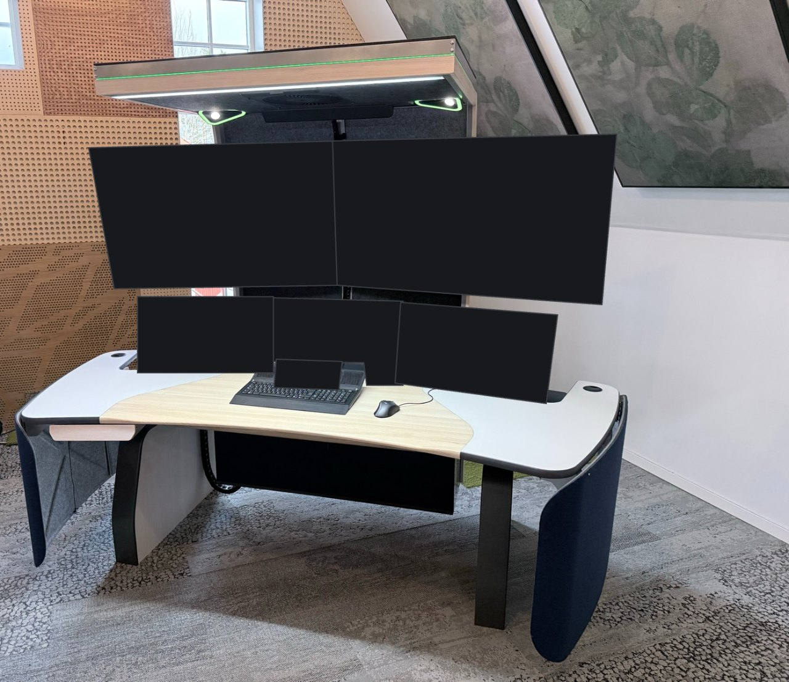
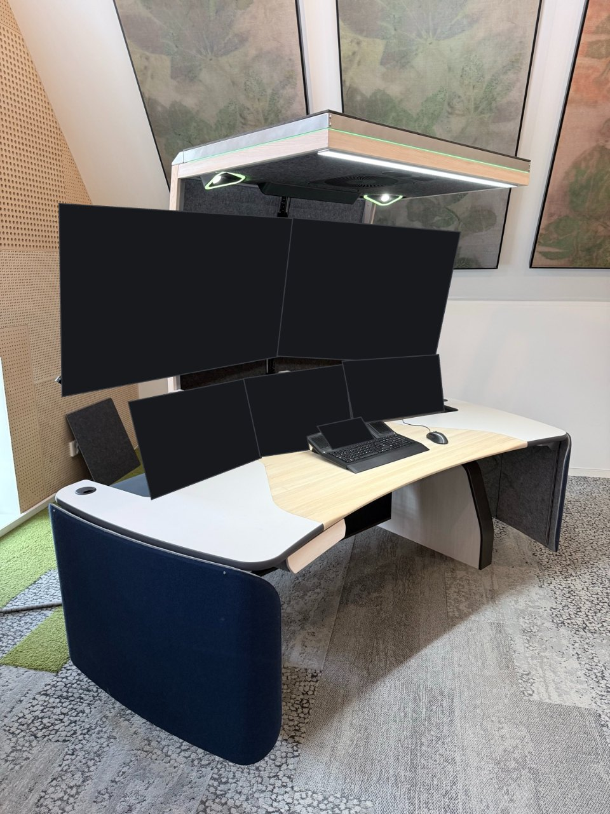
*Two of the three front viewpoints. Sizes away from the desktop come from pairs of photos like these.*

### 2. Set the scale from the metre rule

One photo shows a metre rule lying on the desktop. The phone records the direction of gravity in
every original photo, so the level desktop could be flattened out without guesswork and the rule
gives the size of everything on it: the wood centre, the keyboard unit, the cable outlets, the
front arc.

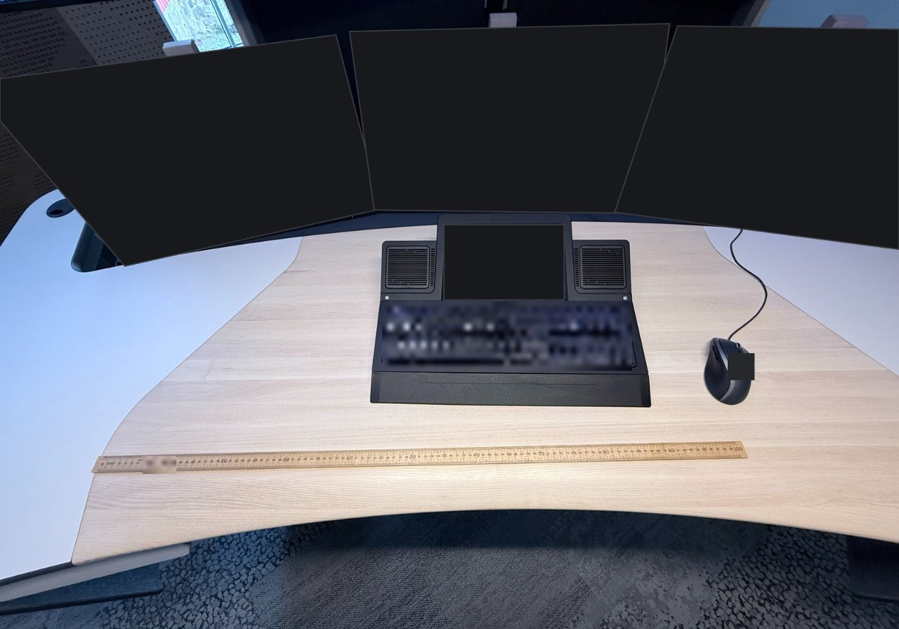
*The most valuable photo of the set. It set the scale for the whole model.*

### 3. Read every label of the measuring app, and test it

Each label was written into a register: which screenshot, from where to where, the value, and what
it was checked against. The outcome is on the [accuracy page](measurements-and-accuracy.md#the-phones-measuring-app):
two labels agreed with the rule-based scale, three were off by 9–17 %, and the only measurement taken
twice differed by 6 cm.

### 4. Find where the camera stood, then measure by crossing sight lines

For three photos, the camera's position was worked out from four points on the desktop whose places
were already known from the rule photo. After that, any point seen in two of the photos can be
placed in space: draw the sight line from each camera through the point; where the lines cross, the
point is. The screens, the canopy and the legs were sized this way.

A fourth photo was **held back**: no size was taken from it. It is the test piece for step 7.

### 5. List the parts

Before any shape exists, the desk is written down as a tree: 5 groups, 30 parts, 6 screen surfaces,
the reference points, and the 6 motions with what each one carries. One new question came up that
the first object never asked: *what rides on the height adjustment?* The small screens stand on the
desk's shelf and were taken to rise with it; the large screens hang on the wall and stay.

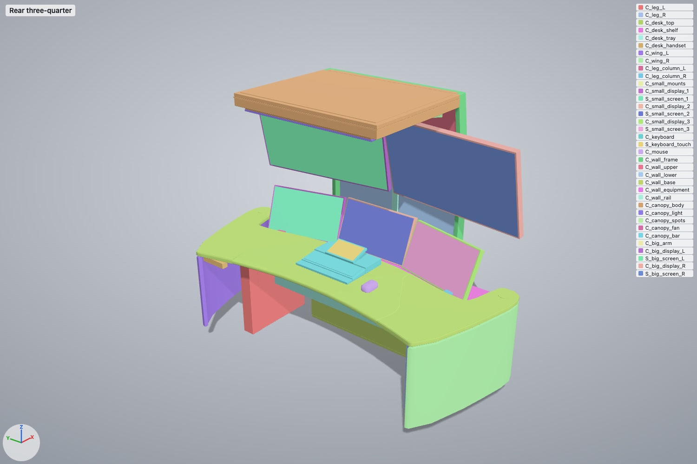
*Every part in its own colour. The list on the right is the parts list a reviewer checks the model against.*

### 6. Build everything as plain boxes

The first build ran and read as the desk at once: 4,308 triangles, every part present, about 25
minutes of modelling. Automatic checks ran on it (is every listed part there, is anything unnamed, do
the motions move what they should). Each new check was made to fail once on purpose, to prove that it
can.

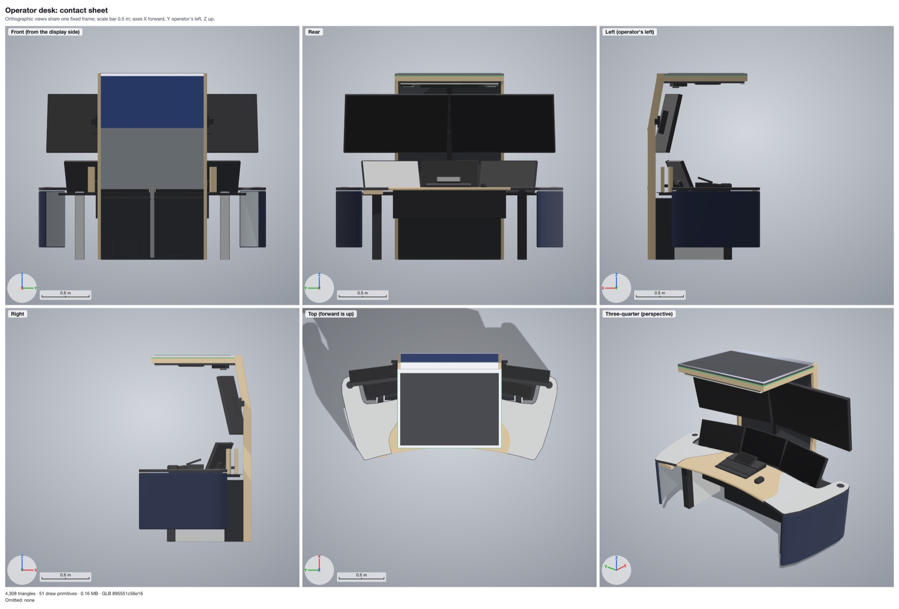
*The simple first model, 22:00. Legs are straight posts, screens are slabs, but every size and place is from the table.*

Then every motion was pushed to its limit. Raising the top by the assumed 40 cm showed a problem
before a single shape had been refined:

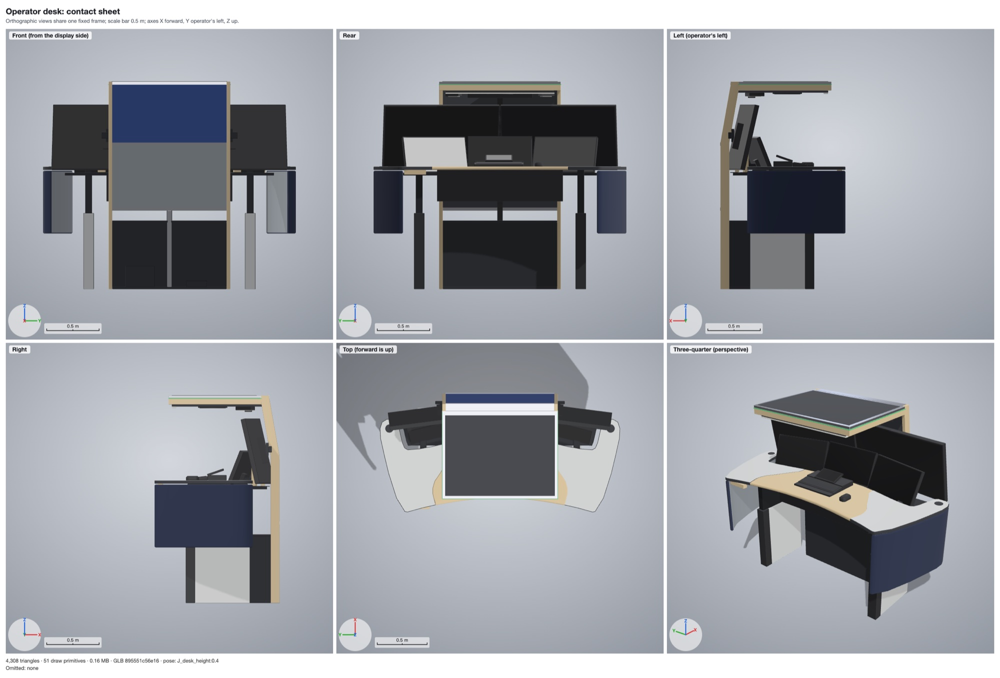
*Top raised by the assumed 40 cm. The small screens cover the lower half of the large ones and almost touch them. Either the real travel is smaller, or more than the top moves. Only the site can say.*

### 7. Compare with the held-back photo

The model was rendered from the held-back photo's camera position and laid beside the photo. In the
three photos used for measuring, agreement proves nothing: the sizes came from those photos. Only the
held-back one counts. Top, legs, end screens, wall and all five screens sat within a few centimetres;
the canopy's front corner was 4–5 cm off. (An auditor later showed that this photo can only reveal
errors larger than about 5 cm.) One thing looked plainly wrong: the dark box under the top hung lower
than in the photo. It went back to measuring (step 9).

### 8. First independent review

A fresh reviewer, 40 minutes: **accept with minor fixes**. Layout, proportions and parts list right.
Six findings, among them the raised-top collision, legs that are "straight posts" where the photos
show a bowed blade, a missing seam in the wall panels, and "dark materials merge into one black". It
also listed what would be wasted effort: single keys, fan vanes, screws.

### 9. Shape the model

One pass per part, starting from the features a person recognises it by. For the desktop: the hollow
front arc, the ends running out to rounded ears, the S-shaped seams between wood and grey, the dark
rim. Several parts went back to measuring instead of being nudged by eye:

- **The ends of the desktop.** A slanted screenshot from above the left end was straightened out mathematically (four known points on the desktop fix the picture). The outline of the end improved from ± 4 cm to ± 2 cm.
- **The legs.** What had been read as a "black band 9 cm deep" was the leg's front face seen at an angle. The front edge was measured as a curve at seven points.
- **The panel under the top.** The box that hung too low was in the wrong place altogether: it is a panel under the *rear* edge of the working surface, about 60 cm behind the front edge, not a box 30 cm behind it. Nobody could have seen this in the comparison picture, because the error lay along the line of sight.
- **A clearance check was written** that moves every joint to its limits and lists what collides. It became part of the standing checks.

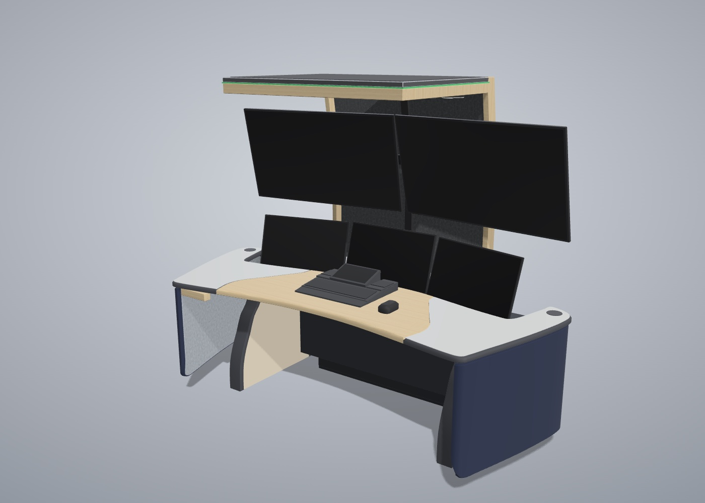
*The shaped model, 23:08: 11,650 triangles. Curved outline, bowed legs, wrapped end screens, bezels on the screens.*

### 10. An optional texture layer

On request, four small material patches were cut from the photos (wood, blue fabric, grey felt, dark
felt), made neutral in colour and repeatable, and stored in the model file. They only add grain to
the flat colours and can be switched off. No patch shows anything but material surface.

### 11. Second review, third review

Review 2 (5 minutes, a new reviewer): **accept with minor fixes**. Eight findings. The lights under
the canopy were "dull grey pucks" where the photos show them glowing; the leg blades were beige where
the photos show grey; the felt looked like stone; and the base of the rear wall showed under the desk
where the photo shows carpet. That last one went back to measuring: carpet is visible in two photos
up to about 93 cm behind the front edge, so the base cannot be 30–40 cm deep. It is now 12.5 cm.

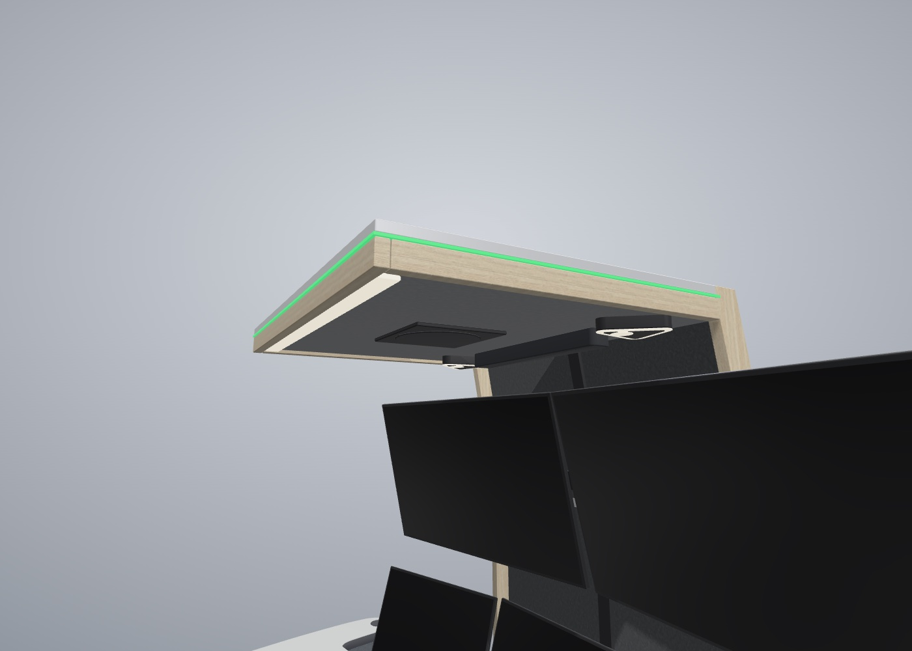
*After review 2: the light strip, spotlight rings and green line give off light.*

Review 3 (5 minutes, a new reviewer): **accept with minor fixes**, "recognisable at a glance from
every view". Five findings: print the real gap between small and large screens when the top is
raised; the loudspeaker blocks of the keyboard unit are sloping boxes, not flat pads; the wall's base
looks deeper from behind than modelled; felt grain still coarse; the mouse looks faceted.

### 12. Two audits, and the corrections they forced

Two further agents that had taken no part looked at the method and at the code. Their main point:
the record claimed more than it had tested. The details are on the
[review page](review-and-lessons.md). The fixes: every size statement now says "unverified"; a value
that had been changed only to make a check pass was put back; the desk-height motion was locked; and
the written method was updated.

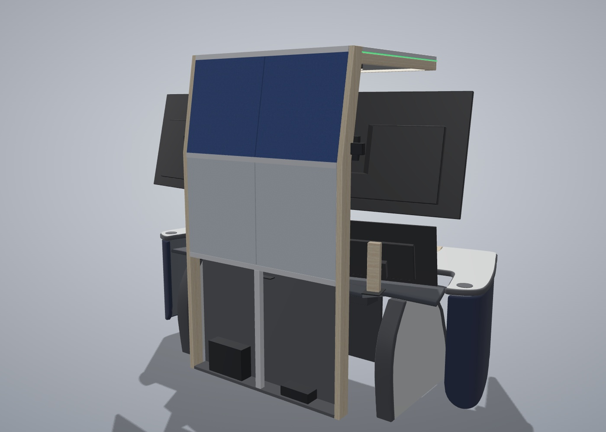
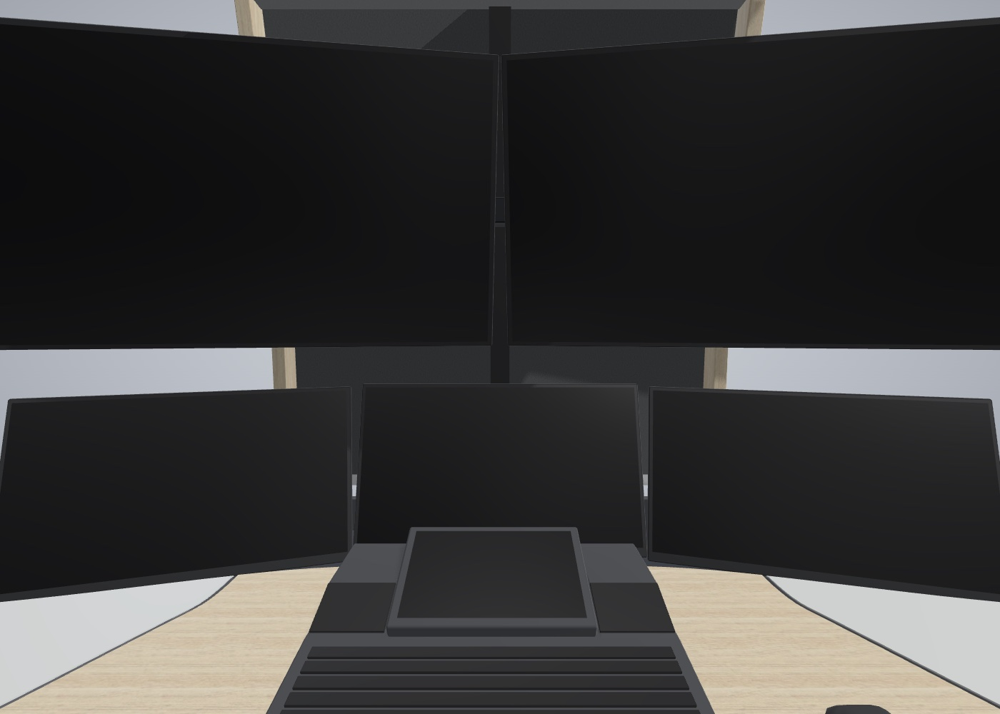
*The finished model from behind, and from the assumed seated eye position.*

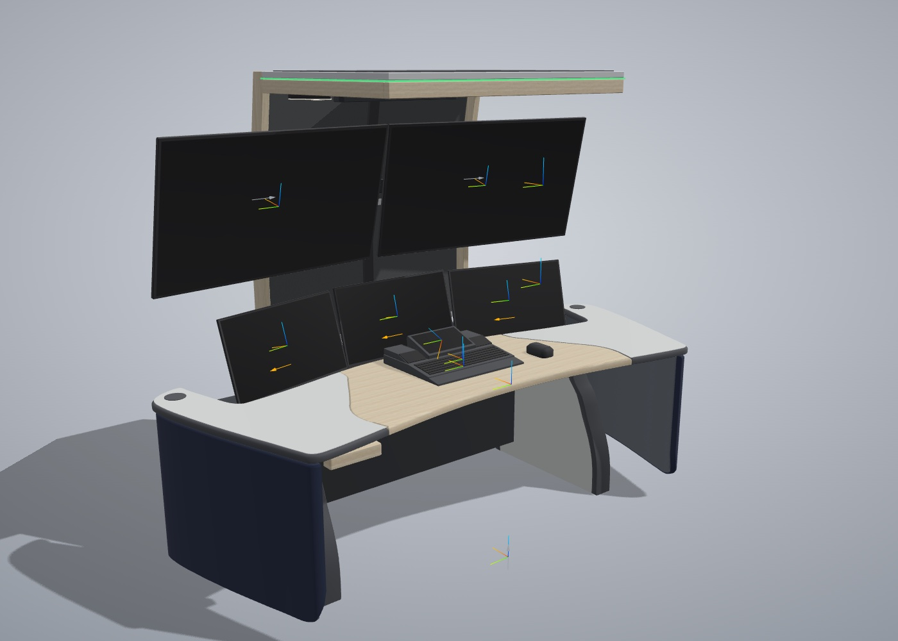
*The reference points other software can measure from: one per screen centre, the keyboard, the desktop's front edge, the floor anchor.*

## The same view through all three rounds

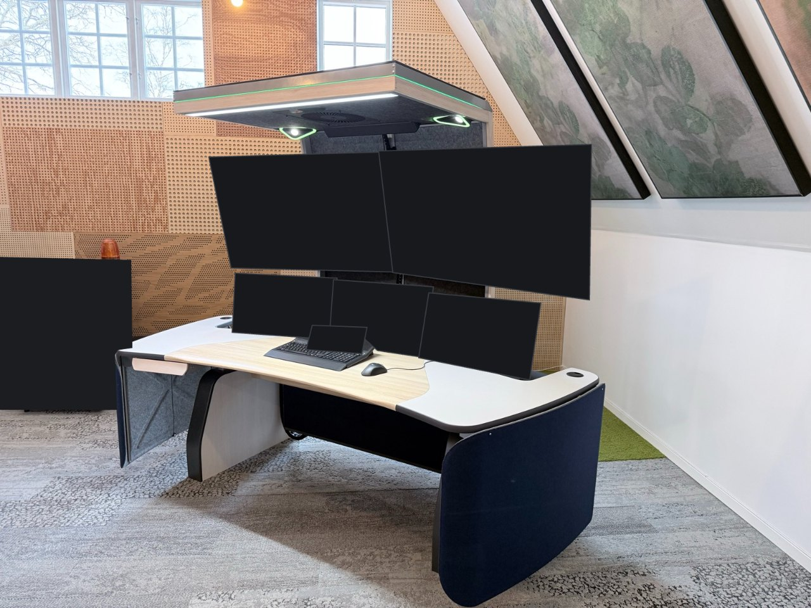
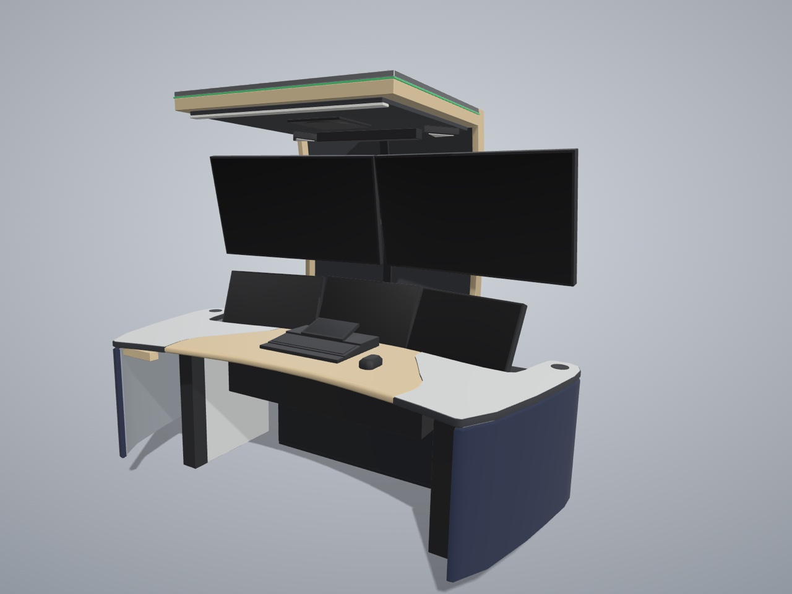
*The held-back photograph, and the simple first model seen from the same spot.*

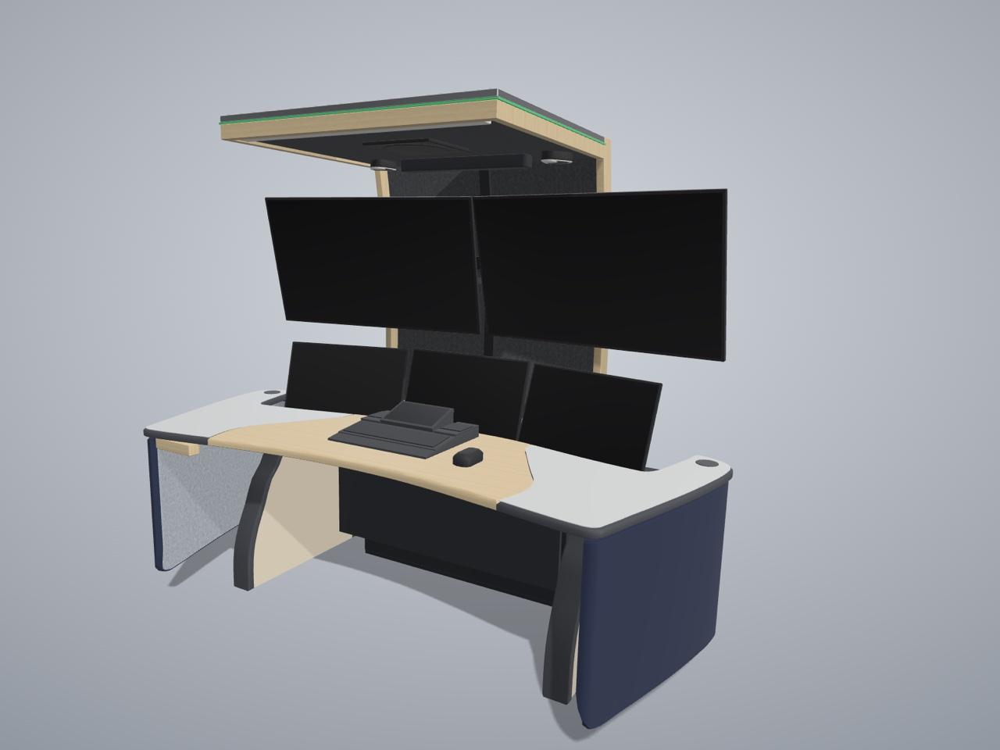
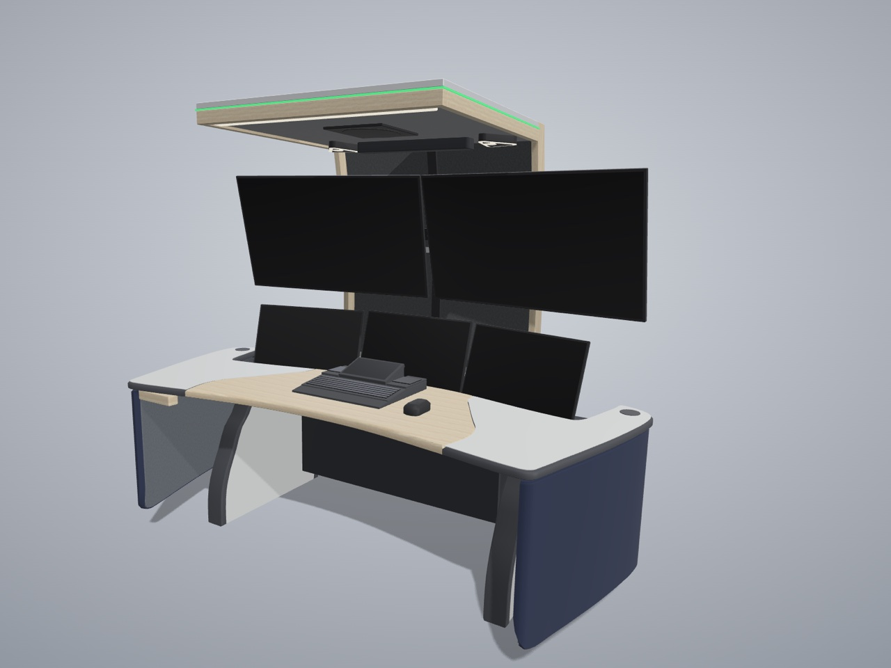
*The shaped model, and the model after the second review. Sizes barely moved between rounds; form and light did.*

A caution about this test. The held-back photo found three errors, and then one size was read in it
(where the wall's base ends). From that moment it was no longer untouched, so the third review had no
fresh photo of the whole desk to judge against. Next time two photos are held back.

## Timeline

| Stage | Minutes (modeller's log) | Finished | Triangles | Outcome |
|---|---|---|---|---|
| Measuring, parts list, tool changes | 48 | — | — | table of sizes; 130 number records in the end |
| Simple first model | 45 | 22:00 | 4,308 | all checks pass; review 1: accept with minor fixes, 6 findings |
| Shaped model with texture layer | 29 | 23:10 | 11,650 | review 2: accept with minor fixes, 8 findings |
| Fixes, drills, model card | 30 | 23:45 | 11,802 | review 3: accept with minor fixes, 5 findings |
| Audits answered, method updated | 45 | 00:02 | 11,138 | final build efa3d875. **These last fixes have not been seen by a reviewer** |

The minutes are the modeller's own log and are approximate; by the times on the files the last stage
was nearer 20–30 minutes. About three hours of modelling in all. The reviewers and auditors ran in
between and took about 80 minutes together.

"Drills" are trial runs of what will happen when real measurements arrive: three sizes were changed
inside their ranges through the text file alone, and the model rebuilt without touching its code. One
check then failed, correctly: a limit that depends on desk height had to be worked out again by hand.

## What was corrected on the way

| First belief | What it turned out to be | How it was found |
|---|---|---|
| Large screens "43 inch class" (by eye against the canopy) | 1.11 × 0.63 m, a 49–50 inch class housing: 20 % larger | crossing sight lines from three photos |
| Rear wall 1.70 m high (a fit through three app labels) | 1.98 m | crossing sight lines; the fit had assumed a flat wall, and the wall has a kink |
| Canopy rear corners from a single photo | 7 cm off | the sight line grazed the surface; replaced by two photos |
| A dark box 30 cm behind the front edge | a panel 60 cm behind it | re-measured after the held-back photo looked wrong |
| Wall base 40 cm deep, then 30 cm | 12.5 cm at most | reviewer 2 saw it against carpet; then measured |
| One reading put the end screens' lower edge 26 cm above the floor | 11.5 cm | that reading saw the surface edge-on; a face-on photo settled it |
| Small screens lean back 22° | 16° (± 5°) | moved inside its range after a check showed neighbouring housings overlapping by 6 mm. Not a measurement; still a weak value |
| Top can rise 40 cm | unknown; locked in the model | collision with the large screens; a question for the site |

The pattern: **what was sized by eye along the camera's line of sight was wrong, every time**, by
20–30 cm. What was measured across the line of sight held.
