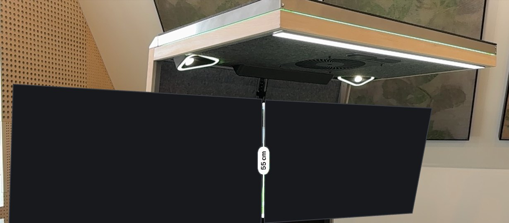
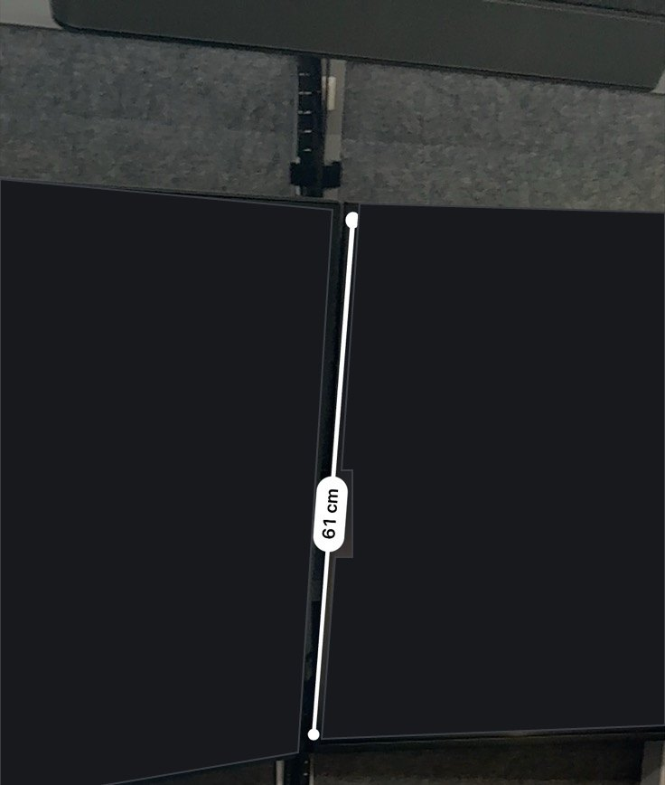
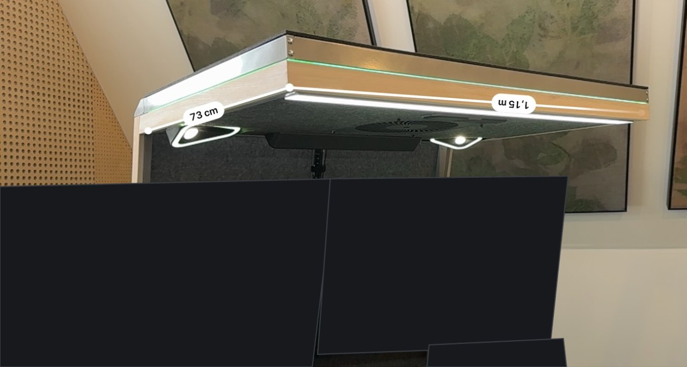
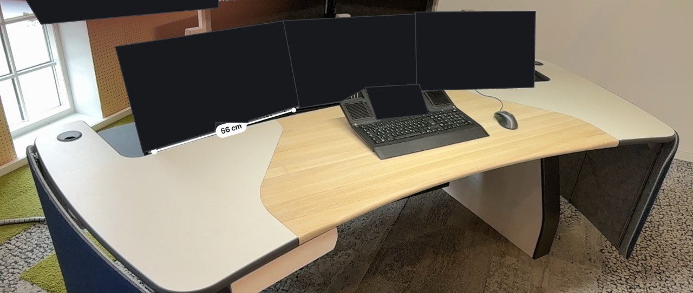

# Desk measurements and accuracy

## TL;DR

- **No size has been verified.** There is no tape value for this desk. The honest statement is: large visible sizes probably within 2–4 %, overall width 2.41 m ± 0.07 m.
- The scale rests on **one metre rule in one photo**. It is firm along the rule; nothing independent tests the depth and height directions.
- Of the model's 130 numbers, 52 come from photos, 62 are assumed, 16 belong to invented parts. Each carries its label in the model's files.
- The **phone's measuring app**: two labels on matt edges agreed within 1.5 %; three were 9–17 % off; the one measurement taken twice differed by 6 cm. Treat its labels as ± 3 cm at best, worse on dark glossy screens.
- **Motions are assumed.** No part was photographed in two positions. The desk-height travel is locked in the model and the tilt ranges are placeholders.

## How a size was obtained

Five routes were used. They are listed from strongest to weakest.

| Route | How it works | Used for | How good |
|---|---|---|---|
| Rule on the desktop | The phone stores the direction of gravity with each photo. With it, the level desktop in the rule photo can be flattened out and scaled by the rule | wood centre, keyboard unit, cable outlets, front arc, depth of the working surface | about 1 % along the rule; 2–3 % expected across it (untested) |
| Two photos (crossing sight lines) | The camera position is found for each photo. A point seen in two photos lies where the two sight lines cross | all five screens, canopy, legs, overall height | ± 2–3 cm. The sight lines missed each other by 1–5 cm, which sets that range |
| One photo and a known surface | The sight line is cut with a surface whose place is already known (the desktop, the floor, a leg's face) | outline of the desktop's ends, leg profile, panel under the top | ± 2–7 cm; useless when the camera looks along the surface |
| Label of the measuring app | Read off the screenshot | rear fabric fields, fan plate | ± 3 cm; see below |
| By eye | Judged from the pictures | depths of housings, posts, rails, the canopy's underside layout | unknown. Labelled "assumed" |

## The main sizes

Heights are above the floor unless stated. "±" is the range the true value is expected to lie in; it
is an estimate, not a tested tolerance.

| Size | Value | Range | Route |
|---|---|---|---|
| Overall width of the top | 2.41 m | ± 0.07 | one photo and the desktop surface, two ways that share one camera; the right half is a mirror of the left |
| Depth of the top, front corners to the rear of the ears | 0.94 m | ± 0.04 | same |
| Footprint with the rear wall | about 2.41 × 1.17 m | | from the above and the wall's position |
| Overall height (top of canopy and wall) | 1.98 m | ± 0.035 | two photos |
| Desk height as photographed | 0.77 m | ± 0.03 | two photos, on one leg's floor corners |
| Depth of the working surface at the centre | 0.603 m | ± 0.012 in the record; 2–3 % is the honest expectation | rule photo |
| Wood centre, width at the front and at the rear | 1.30 m and 0.91 m | ± 0.02 | rule photo |
| Top thickness | 3.2 cm | ± 0.8 | one photo |
| Large screens, housing | 1.11 × 0.632 m (a 49–50 inch class) | ± 0.02 | two photos, three views |
| Large screens, centre | 1.44 m high, 0.56 m left and right of the centre line, 0.82 m behind the front edge | ± 0.025 | two photos |
| Large screens, turned inward and tilted forward | 7.3° and 12.7° | ± 2° and ± 2.5° | two photos |
| Small screens, housing width | 0.617 m (a 27 inch class); height 0.366 m assumed | ± 0.012 | two photos |
| Small screens, top edge above the desktop | 0.285–0.29 m | ± 0.02 | two photos |
| Small screens, outer ones turned inward | 14° | ± 2° | two photos |
| Small screens, lean back | 16° | ± 5°, **weak** | one photo and an assumed housing height |
| Canopy | 1.16 m wide; lower edge 1.895 m high | ± 0.03 | two photos |
| Canopy depth in front of the posts | 0.87 m | 0.81–0.93; **in conflict** with an app label of 0.73 m | one slanted view per side |
| Rear wall | 1.16 m wide; upper part leans forward about 10° from 1.40 m up | ± 0.03; ± 5° | two photos; one photo |
| Rear fabric fields | blue 1.09 × 0.56 m, grey 1.09 × 0.59 m | ± 0.03 | app labels |
| Fan plate under the canopy | 0.28 × 0.30 m | ± 0.03 | app labels |
| Keyboard unit | 0.47 m wide, 0.38 m deep | ± 0.02 | rule photo |
| Legs | 0.77 m left and right of the centre line; at least 0.72 m long on the floor | ± 0.03 | two photos; one photo |
| End screens, lower edge | 11.5 cm above the floor | ± 3 | one face-on photo |
| Depth of the rear wall's base | 12.5 cm at most; **contested** | | carpet visible in two front photos; a rear photo suggests more |
| Assumed eye positions | seated about 1.2 m, standing about 1.6 m above the floor, 0.15 m in front of the desk edge | ± 0.1 | assumed from typical body sizes; a design reference, not a person |

The complete list with the reasoning for each number is in the model's parameter files,
`assets/operator-desk/params/` in the project's repository.

## What supports the scale, and what does not

An independent auditor re-ran the measuring scripts with deliberately wrong inputs to see which tests
could actually fail. Several could not.

| Test | Result | Does it prove anything? |
|---|---|---|
| The other marks of the rule, after scaling on two of them | within 2.6 mm (0.2 %) | **No.** It is the rule tested against itself. A wrong lens value or a tilted phone leaves it unchanged while moving the desktop's depth by 1.5–3 % |
| Key spacing of the keyboard against the standard 19.05 mm | 0.3 % for one of three assumed key heights; up to 3.6 % for the others | Hardly. Key height and phone tilt cannot be told apart |
| Four desktop points found again in three other photos | within 2–28 mm | Yes: a real, soft check |
| Screen housings against standard sizes (27 inch, 49 inch class) | fit within 1–2 % | Yes, soft: the screen models are not identified |
| Two app labels on matt edges | agree within 1.5 % | Yes, soft: an instrument of unknown quality |
| The held-back photo | agrees to about 5 cm | Yes, for errors above about 5 cm. It has since been used for one size and is no longer untouched |

So "the scale closes to 0.2 %", which an early draft of the record said, is true and means little.
What can be said: **about 1 % along the rule, 1.5–2.5 % at the far edges of the top, 2–4 % for sizes
away from the desktop. Expected, not shown.** The missing test is simple: the rule photographed lying
front to back, and standing upright.

Two more weaknesses the audit named:

- **The person who measured also built the model.** No second pair of eyes re-derived a size. The reviewers judged looks and structure and said themselves that they could not judge sizes.
- **The two routes to the overall width share one camera**, so their agreement (within 1 cm) is partly built in. That is why the range is ± 0.07 m and not ± 0.04 m.

## The phone's measuring app

Many phones have an app that measures a distance when you tap its two ends on the screen. It is
tempting because the number appears in the picture. Here every label was checked against the
rule-based scale.

| What was measured | App label | From rule and photos | Difference |
|---|---|---|---|
| Canopy front edge, corner to corner (matt wood) | 1.15 m | 1.167 m | 1.5 %: agrees |
| Under the canopy, post to post (matt aluminium) | 1.14 m | 1.124 m | 1.4 %: agrees |
| Wood centre of the desktop, front edge | 1.27 m | 1.304 m | 2.6 % short |
| Meeting edge of the large screens, second try | 61 cm | 62–64 cm | 3 % short |
| Lower edge of a small screen | 56 cm | 61–63 cm | 9 % short |
| Meeting edge of the large screens, first try | 55 cm | 62–64 cm | 13 % short |
| Side of the canopy | 73 cm | 87–89 cm | 17 % short: **unexplained** |
| Fan plate, two sides | 28 and 30 cm | no cross-check | used as given, ± 3 cm |
| Rear fabric fields | 1.09 m; 54, 57, 59 cm | fits the wall's width | used as given, ± 3 cm |
| Canopy corner to a point on the floor | 1.96 m | the line is slanted, not a height | not usable alone |

*The same edge measured twice with the app, from two positions: 55 cm and 61 cm. From the photos it is 62–64 cm.*

*One screenshot, two labels. The front edge (1.15 m) agrees with the photos within 1.5 %. The side (73 cm) is 14 cm shorter than the photos say, and two separate checks speak against 73 cm.*

*56 cm on the lower edge of a small screen whose housing is about 62 cm wide.*

What to take from this:

- **± 3 cm at best.** Good enough to tell a 27 inch screen from a 49 inch one; not good enough to size a part.
- **Worst on dark glossy surfaces.** All three labels on screen edges were short, by 2, 5 and 8 cm. The two good ones were on matt wood and aluminium.
- **A label is only as good as its end points.** Where an end point was out of the frame the label could not be used at all.
- **Count measurements, not screenshots.** The app leaves a measurement standing in the scene, so five screenshots of the canopy showed the same single measurement. 21 screenshots held about a dozen measurements; five of them ended up in the model, all on the rear or under the canopy.
- This is one phone on one day. It is a caution, not a law.

## Numbers that were wrong, and how they were caught

Each of these was in the table of sizes for a while. They are kept in the record because they show
where the method is weak.

| Wrong value | Right value | Why it was wrong |
|---|---|---|
| Large screens "43 inch" | 49–50 inch class | sized by eye against another part: 20 % off |
| Wall height 1.70 m | 1.98 m | a fit that had exactly as many unknowns as measurements, so it could not show its own error; it also assumed a flat wall |
| Canopy rear corners 0.79–0.83 m | 0.87 m | the sight line ran almost parallel to the surface it was cut with: 7 cm of error per cm of height |
| Box under the top, 0.30 m behind the front edge | a panel 0.60 m behind it | placed by eye along the line of sight |
| Wall base 0.40 m, then 0.30 m deep | 0.125 m at most | placed by eye along the line of sight, twice |
| End screens 0.26 m above the floor | 0.115 m | the photo saw the surface edge-on |

Three rules came out of this and are now in the written method: a size judged **by eye along the line
of sight** is not a size; a **sight line that grazes a surface** gives nothing; and a calculation that
**cannot show its own error** must be checked against something else.

## What the photos could not settle

1. **Canopy depth:** 0.73 m (app) or 0.87–0.89 m (photos). The model uses 0.87 m.
2. **Lean of the wall's upper part:** 8–12° from the front photos, 15–18° by the look of the wide-lens side photo.
3. **The open base of the wall:** its height is only what is left over after the fabric fields; its depth is contested.
4. **Whether and how far the top rises, and what rises with it.**
5. **The lean of the small screens**, and any tilt range.
6. **Depth of everything seen in one photo only:** the tray under the top, housing depths, posts, most of the canopy's underside.
7. **The underside of the top and the inside of the legs:** never photographed.
8. **Which screen models these are.** No label was read. Maker drawings would replace eight assumed values.

## Motions: all assumed

| Motion | In the model | What is known |
|---|---|---|
| Desk height | present, **locked** at the photographed 0.77 m | A lifting leg is suggested by the leg's shape. No second height was photographed. In the model, more than 5 cm of travel brings a screen post against a rail whose size is a guess, so the number means nothing |
| Tilt of each small screen | 14.5–28° lean, placeholder | A pivoting bracket is visible from behind, in one position |
| Tilt of each large screen | 2–14° forward, placeholder, locked | Bracket visible; range unknown |

The tilt limits are simply where the model's own parts would start to touch. They say something
about the model, **nothing about the real brackets**. The three questions that would replace these
placeholders are on the page [questions for the site](questions-for-the-site.md).
