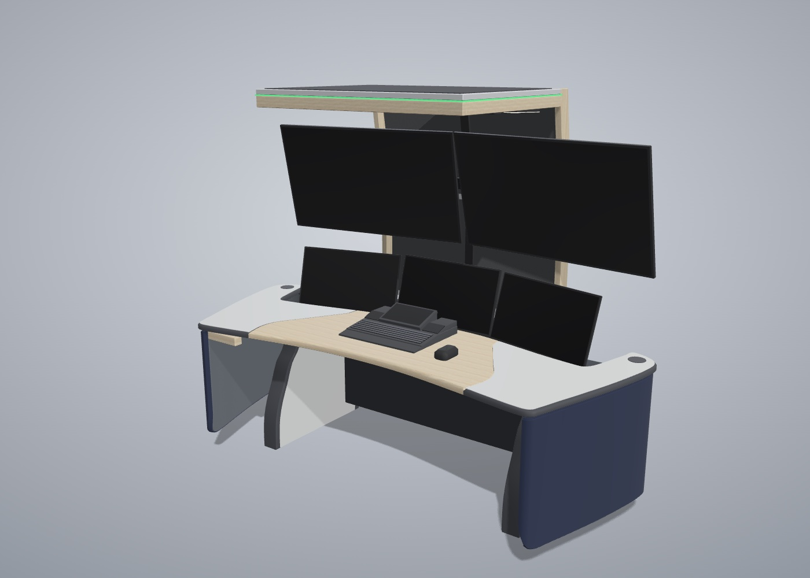
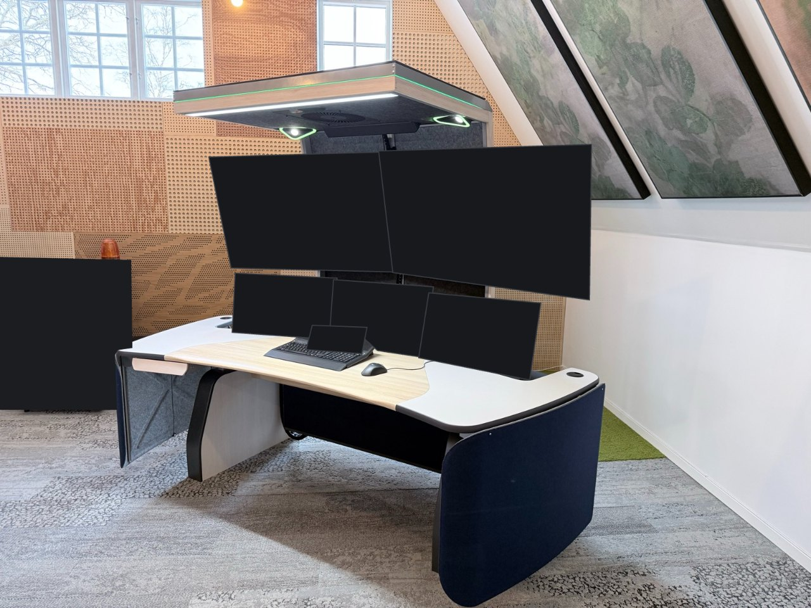
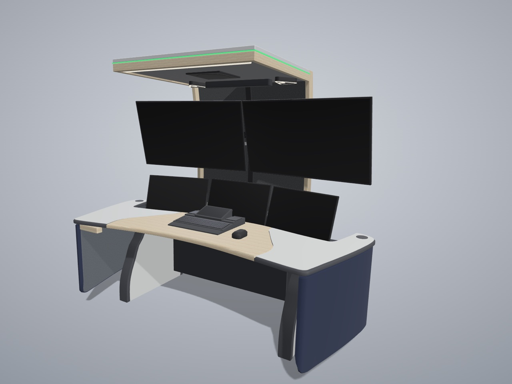
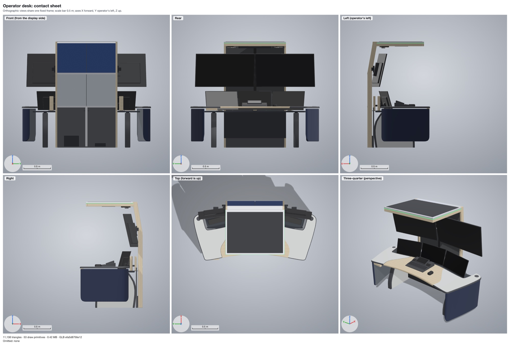
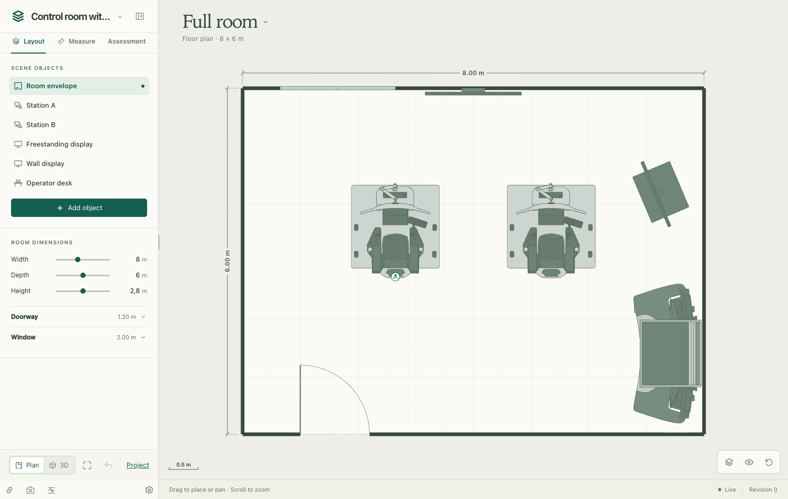
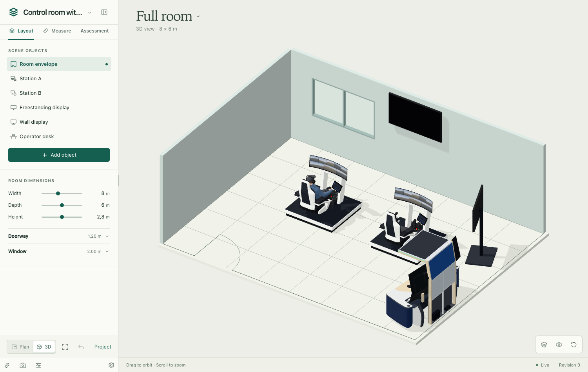

# Operator desk: a second object built from photos

## TL;DR

- A control-room desk (curved top, five screens, rear wall, canopy) was modelled from **15 phone photos and 21 screenshots of a phone's measuring app**, all taken in eleven minutes. The work took one AI modeller about three hours, plus about 80 minutes of independent review and audit.
- The result is a **recognisable model divided into 30 named parts** with 6 screen surfaces. Three independent reviewers each accepted it "with minor fixes", and a fourth, checking the last fixes, accepted it outright.
- **Sizes are unverified.** Nobody has held a tape against the desk. They are probably within 2–4 %; the overall width is 2.41 m ± 0.07 m. Six in ten of the model's numbers are assumed or invented, and each one says so.
- **Verdict: feasible** for placing the desk in a room and for a first look at sight lines. **Not yet** for anything that depends on how far the top rises or how far a screen tilts: both are assumed.
- The most valuable thing in the photo set was **a metre rule lying on the desktop**. The phone's measuring app was only good to about ±3 cm, and worse on dark glossy screens.

This section is written for the people who work with the desk. It says what was done, shows the
intermediate pictures, and is plain about what is known and what is guessed. Pictures of the model are
computer renders. Photographs are masked copies: every screen is filled dark, labels and logos are
covered, and nothing identifies the site, the desk's maker or any person.

## The result

*The finished model (build efa3d875): 11,138 triangles, 30 parts, 6 screen surfaces. Screens are blank on purpose.*

*Left: one of the photographs (masked). Right: the model seen from the same spot with the same lens. This photo was held back during measuring, so it is a fair test: the model agrees with it to about 5 cm.*

*The finished model from six sides, with a 0.5 m scale bar in each view.*

The desk is now one of the objects that can be placed in a room in the Synergon room editor, next to
the two operator stations built earlier.

*The desk placed in the default 8 × 6 m room: floor plan and 3D view (local build at the time of writing).*

## What was modelled

A workstation for one operator: a curved desktop with a wood centre and grey wings, standing on two
legs with fabric end screens; a shelf with three small screens; a keyboard unit with its own touch
panel, and a mouse; a rear wall with fabric fields and an open base for equipment; two large screens
hung on the wall; and a canopy with a light strip, two spotlights and a fan plate.

| | |
|---|---|
| Overall size | 2.41 m wide (± 0.07), 1.17 m deep, 1.98 m high: **unverified** |
| Desk height as photographed | 0.77 m (± 0.03) |
| Parts | 30 named parts in 5 groups, plus 6 screen surfaces |
| Motions | 6: desk height and the tilt of each of the five screens. All assumed; desk height is locked |
| Reference points | 13, for example the centre of each screen, the front edge of the desktop, an assumed seated and standing eye position |
| Numbers behind the model | 130. From photos: 52. Assumed: 62. Invented (parts never seen): 16. From a tape: 0 |
| File | one 0.42 MB file in the open glTF format, with a description file listing every part and number |

Not modelled, on purpose: cables, what the screens show, logos, single keys.

## Is this a feasible approach?

The answer comes in three parts.

**What this approach is good for**

| Use | Verdict |
|---|---|
| A picture that people who know the desk recognise | Yes. Three independent reviews, each "accept with minor fixes", then a closing review: "accept" |
| Placing the desk in a room: footprint, heights, clearances | Yes, to a few centimetres |
| Distance and angle from an assumed eye position to each of the six screens | Yes, as first estimates |
| A model that improves when real measurements arrive | Yes. A tape value replaces an estimate in a text file, with no change to the model's code |
| Naming and separating the parts (which screen, which panel) | Yes. The parts list was accepted unchanged in all three reviews |

**What it needs**

| Need | Amount |
|---|---|
| Photos | About 14 well-chosen ones. See the [photo guide](photo-guide.md) |
| A scale object in the picture | One metre rule or tape, photographed lying flat, front to back and upright |
| Tape readings | About ten. See [questions for the site](questions-for-the-site.md) |
| Answers only the site can give | Three: does the top rise and how far, is the screen tilt adjustable, how deep is the canopy |
| Working time | About three hours for the modeller and 80 minutes of independent checking, for an object of this size |
| A second pair of eyes | Reviewers that did not build the model. They found things the builder could not see in every round |

**What it cannot give**

| Not available | Why |
|---|---|
| Verified accuracy | No tape value exists for this desk. Every check so far is the photos tested against themselves |
| Anything never photographed | The underside of the top, the inside of the legs and the lifting columns are invented and marked as such |
| Depth of things seen in one photo only | Three such values were wrong by 20–30 cm during the build. Two were caught by measuring again, one by a reviewer |
| How parts move | No part was photographed in two positions. The height travel and all tilt ranges are assumptions |
| An ergonomic assessment that depends on those motions | Not until the three questions are answered |

A caution on how far this generalises: the method has now worked on two objects, both built by the
same team, both without a tape value to score against. It has not been tried with photos from another
make of phone, with forwarded or edited photos, or on objects without a flat level surface to lay a
rule on.

## What it cost

| Who | What | Minutes | Tokens |
|---|---|---|---|
| Lead modeller | Measuring, parts list, tool changes | 48 | |
| Lead modeller | Simple first model and review packet | 45 | |
| Lead modeller | Shaped model, clearance check, texture layer | 29 | |
| Lead modeller | Fixes after review 2, drills, model card | 30 | |
| Lead modeller | Fixes after review 3 and the audits, method update | 45 | |
| **Lead modeller, total** | | **about 198** | not logged as a clean total (see below) |
| Reviewer 1 (simple model) | | 40 | 147,000 |
| Reviewer 2 (shaped model) | | 5 | 145,000 |
| Reviewer 3 (final) | | 5 | 180,000 |
| Method auditor | | 15 | 278,000 |
| Code and platform reviewer | | 16 | 327,000 |
| **Independent checking, total** | | **about 81** | **about 1.08 million** |

A token is the unit AI services count work in; a thousand tokens is roughly 750 words read or
written. The modeller's minutes are its own log and are approximate (by the times on the files the
last stage was nearer 20–30 minutes, so about three hours in all). The reviewers' and auditors' figures come from the
software that runs the agents. The modeller's token use was not logged as a sum: the two figures on
record (about 0.57 and 0.52 million) are partly cumulative, so the true total is higher and is
**not known**. Writing this wiki section and placing the desk in the room are not in the table. About
fifteen small one-off scripts were written for the measuring; a second desk would need fewer.

## The pages of this section

1. [How it was done, step by step](how-it-was-done.md): goals, the way of working, each step with its picture, and what was changed along the way.
2. [Measurements and accuracy](measurements-and-accuracy.md): how each size was found, how sure it is, and how the phone's measuring app did.
3. [Reviews, changes to the method, lessons](review-and-lessons.md): what the independent reviewers and auditors found and what we changed.
4. [Photo guide](photo-guide.md): were these photos enough, which ones carried the result, and how to take documentation photos next time.
5. [Questions for the site](questions-for-the-site.md): three questions and ten tape readings that would settle most of what is open.

## Words used in this section

| Word | Meaning here |
|---|---|
| Part | A piece of the desk a person would name (left leg, canopy, middle small screen). Each is a separate object in the model |
| Simple first model (blockout) | Every part as a plain box of the right size in the right place, before any shaping |
| Joint | A motion built into the model, with limits (desk height, screen tilt) |
| Range | How far a value could be off, written "± 0.03 m" |
| Assumed | A value chosen from experience because the photos do not show it. Labelled, and listed for the site to check |
| Invented | A part nobody saw (for example the lifting columns inside the legs), added so the model is complete. Labelled |
| Held-back photo | A photo that no size was taken from, kept aside to test the finished model against |
| Sight line | The straight line from the camera through a point in a photo. Where the sight lines of two photos cross, the point is |
| Reviewer | A fresh AI agent that sees only the pictures and the parts list, never the builder's notes |
