# Photo guide: documenting an object for modelling

## TL;DR

- **Were the photos enough?** Yes for a recognisable model with the right layout and parts. No for verified sizes, for angles (± 5° on the small screens) and for anything that moves.
- **The model rests on 15 of the 36 images.** Four photos carry almost all the geometry: the one with the metre rule, and three of the whole desk from different sides.
- **19 images were not needed:** repeats of the same view, and screenshots that show the same measurement again.
- **Nine views were missing**, each of which would have settled an open point: square-on side, from above each end, the rule upright, under the top, the top at a second height.
- **Next time:** about 14 photos taken to the list below, plus ten tape readings, beat a hundred casual photos.

All photographs on this page are masked copies: screens filled dark, labels and logos covered, the
surroundings cropped where they showed other equipment or people.

## Were these photos sufficient?

| For | Enough? | Why |
|---|---|---|
| Recognising the desk and its parts | Yes | every visible part was seen in at least one photo |
| Layout: where each screen is, how big, how the top is shaped | Yes, to 2–4 % | three viewpoints of the whole desk plus a rule on the desktop |
| Trusting the sizes | No | nothing but the photos themselves confirms them; no tape reading |
| Depth and height scale | Partly | the rule lay in one direction only |
| The right end of the top | No | only the left end was seen from above; the right is a mirror copy |
| Side profile: lean of the wall, tilt of the screens, depth of the canopy | Weak | no square-on side photo; the side was seen only through the wide lens |
| Under the top, inside the legs | No | never photographed; those parts are invented |
| Motion: height travel, tilt ranges | No | every part appears in one position only |

## The photos the result rests on

**This is the list of what was actually used. It is not a proven minimum: nobody has rebuilt the
model from these 15 alone.**

### The scale

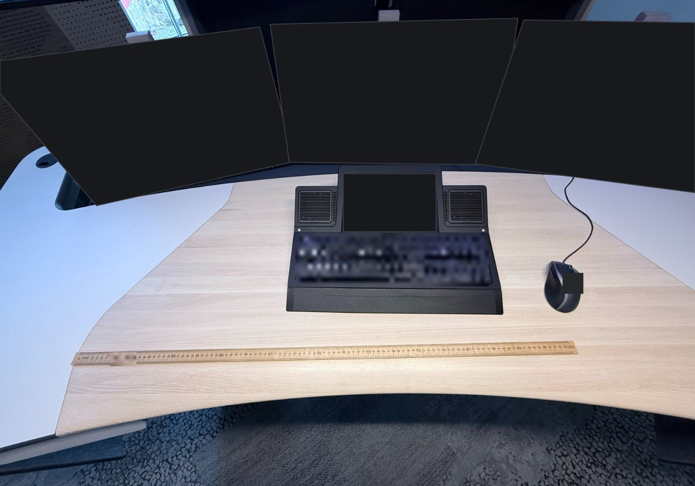
*Photo 1. Wide lens, from above, a metre rule on the desktop. It gave the scale of the whole model, the outline of the middle of the top, and the keyboard unit. If only one photo could be kept, it would be this one.*

### The whole desk from three sides, and one held back

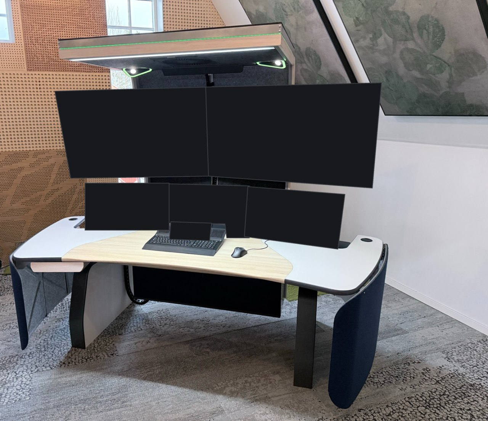
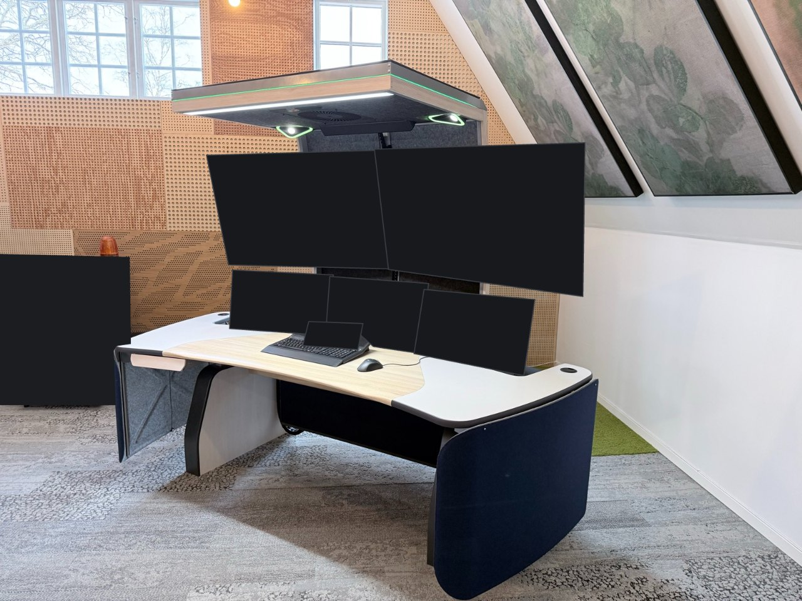
*Photo 2 (left): from the front. Position and size of all five screens, the legs, the panel under the top. Photo 5 (right): from the front right. Held back as the test of the finished model.*

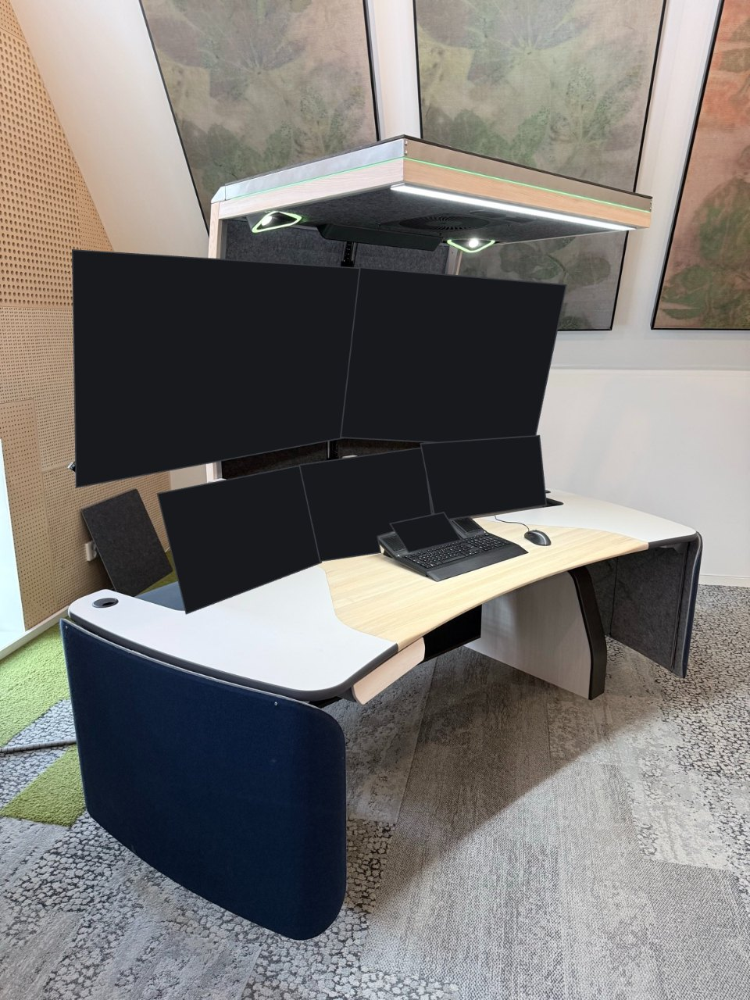
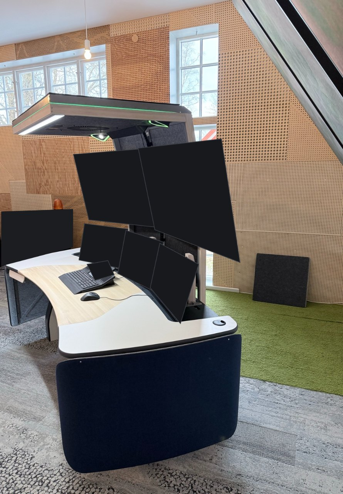
*Photo 3 (left): from the front left, 64° round from photo 2. Together they place every point by crossing sight lines. Photo 4 (right): from the right end. The end screen face-on, the profile of the wall's posts.*

### From above one end

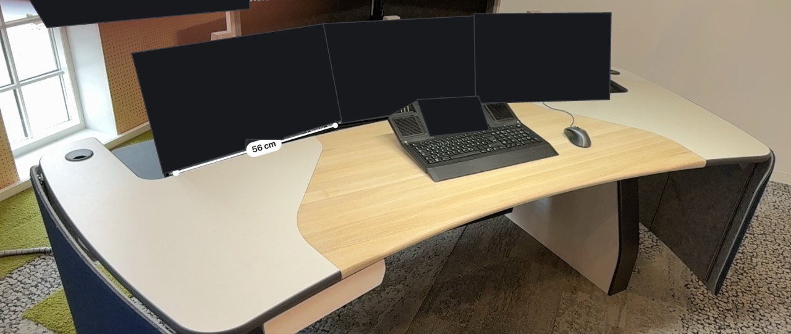
*Photo 6: a measuring-app screenshot, used as a picture. Straightened out mathematically, it gave the outline of the left end of the top. A plain photo from the same spot would have done better.*

### The rear and the side

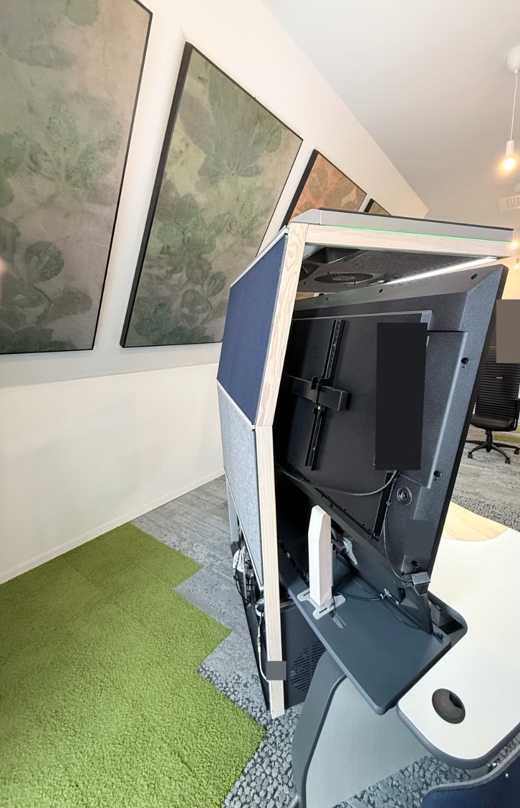
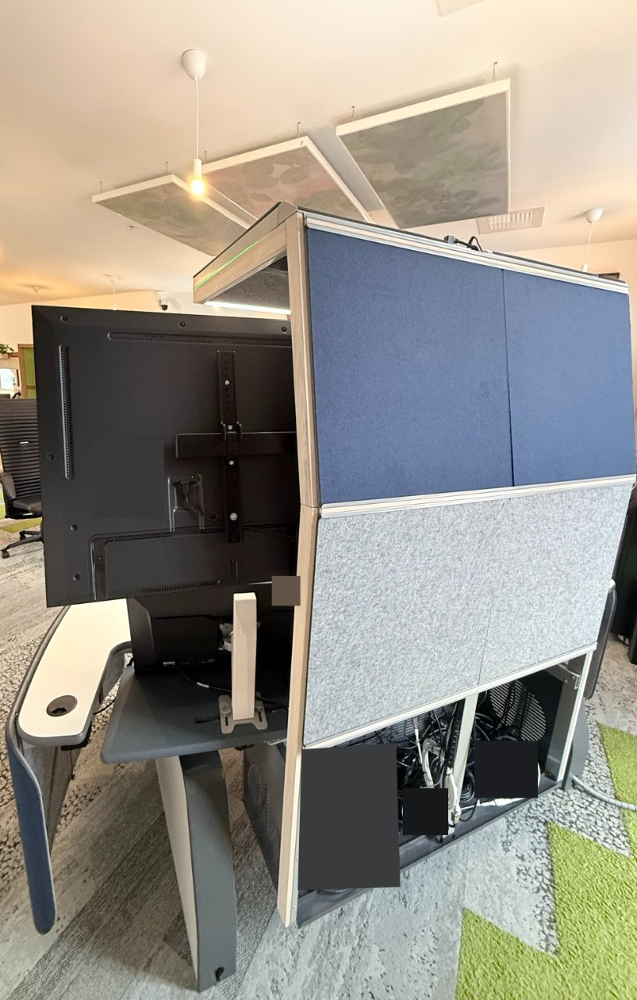
*Photo 7 (left): the wall from the side. It showed that the wall is thin and has a kink; no size was taken from it. Photo 8 (right): from behind. The fabric fields, the open base, a leg from the rear. Both are wide-lens photos: good for understanding, poor for measuring.*

### Labels of the measuring app that were used

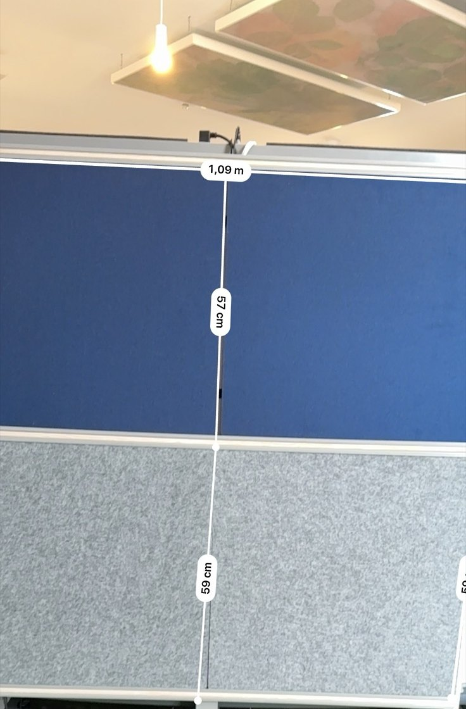
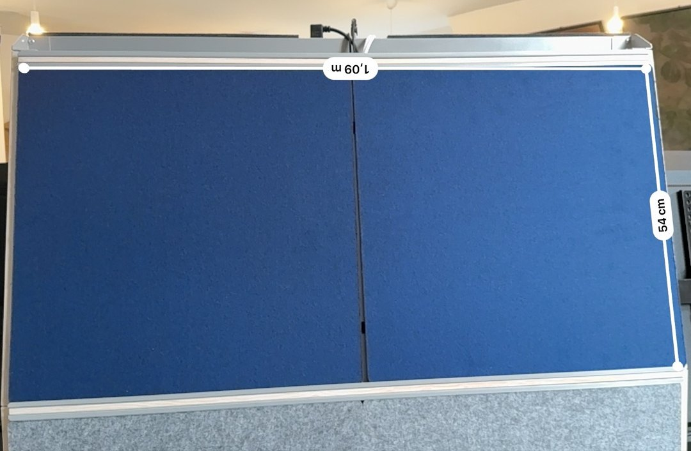
*Photos 9 and 10: the rear fabric fields with the app's labels. Used with ± 3 cm because nothing better exists. The blue fabric and grey felt textures were also cut from these.*

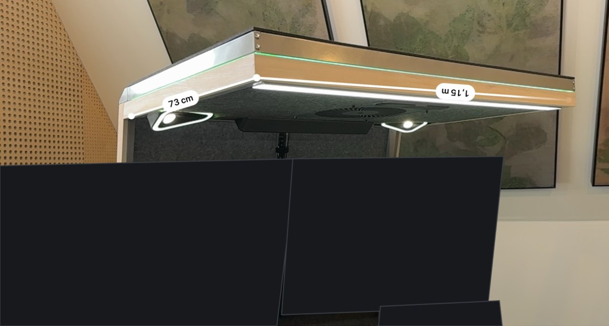
*Photo 11: the canopy with a good label (1.15 m, front) and one in conflict (73 cm, side).*

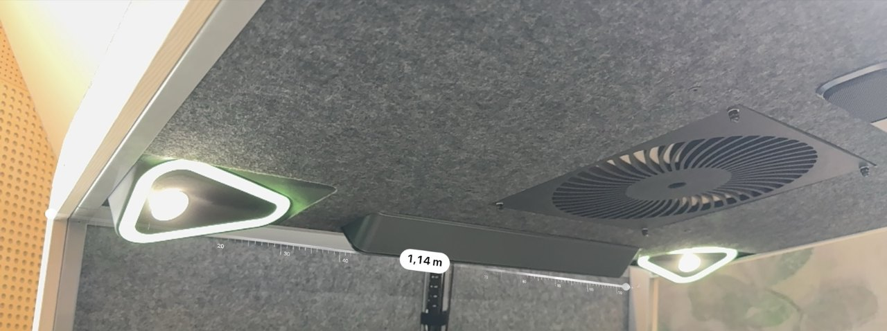
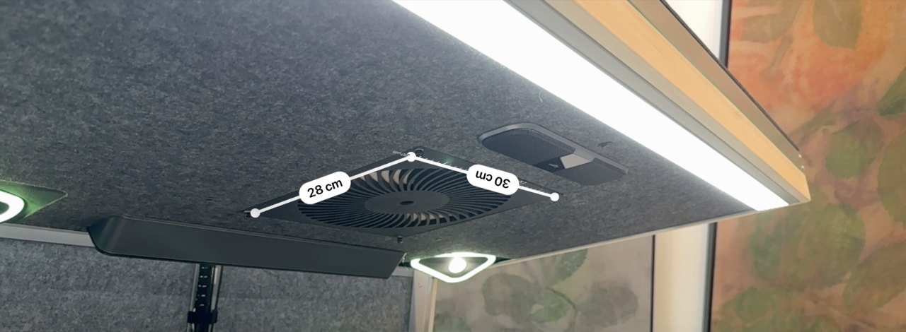
*Photos 12 and 13: under the canopy. The layout of spotlights, bar and light strip; the size of the fan plate.*

### Close-ups

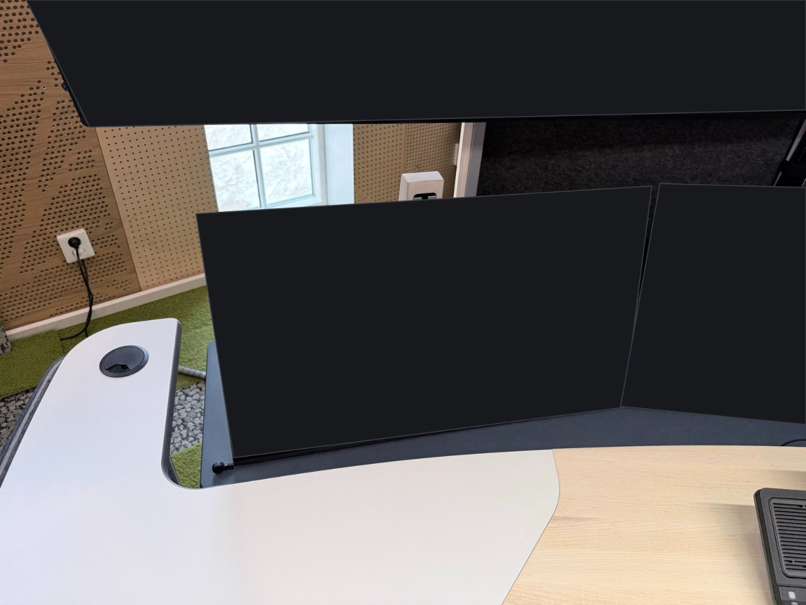
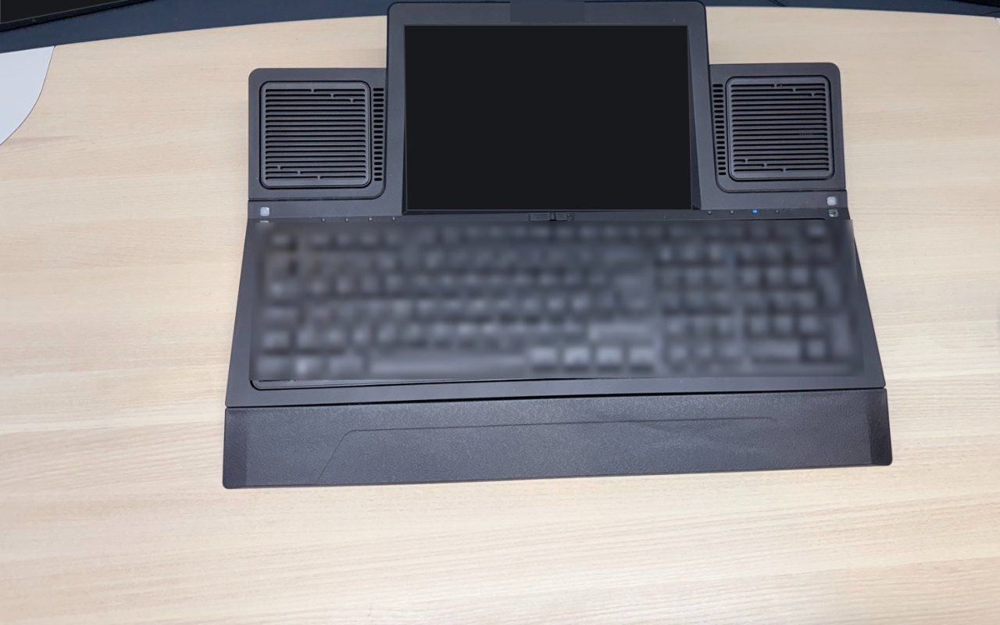
*Photo 14 (left): how the small screens stand on the shelf. Photo 15 (right): the layout of the keyboard unit.*

Six of these fifteen are measuring-app screenshots. They were needed only because the plain photo
that would have served better was not taken.

## The same set, stated as views to take

| View | How many | In this set |
|---|---|---|
| A metre rule on the main flat surface, from above | 1 | yes (photo 1) |
| The whole object, main lens, from clearly different sides | 3 | yes (photos 2, 3, 4) |
| More whole-object photos, to be held back as tests | 2 | only one (photo 5) |
| From above each end of the top | 2 | only the left end, as a screenshot (photo 6) |
| The rear and one side | 2 | yes, but wide lens only (photos 7, 8) |
| Close-ups: each kind of part, each material | about 4 | yes (photos 14, 15, and material patches from 9, 10, 12) |
| Tape readings | about 10 | **none** |

What that set bought: a recognisable, well-divided model with 60 % of its numbers assumed or invented
and every size unverified. Enough for layout and a first look.

## What was not needed

19 of the 36 images added nothing to the model.

| Images | Why not needed |
|---|---|
| A second photo one step to the side of photo 3 | the same viewpoint: two photos must be well apart for sight lines to cross cleanly |
| Two more close-ups of small screens | repeat photo 14 for the other screens |
| Three more wide-lens photos of the rear and along the desk | repeat photos 7 and 8 |
| Four more screenshots of the canopy | show the same two measurements as photo 11: the app leaves a measurement standing in the scene |
| Seven more screenshots of the rear fields and the canopy underside | repeat photos 9, 10, 12, 13; in one the end points are out of the frame |
| Two screenshots at screen level | no label, or a label 2.6 % short on a span the rule photo gives better |

The remaining two images (15 + 19 + 2 = 36) are screenshots of the large screens' meeting edge. They
gave nothing to the model but are the evidence on the app: the only measurement it took twice, 55 cm
and 61 cm. They are shown on the [accuracy page](measurements-and-accuracy.md#the-phones-measuring-app).

## What was missing

| Missing photo or reading | What it would have settled |
|---|---|
| The whole desk square-on from the side, main lens, from 4 m or more | lean of the wall (now ± 5°), tilt of the screens, depth of the canopy, leg profile |
| From straight above each end of the top, or from as high as you can reach | the right end (now a mirror of the left), the shelf |
| The rule standing upright against the desk edge, and lying front to back | desk height and depth scale without relying on the phone's lens data |
| The rule held beside the canopy's side | the canopy depth conflict (0.73 or 0.87 m) |
| From the floor, looking under the top | panel, tray, upper ends of the legs, lifting columns: now invented or weak |
| The desk at a second height | whether it moves, how far, and what moves with it |
| A phone's level app laid on a small and on a large screen | their lean: the weakest important values in the model |
| Close photos of the type labels on the screens and the keyboard unit | sizes and depths from the makers' drawings instead of estimates |
| A main-lens photo of the rear | the rear is known only from wide-lens photos and screenshots |

## How to take documentation photos next time

Ten minutes, an ordinary phone, a folding rule or a tape.

**Before you start**

1. **Screens off or blank, no people in the frame** if you can. It makes the pictures easier to share later.
2. **Use the main lens** (1×) for everything that will be measured. Use the wide lens only for the rule shot from above and where you cannot step back.
3. **Hold the phone still, upright or level**, not tilted sideways.

**The rule**

4. **Put a rule in the picture.** Lay a metre rule or a tape on the main flat surface and photograph it from above.
5. **Do it twice more:** the rule lying front to back, and the rule standing upright against the edge. Without these nothing tests depth and height.

**The whole object**

6. **From each front corner, straight from the front, and from each side.** The whole object in the frame, from standing height. A step to the side is not a new view; walk a quarter of the way round.
7. **Square-on views are worth the most:** straight from the front, straight from the side, straight from behind, and from above. Step well back (4 m or more) and zoom in a little if needed.
8. **Take two or three more than seems necessary.** The modeller keeps some aside to test the model against.

**The parts**

9. **Photograph flat faces face-on.** A panel seen edge-on gives no height or depth.
10. **Look underneath and behind once.** What is never photographed has to be invented.
11. **Show what moves in both positions,** from the same spot: the top at its lowest and highest, a screen tilted both ways.
12. **Type labels: do photograph them, close up.** They lead to the makers' drawings. The originals stay private; nothing with a name on it is published.
13. **Materials:** one sharp close photo of each surface in even light, face-on, about 20 cm across.

**Measuring and sending**

14. **Skip the measuring app; photograph a tape instead.** If you do use the app, keep both end points in the frame and say from where to where.
15. **Send the phone's original files**, unedited: by cable, a file transfer, or a shared album set to originals. Messaging apps and e-mail shrink the pictures and strip the data stored in them (lens, and on some phones the direction of gravity), which did much of the work here.
16. **Ten tape readings beat a hundred photos.** The list for this desk is on the page [questions for the site](questions-for-the-site.md).

## A short version to take along

| Shot | Count |
|---|---|
| Rule on the surface from above; rule front to back; rule upright | 3 |
| Whole object: front, both front corners, both sides, rear | 6 |
| From above each end, or as high as you can reach | 2 |
| Under the top, from the floor | 1 |
| Each moving part in its second position | 1–2 |
| Close-ups: type labels, each material | 4–6 |
| **Total** | **about 18 photos, plus ten tape readings** |
