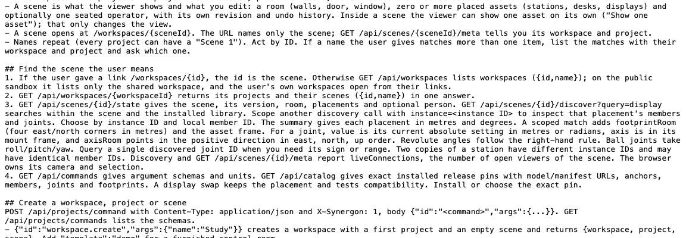
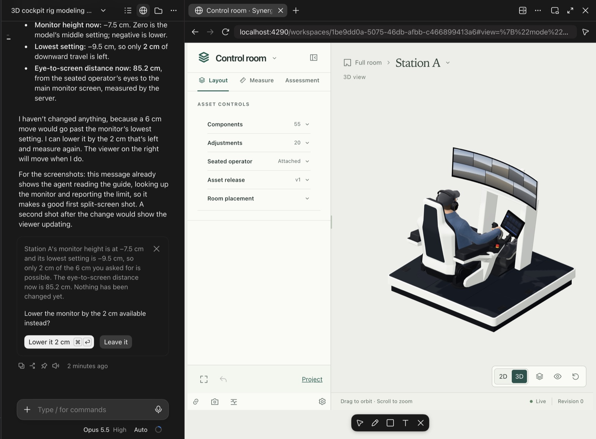
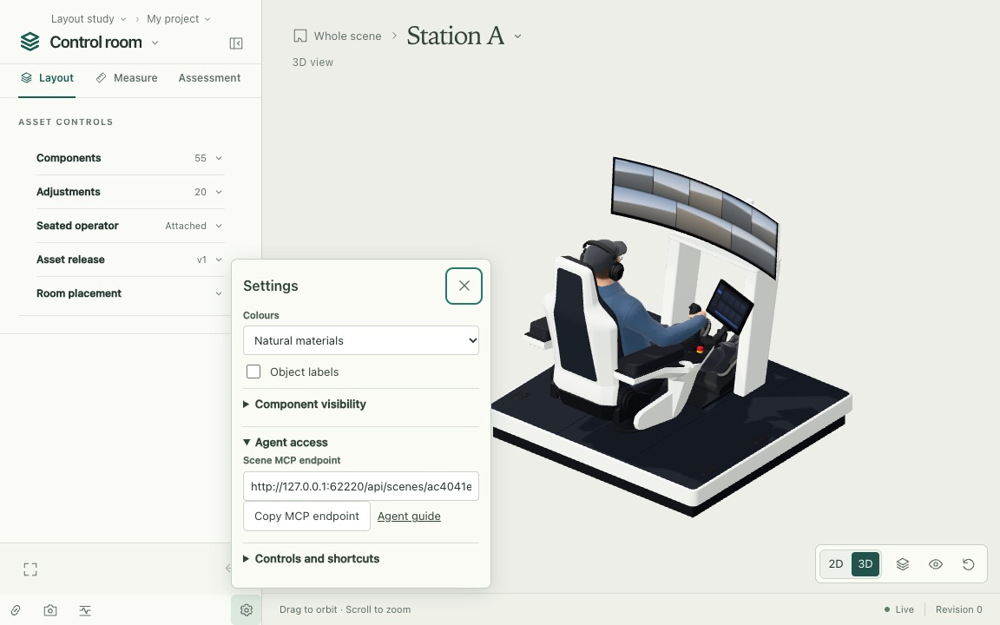
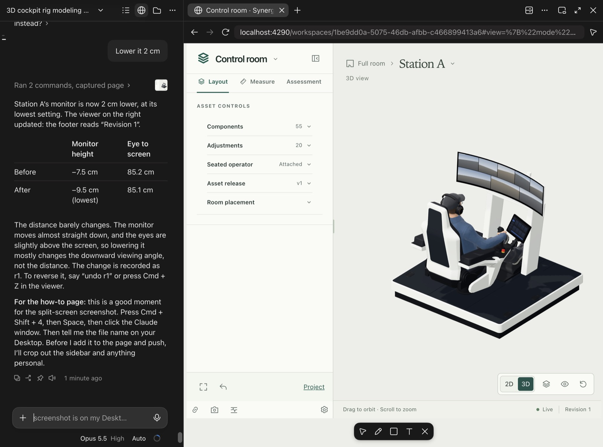
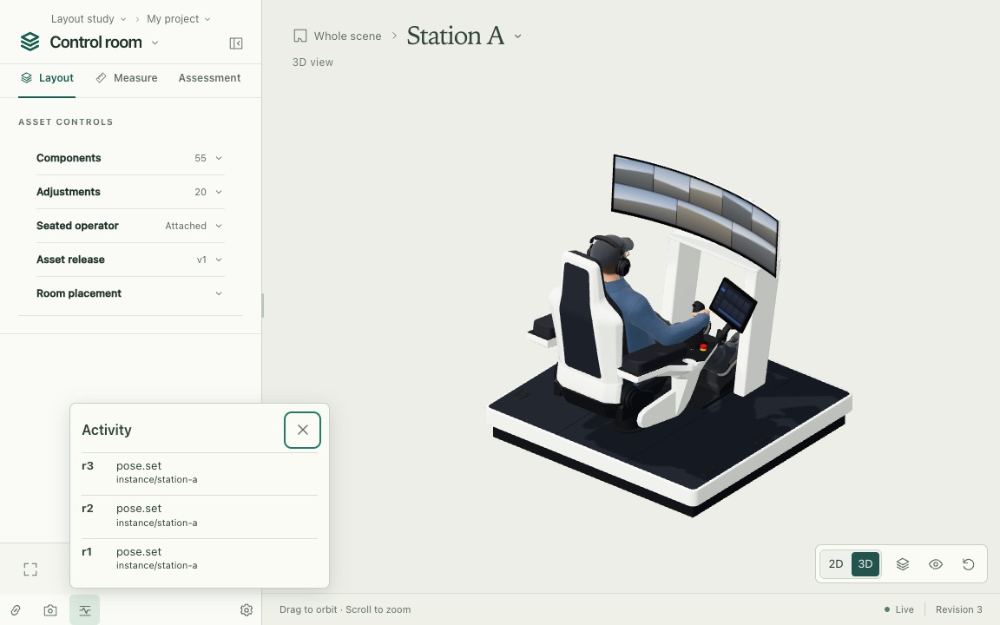

# How to work with Synergon through an AI agent

## TL;DR

- Synergon is organised as **Workspace → Project → Scene**. You work in a scene: a room with its assets and operator. Its link is `/workspaces/<scene>`.
- Open the scene and put the agent conversation and the viewer side by side.
- Start with one message that says what you want to do, points the agent at the **Agent guide** (`/llms.txt`, written for AI agents) and asks it to open your scene.
- Then ask in plain words ("lower the monitor at Station A by 3 cm"). The agent uses the same commands as the buttons, so every change appears live in the viewer and in its **Activity** list.
- Ask for numbers, not impressions. Every change can be undone. The public site is an open sandbox: put nothing confidential in it.

## What you need

- **An agent harness**: a program in which an AI model can read web pages and make web requests on your behalf. Tested here with **Claude Code** (the desktop app's Code tab; the same works in its terminal and IDE versions). **Codex** (OpenAI's command-line tool, IDE extension and app) and other harnesses that can make web requests or connect to an MCP server work the same way. *(Tested with Claude Code; Codex not tested here.)*
- **A Synergon scene**: on the public site, https://synergon.mightwork.ai/, or on a local installation (`bun run serve`).
- Nothing to install in Synergon. The agent talks to the same server the viewer uses.

## Step 1 · Open your scene

On the Synergon homepage choose **Open viewer**: it reopens your last scene, or makes a new one with a furnished control room. To pick another, use **Workspaces ▾** in the bar at the top, then the project and the scene. The address in the browser, `…/workspaces/<scene>`, is the scene's link. Copy it: it tells the agent exactly which scene you mean.


*The homepage. **Workspaces ▾**, then the project, then the scene.*

## Step 2 · Start the conversation: goal, Agent guide, scene

The **Agent guide** is a short plain-text page at `/llms.txt` (https://synergon.mightwork.ai/llms.txt). It is written for AI agents, not for people. It explains the hierarchy Workspace → Project → Scene and tells an agent how to find a scene, look up the exact names of parts and adjustments, send a command, check that it worked and undo it. The homepage links to it (**Agent guide**), and so does the viewer under **Settings → Agent access**. You do not need to read it.

Your first message should give the agent three things at once: what you are trying to do, the Agent guide, and the scene. For example:

> I want to work on the layout of my control room in Synergon. First read the Agent guide at https://synergon.mightwork.ai/llms.txt. Then open my scene https://synergon.mightwork.ai/workspaces/<scene> in the preview browser and wait for my first request.

- **Claude Code desktop app:** "in the preview browser" opens the scene in the app's browser pane: the conversation stays on the left, the viewer opens on the right.
- **Codex, or Claude Code in a terminal:** leave that part out and place the terminal and your own browser next to each other.

Changes made by the agent appear in every open viewer of that scene within a second, so it does not matter which browser shows it.


*The top of the Agent guide. Its first paragraph tells the agent what it is for.*


*The Claude Code desktop app, conversation left, viewer right (a local installation, before the workspace menus were added). Asked to lower Station A's monitor by 6 cm, the agent read the Agent guide, found that only 2 cm of travel was left, reported the eye-to-screen distance (85.2 cm) and asked before changing anything. The viewer still shows Revision 0.*

The agent can also find a scene by name: *"Use the scene Option B in the project Phase 2."* Names can repeat, so a well-behaved agent asks when more than one fits.

## Step 3 · Optional: connect the agent as an MCP tool

With the Agent guide alone, the agent sends ordinary web requests. For a closer connection, a harness that supports MCP (Model Context Protocol, a standard way to give an agent a set of tools) can load the scene's commands as tools. In the viewer, open **Settings** (the cog at the bottom left), then **Agent access**, and choose **Copy MCP endpoint**.


*Settings → Agent access. This screenshot is from a local installation; on the public site the endpoint starts with https://synergon.mightwork.ai.*

Then add it to your harness and start a new conversation:

```bash
claude mcp add --transport http synergon <MCP endpoint>
```

```bash
codex mcp add synergon --url <MCP endpoint>
```

Both routes reach the same commands. Use one; the Agent guide is enough to start. For creating workspaces, projects and scenes through MCP, add `/api/projects/mcp` the same way.

## Step 4 · Ask in plain words

Say what you want as you would to a colleague. Name the station or object, and give sizes with units. Examples that work:

| You ask | What the agent does |
|---|---|
| *Lower the monitor at Station A by 3 cm.* | Finds Station A's monitor height adjustment and changes it by -3 cm. |
| *Recline the backrest at Station B a little and tell me the new angle.* | Changes the backrest and reports the value it set. |
| *Move the operator desk 50 cm towards the window.* | Moves the desk in the room plan and reports its new position. |
| *How far is the operator's eye from the centre of the screen at Station A?* | Asks the server to measure from the seated operator's eyes and reports the distance. |
| *Is there a clear path from the door to Station B?* | Measures the clearance from the door and reports the narrowest gap. |
| *Run the assessment and list the findings that do not pass.* | Runs the configured assessment and summarises each finding with its status. |
| *Show me the operator's view.* | In the Claude Code desktop app, clicks **Operator's eye** in the viewer in its browser pane. Rooms have no remote camera command yet, so an agent without a browser asks you to click it. |
| *Make a new scene called Option B in this project, with an empty room.* | Creates the scene and gives you its link. |
| *Undo your last two changes.* | Undoes them by their recorded numbers. |

If a request is ambiguous, for example two stations both have a monitor, the agent should ask which one you mean. If an adjustment's range is only assumed, Synergon says so, and the agent should tell you.

## Step 5 · Watch the change and check it

The viewer updates as soon as the agent's command is accepted.


*After the reply "Lower it 2 cm": the agent lowered the monitor to its lowest setting, measured again (85.2 cm before, 85.1 cm after) and explained why the distance hardly changes. The viewer's footer now reads Revision 1.*

To see what was done, open **Activity** (the button with the wave symbol at the bottom left). Each change has a number (r1, r2, …), the command and the object it changed.


*Three adjustments to Station A made by an agent, listed in Activity with their numbers.*

Ask the agent for the numbers behind a change: *"What is the monitor height now, and how is it known?"* Measurements are computed by the server from the model, so they are the same whether a person or an agent asks.

## Step 6 · Undo

Every change made by the agent can be undone: ask the agent (*"undo r3"*, *"undo your last change"*), or undo the latest change in the viewer with Ctrl/Cmd + Z or the undo arrow at the bottom of the left panel.

## Good practice

- **One clear request at a time** at first. When you trust the steps, ask for sequences: *"Try the monitor 2, 4 and 6 cm lower and give me the viewing distance for each."*
- **Ask for a measurement before and after** a change, so the effect is a number, not an impression.
- **Keep the scene in view.** If something moves that you did not expect, say so; the agent can read the recent changes and undo the wrong one.
- **Public means public.** On the public site anyone with a scene's link can see and change that scene. Use a local installation for anything confidential.

## Related pages

- [Remote commands](remote-commands.md): finding, creating, editing and measuring scenes.
- [Workspaces, projects and scenes](../50-implementation/workspaces-projects-scenes.md): the hierarchy and what was retired.
- [Skills and agents](skills-and-agents.md): the operating Skill that tells Claude Code how to work in a scene.
